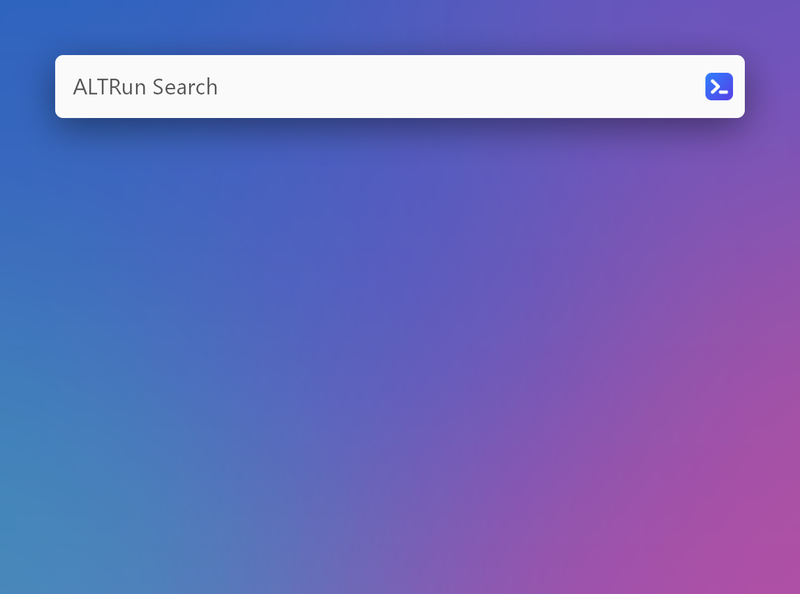
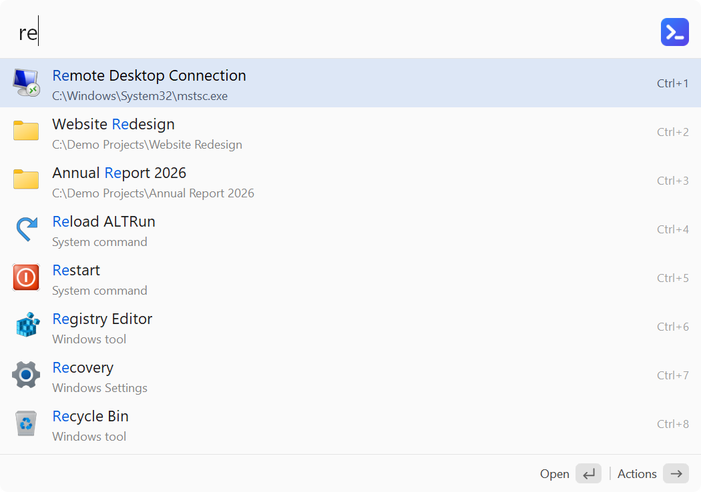
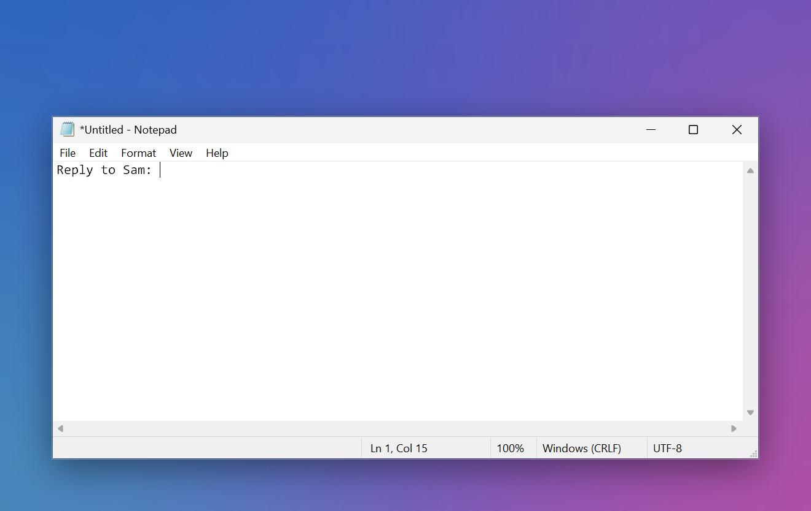
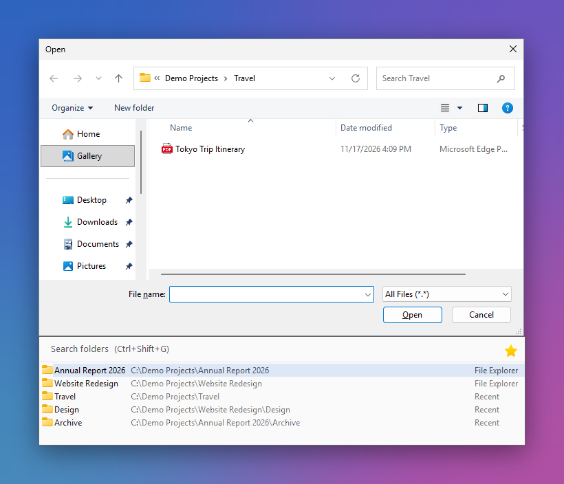

<h1 align="center"> ALTRun</h1>

<p align="center"><b>English</b> | <a href="README.zh-CN.md">简体中文</a></p>

<p align="center">
  <b>A lightweight, open-source launcher for Windows, modeled on <a href="https://www.alfredapp.com/">Alfred</a> for macOS</b><br>
  Press <code>Alt+Space</code>, type a few letters, press <code>Enter</code>: apps, files, web search, calculations, clipboard and system commands, all from one window
</p>

<p align="center">
  <a href="https://github.com/zhugecaomao/ALTRun/releases/latest"></a>
  <a href="https://github.com/zhugecaomao/ALTRun/releases"></a>
  <a href="https://github.com/zhugecaomao/ALTRun/actions/workflows/tests.yml"></a>
  <a href="https://www.autohotkey.com/"></a>
  
  <a href="LICENSE"></a>
</p>

<p align="center">
  <a href="https://zhugecaomao.github.io/ALTRun/">Website</a> ·
  <a href="#features">Features</a> ·
  <a href="#getting-started">Getting started</a> ·
  <a href="https://github.com/zhugecaomao/ALTRun/wiki/Home">Documentation (Wiki)</a> ·
  <a href="CHANGELOG.md">Changelog</a>
</p>

<p align="center">
  
</p>


## Features
- **Search as you type**: apps (Start menu, desktop, Microsoft Store), custom commands, open windows and system commands in one list; matches word initials (`vsc` → Visual Studio Code) and pinyin initials (`wx` → 微信), and learns which result you pick. [More](https://github.com/zhugecaomao/ALTRun/wiki/Usage)
- **Files and folders**: `Space` + a name searches all disks in milliseconds with [Everything](https://www.voidtools.com/) running, or the built-in index otherwise; type a path to browse folder by folder. [More](https://github.com/zhugecaomao/ALTRun/wiki/File-Search)
- **Actions, not just launching**: `→` lists what you can do with a result (run as administrator, open its folder, copy the path, open a terminal there...); `Ctrl+Alt+\` does the same for text, files or a URL selected in any program. [More](https://github.com/zhugecaomao/ALTRun/wiki/Usage#action-panel)
- **Calculator**: `12*(3+4)`, `10 km in mi`, `255 in hex`, `today + 30 days`, `100 usd to sgd`, with an optional calculation history. [More](https://github.com/zhugecaomao/ALTRun/wiki/Calculator)
- **Web search and bookmarks**: `g keywords`, `bd keywords` or your own engines; search Chrome, Edge, Brave and Vivaldi bookmarks and history. [More](https://github.com/zhugecaomao/ALTRun/wiki/Web-Search)
- **Clipboard history and snippets**: `Ctrl+Alt+C` for copied text, files and images; type `;keyword` in any program to expand a snippet. [More](https://github.com/zhugecaomao/ALTRun/wiki/Clipboard)
- **Quick Switch**: jump an Open / Save dialog to a folder open in File Explorer, Total Commander, Directory Opus or Arke with `Ctrl+G` or the folder panel next to the dialog. [More](https://github.com/zhugecaomao/ALTRun/wiki/Quick-Switch)
- **Make it yours**: custom commands with an argument (`{query}`), custom hotkeys, and `.ahk` / `.ps1` / `.py` / `.bat` scripts that can show live results, with a [script library](https://zhugecaomao.github.io/ALTRun/#scripts) to start from. [More](https://github.com/zhugecaomao/ALTRun/wiki/Scripts)
- **Small, portable and private**: about 2.5 MB, with no installer, registry entries, admin rights or background service; your data stays on your PC and there is no telemetry. [More](https://github.com/zhugecaomao/ALTRun/wiki/Privacy)
- **Customizable and up to date**: English, Simplified Chinese, Traditional Chinese and Japanese; 22 [themes](https://github.com/zhugecaomao/ALTRun/wiki/Themes) that can follow the Windows light / dark mode; one-key updates that keep your settings.


## Getting started
1. [Download the latest release](https://github.com/zhugecaomao/ALTRun/releases/latest), unzip it to any folder and run `ALTRun.exe` (no installation or AutoHotkey needed). Or install it with a package manager:
   ```powershell
   winget install zhugecaomao.ALTRun
   # or
   scoop bucket add altrun https://github.com/zhugecaomao/ALTRun
   scoop install altrun
   ```
2. Press `Alt+Space` (or `Alt+R`), type a few letters and press `Enter`.
3. Type `?` for every search syntax and shortcut; press `Ctrl+,` for Preferences.

If Windows SmartScreen blocks it, choose **More info** → **Run anyway**; for antivirus warnings, see the [FAQ](https://github.com/zhugecaomao/ALTRun/wiki/FAQ#my-antivirus-flags-it). Upgrading, running from source with AutoHotkey v2 and uninstalling: [Installation and upgrades](https://github.com/zhugecaomao/ALTRun/wiki/Installation).

| To do this | Type |
|---|---|
| Open a program | `word` → `Enter` |
| Find a file or folder | `Space`, then `report` |
| Calculate | `12*(3+4)`; `Enter` copies the result |
| Search the web | `g keywords` |
| Paste from the clipboard history | `Ctrl+Alt+C` |
| Run a command in a terminal | `>ipconfig /all` |
| See what you can do with a result | `→` or right-click |
| Edit the selected command | `F3` |

Every shortcut: [Search and shortcuts](https://github.com/zhugecaomao/ALTRun/wiki/Usage#shortcuts).


## Screenshots
| Search window | Action panel (`→`) |
|:---:|:---:|
|  |  |
| **File search (`Space` + name)** | **Calculator and unit conversion** |
|  |  |
| **Clipboard history (`Ctrl+Alt+C`)** | **Quick Switch in an Open / Save dialog** |
|  |  |

Each Wiki page shows its feature in screenshots, and the [Themes](https://github.com/zhugecaomao/ALTRun/wiki/Themes) page shows all 22 themes. The screenshots are made automatically by [Tests/Screenshots](Tests/Screenshots/TakeScreenshots.ahk) on a Windows runner in GitHub Actions.


## Documentation
The [Wiki](https://github.com/zhugecaomao/ALTRun/wiki/Home) covers every feature in detail, with examples. Good places to start:
[Getting started](https://github.com/zhugecaomao/ALTRun/wiki/Getting-Started) ·
[Search and shortcuts](https://github.com/zhugecaomao/ALTRun/wiki/Usage) ·
[Custom commands](https://github.com/zhugecaomao/ALTRun/wiki/Custom-Commands) ·
[Snippets](https://github.com/zhugecaomao/ALTRun/wiki/Snippets) ·
[Quick Switch](https://github.com/zhugecaomao/ALTRun/wiki/Quick-Switch) ·
[Scripts](https://github.com/zhugecaomao/ALTRun/wiki/Scripts) ·
[Settings reference](https://github.com/zhugecaomao/ALTRun/wiki/Configuration) ·
[FAQ](https://github.com/zhugecaomao/ALTRun/wiki/FAQ)


## Feedback and contributing
- [Report a bug](https://github.com/zhugecaomao/ALTRun/issues/new?template=bug_report.yml) (with your Windows version and the steps to reproduce), [suggest a feature](https://github.com/zhugecaomao/ALTRun/issues/new?template=feature_request.yml) or [start a discussion](https://github.com/zhugecaomao/ALTRun/issues/new?template=discussion.yml), in English or Chinese
- Code: read [CONTRIBUTING.md](CONTRIBUTING.md) first; the [Development guide](https://github.com/zhugecaomao/ALTRun/wiki/Development) covers the project structure, the tests and adding a search feature
- Scripts: contribute one to the [script library](docs/scripts/README.md#contributing-a-script--投稿脚本) with a pull request

If ALTRun is useful to you, a star ⭐ is much appreciated.


## Code signing policy
Free code signing provided by [SignPath.io](https://about.signpath.io/), certificate by [SignPath Foundation](https://signpath.org/).

- Only `ALTRun.exe` built from this repository's source by the [Release workflow](.github/workflows/release.yml) is signed.
- Committers and reviewers: [zhugecaomao](https://github.com/zhugecaomao)
- Approvers: [zhugecaomao](https://github.com/zhugecaomao)
- Privacy policy: [SECURITY.md](SECURITY.md#privacy-policy)


## License and credits
ALTRun is open source under the [GPL-3.0](LICENSE) license © zhugecaomao

Thanks to these projects:
- [ALTRun](https://github.com/etworker/ALTRun) (etworker, Delphi): the name and the original design
- [RunZ](https://github.com/goreliu/runz) (goreliu, AutoHotkey): the idea of writing a launcher in AutoHotkey
- [Alfred](https://www.alfredapp.com/): the interaction model
- [Listary](https://www.listary.com/): its Quick Switch is the model for ALTRun's
- [pypinyin](https://github.com/mozillazg/python-pinyin) (Copyright (c) 2016 mozillazg, 闲耘; [MIT](https://github.com/mozillazg/python-pinyin/blob/master/LICENSE.txt)): pinyin initials of rare and Traditional characters
