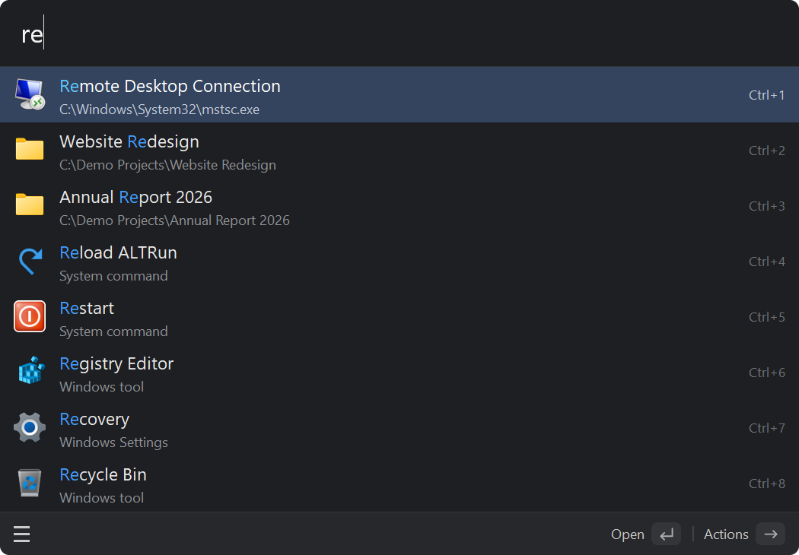
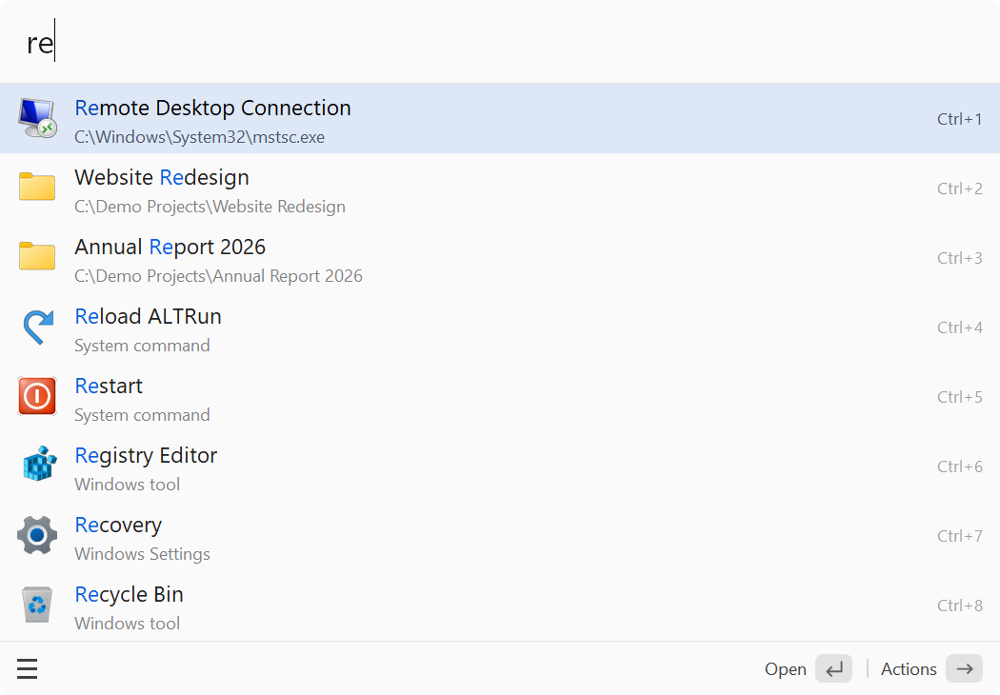
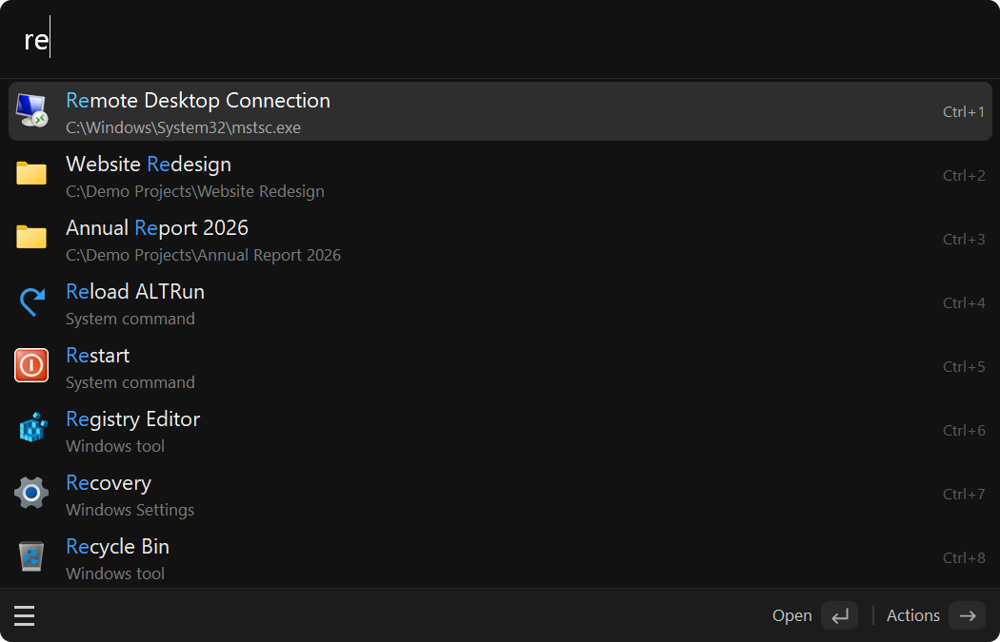

<h1 align="center"> ALTRun</h1>

<a href="README.md">English</a> | <b>简体中文</b>

  <b>轻量、开源的 Windows 启动器，操作方式参照 macOS 上的 <a href="https://www.alfredapp.com/">Alfred</a></b> 
  按 <code>Alt+Space</code>，输入几个字母，按 <code>Enter</code>：程序、文件、网页、计算、剪贴板、系统命令，一个窗口完成

  
  
  
  
  
  

  <a href="https://zhugecaomao.github.io/ALTRun/">官网</a> ·
  <a href="#为什么选择-altrun">为什么选择</a> ·
  <a href="#快速开始">快速开始</a> ·
  <a href="#功能">功能</a> ·
  <a href="#快捷键">快捷键</a> ·
  <a href="https://github.com/zhugecaomao/ALTRun/wiki">使用文档 (Wiki)</a> ·
  <a href="CHANGELOG.md">更新日志</a>

  

## 为什么选择 ALTRun
- **小巧快速**：下载不到 1 MB，不需要 .NET、Electron 或其他运行库；输入第一个字符即显示结果，配合 [Everything](https://www.voidtools.com/) 毫秒级搜索全盘文件，未安装时使用内置索引。
- **智能排序**：根据使用习惯自动调整排名；支持单词首字母（`vsc` → Visual Studio Code）和拼音首字母（`wx` → 微信）。
- **不只是启动器**：计算与单位换算、剪贴板历史、随处展开的文字片段、网页搜索、书签、切换窗口、系统命令，无需再装多个小工具。
- **全键盘操作**：`→` 打开任意结果的操作面板，`F3` 直接编辑，`Ctrl+1`～`Ctrl+9` 快速打开。
- **便携与隐私**：免安装，不写注册表，不需要管理员权限，没有后台服务；所有数据保存在 `Data\` 文件夹；不收集任何数据，只在更新时联网（搜索窗口里提示，按 `Enter` 安装，设置保留）。
- **随你定制**：简体中文、繁體中文、English、日本語界面；20 套内置主题，可跟随系统浅色 / 深色模式。GPL-3.0 开源免费，每个 PR 都会在 Windows 上自动运行 7000 余项测试。

## 快速开始
1. 下载[最新版本](https://github.com/zhugecaomao/ALTRun/releases/latest)，解压到任意文件夹，运行 `ALTRun.exe`（无需安装，也无需 AutoHotkey）。SmartScreen 提示“Windows 已保护你的电脑”时，点 **更多信息** → **仍要运行**；杀毒软件误报见[常见问题](https://github.com/zhugecaomao/ALTRun/wiki/FAQ#杀毒软件报毒)。
2. 按 `Alt+Space`（或 `Alt+R`）打开搜索窗口，输入名称，按 `Enter` 打开。
3. 输入 `?` 查看全部语法和快捷键；按 `Ctrl+,` 打开偏好设置。

也可以用 [Scoop](https://scoop.sh/) 安装：`scoop bucket add altrun https://github.com/zhugecaomao/ALTRun`，然后 `scoop install altrun`。已安装 [AutoHotkey v2](https://www.autohotkey.com/) 时，也可以直接运行源码中的 `ALTRun.ahk`。从 2.x 升级、开机启动等见[安装与升级](https://github.com/zhugecaomao/ALTRun/wiki/Installation)。

## 功能
**搜索**
- **应用、文件和文件夹**：自动索引开始菜单、桌面和 Microsoft Store 应用；在空白搜索框中按 `空格` 搜索文件（Everything 或内置索引），`doc 报告` 按类型搜索，输入 `D:\Projects\` 这样的路径逐级浏览。
- **自定义命令**：文件、文件夹、程序（可带参数）、网址，可设置关键字；在资源管理器中右键 → 发送到 → ALTRun 即可添加。
- **计算器**：单位换算（`10 km in mi`）、进制换算（`255 in hex`）、日期加减（`today + 30 days`）和可选的货币换算（`100 usd to sgd`）。
- **网页搜索和书签**：`g 关键词`（Google）、`bd 关键词`（百度），可自定义搜索引擎；搜索 Chrome、Edge、Brave、Vivaldi 的书签。
- **窗口和系统命令**：切换到已打开的窗口（`w 关键词`）；锁屏、睡眠、关机、音量和媒体控制、40 多个 Windows 设置页面、文本转换。
- **置顶和最近使用**：还没输入时直接列出；使用统计按功能计数（仅记录次数）。

**效率**
- **操作面板**（`→` 或右键）：以管理员身份运行、打开所在位置、复制路径、在此处打开终端、属性等。
- **选中内容操作**：在任意程序中选中文字、文件或网址，按 `Ctrl+Alt+\` 搜索、保存为片段、转换后替换原文。
- **剪贴板历史**（`Ctrl+Alt+C`）：文字、文件和图片；可以置顶、粘贴为纯文本，自动忽略密码管理器复制的内容。
- **文字片段**：支持 `{date}`、`{clipboard}`、`{cursor}` 等占位符；在任意程序中输入 `;关键字` 自动展开。
- **还有**：直接运行终端命令（`>ipconfig /all`），大字显示结果（`Ctrl+L`）。

**扩展**
- **对话框快速跳转（Quick Switch）**：在打开 / 保存对话框中按 `Ctrl+G` / `Ctrl+E` 跳转到 Total Commander / 资源管理器当前目录；文件夹面板列出所有已打开和最近使用的文件夹。
- **一键加日期**：重命名文件时按 `Ctrl+D`，在扩展名前添加或更新日期。
- **自定义热键**：为任意系统命令设置热键，可限定在指定程序中生效。
- **脚本扩展**：把 `.ahk`、`.ps1`、`.bat`、`.py` 脚本放进 `Scripts\` 文件夹，就能在搜索窗口里运行，可以带参数并显示输出。
- **结构工程师专用**：计算器附带梁配筋计算（默认关闭）；PT 工具箱（钢筋 / BRC 面积、SPF2M 预应力束线型）。

## 截图
| 搜索窗口 | 操作面板（`→`） |
|:---:|:---:|
|  |  |
| **文件搜索（`空格` + 名称）** | **计算器** |
|  |  |
| **拼音首字母（`jsb` 找到记事本）** | **剪贴板历史（`clip`）** |
|  |  |
| **对话框快速跳转（打开 / 保存对话框下面的文件夹面板）** | **主题（偏好设置 → 外观）** |
|  |  |

<b>内置主题</b>（共 20 套，点击展开）

| Dark | Classic | Midnight |
|:---:|:---:|:---:|
|  |  |  |
| **Frost** | **Graphite** | **Ocean** |
|  |  |  |
| **Paper** | **DarkCompact** | **LightCompact** |
|  |  |  |
| **TokyoNight** | **Dracula** | **CatppuccinMocha** |
|  |  |  |
| **GruvboxDark** | **SolarizedLight** | **MidnightCompact** |
|  |  |  |
| **DarkModern** | **LightModern** | **Monokai** |
|  |  |  |
| **OneDark** | | |
|  | | |

截图由 [Tests/Screenshots](Tests/Screenshots/TakeScreenshots.ahk) 在 GitHub Actions 的 Windows 环境中自动生成。

## 快捷键
| 按键 | 功能 |
|---|---|
| `Alt+Space` | 显示 / 隐藏搜索窗口（可在设置中修改） |
| `Enter` / `Ctrl+1`～`Ctrl+9` | 打开选中项 / 第 N 项 |
| `Ctrl+Enter` | 文件：打开所在位置；文字：粘贴到当前窗口 |
| `Alt+Enter` / `Ctrl+C` | 复制路径、网址或文字 |
| `→` / 右键 | 操作面板 / 操作菜单 |
| `空格`（搜索框为空时） | 进入文件搜索 |
| `Tab` | 自动补全；文件夹：进入浏览 |
| `F3` / `Ctrl+Del` | 编辑 / 删除（应用：隐藏）选中项 |
| `Ctrl+,` / `F1` | 偏好设置 / 关于 ALTRun |
| `?` | 速查表：全部语法和快捷键 |

更多见 Wiki：[搜索与快捷键](https://github.com/zhugecaomao/ALTRun/wiki/Usage)。

## 文档
完整文档见 [Wiki](https://github.com/zhugecaomao/ALTRun/wiki)：

| 页面 | 内容 |
|---|---|
| [安装与升级](https://github.com/zhugecaomao/ALTRun/wiki/Installation) | 下载、Scoop / winget、开机启动、自动更新、从 2.x 升级、卸载 |
| [搜索与快捷键](https://github.com/zhugecaomao/ALTRun/wiki/Usage) | 输入语法、快捷键、操作面板、学习排序、使用统计 |
| [自定义命令与片段](https://github.com/zhugecaomao/ALTRun/wiki/Commands-and-Snippets) | 命令类型、路径变量、片段占位符、自动展开 |
| [文件搜索](https://github.com/zhugecaomao/ALTRun/wiki/File-Search) | Everything 联动、内置索引、排除规则 |
| [主题](https://github.com/zhugecaomao/ALTRun/wiki/Themes) | 内置主题、自定义主题、全部可用的键 |
| [扩展功能](https://github.com/zhugecaomao/ALTRun/wiki/Extensions) | 对话框快速跳转、一键加日期、自定义热键、系统命令、PT 工具箱 |
| [设置文件参考](https://github.com/zhugecaomao/ALTRun/wiki/Configuration) | ALTRun.json 各项的含义和默认值 |
| [常见问题](https://github.com/zhugecaomao/ALTRun/wiki/FAQ) | 热键冲突、搜索不到、杀毒软件误报等 |
| [开发指南](https://github.com/zhugecaomao/ALTRun/wiki/Development) | 架构、新增搜索功能、代码规范、测试 |

## 贡献与反馈
- 报告问题：[提交 Issue](https://github.com/zhugecaomao/ALTRun/issues/new/choose)（请附上 Windows 版本和复现步骤）
- 建议与讨论：[Discussions](https://github.com/zhugecaomao/ALTRun/discussions)
- 贡献代码：请先阅读 [贡献指南](CONTRIBUTING.zh-CN.md)；项目结构、运行测试、新增搜索功能见 Wiki 的[开发指南](https://github.com/zhugecaomao/ALTRun/wiki/Development)

如果 ALTRun 对你有帮助，欢迎点亮星标 ⭐

## Code signing policy
Free code signing provided by [SignPath.io](https://about.signpath.io/), certificate by [SignPath Foundation](https://signpath.org/).

- Only `ALTRun.exe` built from this repository's source by the [Release workflow](.github/workflows/release.yml) is signed.
- Committers and reviewers: [zhugecaomao](https://github.com/zhugecaomao)
- Approvers: [zhugecaomao](https://github.com/zhugecaomao)
- Privacy policy: [SECURITY.md](SECURITY.md#privacy-policy)（中文：[隐私说明](SECURITY.md#隐私说明)）

## 许可证与致谢
ALTRun 以 [GPL-3.0](LICENSE) 许可开源 © zhugecaomao

感谢这些项目带来的启发：
- [ALTRun](https://github.com/etworker/ALTRun)（etworker，Delphi）：名字和最初的设计
- [RunZ](https://github.com/goreliu/runz)（goreliu，AutoHotkey）：用 AutoHotkey 写启动器的思路
- [Alfred](https://www.alfredapp.com/)：操作方式
- [Listary](https://www.listary.com/)：对话框快速跳转参考了它的 Quick Switch
