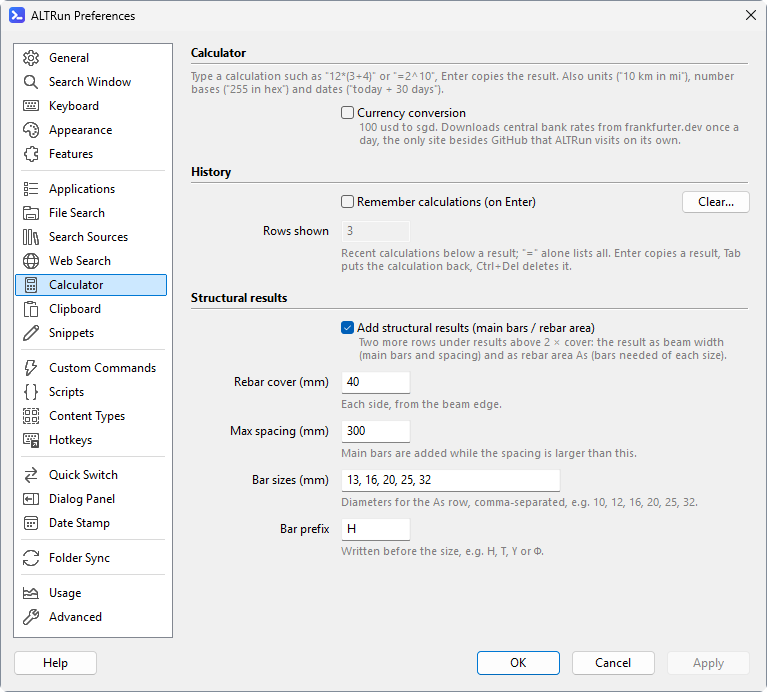
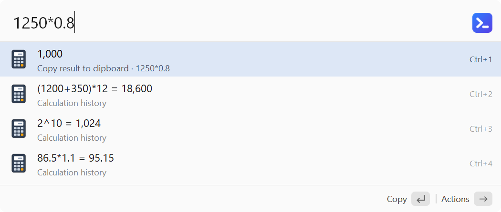

[English](Calculator) · **中文**

# 计算器

## 计算

直接输入算式: `12*(3+4)`、`=2^10`, `Enter` 复制结果。支持 `+ - * /` (也可以用 `×` `÷`; 字母 `x` 不当乘号, `1920x1080` 照常搜索文件)、乘方 `^` (或 `**`) 和括号, 结果最多保留两位小数 (`10/3` 显示 `3.33`; 不到 0.005 的数保留到第一位有效数字后一位, 例如 `0.004`)。

## 使用结果

对结果可以做什么 (`→` 或右键打开动作面板):

| 按键 / 操作 | 放到哪里 | `12*(3+4)` 的例子 |
|---|---|---|
| `Enter` | 结果复制到剪贴板 | `84` |
| `Ctrl+Enter` | 结果粘贴到之前的窗口 | `84` |
| **复制算式和结果** (动作面板) | 算式和结果一起复制到剪贴板, 方便写笔记、报告 | `12*(3+4) = 84` |

**复制算式和结果** 只在有运算符的算式上出现 (单独 `=5` 没有), 计算历史的行也有 (见下面)。算式按你输入的样子复制 (`3×4 = 12`、`1,000*2 = 2,000`)。

## 结构计算结果

在 偏好设置 → 计算器 打开 "附带结构计算" (`Features.Calculator.StructuralCalc`) 后, 结果大于 2 × 保护层时下方附带两行结构计算:
- 把结果当作 **梁宽 (mm)**: 主筋根数和间距。根数 = ⌈(梁宽 − 2 × 保护层) / 最大间距⌉ + 1, 间距 = (梁宽 − 2 × 保护层) / (根数 − 1)
- 把结果当作 **配筋面积 As (mm²)**: 每种直径需要的根数 (⌈As / 一根的面积⌉, 一根的面积 = π d² / 4)

例如 `300*2` (600) 默认显示 `Beam width 600 mm: 3 main bars @ 260 c/c` 和 `As = 600 mm²: 5H13  3H16  2H20  2H25  1H32`。参数在同一页里修改:

| 设置 | 键 | 默认 | 说明 |
|---|---|---|---|
| 保护层 (Rebar cover) | `RebarCover` | `40` | 每边, mm |
| 最大间距 | `MaxBarSpacing` | `300` | mm, 间距大于它时增加主筋 |
| 钢筋直径 | `BarSizes` | `[13, 16, 20, 25, 32]` | 配筋面积那一行列出的直径 (mm) |
| 钢筋代号 | `BarPrefix` | `H` | 钢筋代号, 例如 `T`、`Y`、`Φ` |

## 计算历史
在 偏好设置 → 计算器 勾选 "记住计算 (按 Enter 时)" (`Features.Calculator.History`, 默认关), 用到计算结果时 (`Enter` 复制、`Ctrl+Enter` 粘贴或者动作面板里的操作) 记下这条算式, 打字过程中不记。单位、进制、日期换算和单个数字不记。

- 输入算式时, 结果下面列出最近几条 ("显示条数", `HistoryCount`, 默认 3)
- 只输入 `=` 列出全部 (最多 50 条, 最新的在前; 再用一次的移到最前)
- 在历史上: `Enter` 复制结果, `Tab` 把算式填回搜索框接着改, `Ctrl+Del` 删除这一条
- 勾选框右边的 "清空..." 删除全部; 历史保存在 `Data\CalcHistory.json`

计算结果不进空搜索框的 "最近使用"。

## 单位和货币换算
写法: 数值 + 单位 + `in` / `to` / `=` / `->` / `转` + 目标单位, 单位不区分大小写, `m²` 可以写成 `m2`。例如 `10 km in mi`、`5ft to cm`、`100 f to c`、`3 亩 in m2`、`1 GB to MB`、`300 kN to kip`、`20 MPa in psi`。`Enter` 复制数字。

| 类别 | 单位 |
|---|---|
| 长度 | mm cm m km in ft yd mi nmi (毫米 厘米 米 公里 英寸 英尺 码 英里 海里) |
| 质量 | mg g kg t lb oz 斤 两 |
| 面积 | mm2 cm2 m2 km2 ha acre ft2 in2 亩 |
| 体积 | ml cl l m3 cm3 ft3 gal qt pt cup floz |
| 速度 | m/s km/h mph knot ft/s |
| 时间 | ms s min h day week year |
| 数据 | bit B KB MB GB TB (按 1024) |
| 压强 / 应力 | Pa kPa MPa (N/mm2) bar psi ksi atm psf |
| 力 | N kN lbf kip kgf tf |
| 能量 / 功率 | J kJ cal kcal Wh kWh / W kW hp |
| 温度 | C F K |

### 货币换算
货币换算 (`100 usd to sgd`、`100 美元 to 人民币`) 默认关闭: 在 偏好设置 → 计算器 勾选 "货币换算" (`Features.Calculator.Currency`)。打开后每天从 [Frankfurter](https://frankfurter.dev) 下载一次欧洲央行等央行公布的参考汇率 (免费, 不需要注册), 保存在 `Data\Currency.json`; 这是 ALTRun 除 GitHub 之外唯一会自己访问的网站 (网页搜索的网站只在你点 "下载网站图标" 时访问一次)。结果里会显示汇率的日期。

支持约 160 种货币, 包括新台币 (TWD), 越南盾 (VND), 迪拉姆 (AED) 等 (2026.11.25 起; 之前只有欧洲央行的 30 种), 另有少量加密货币和贵金属 (BTC, ETH, XAU 等), 它们的汇率晚一天. 货币写 3 个字母的代码 (不分大小写) 或下面的中文名: 人民币 / 人民幣 / 元 / rmb, 美元 / 美金, 欧元 / 歐元, 日元 / 日圓 / 日幣, 英镑 / 英鎊, 港币 / 港幣 / 港元, 新币 / 新幣 / 新加坡元 / 新加坡幣, 马币 / 馬幣 / 令吉, 澳元 / 澳幣, 加元 / 加幣, 台币 / 台幣 / 臺幣 / 新台币 / 新台幣, 韩元 / 韓元, 泰铢 / 泰銖, 瑞士法郎.

| 输入 | 得到 |
|---|---|
| `100 usd to sgd` | 换算成新加坡元的金额, 附汇率日期 |
| `1000 新台幣 to 美金` | 换算成美元的金额 |
| `100 usd to xyz` (没有汇率的代码) | "没有 XYZ 的汇率" |
| 第一次下载还没完成时输入 `100 usd to sgd` | "还没有下载汇率" |
| 没打开货币换算时输入 `100 usd to sgd` | 按 Enter 打开 偏好设置 → 计算器 |
