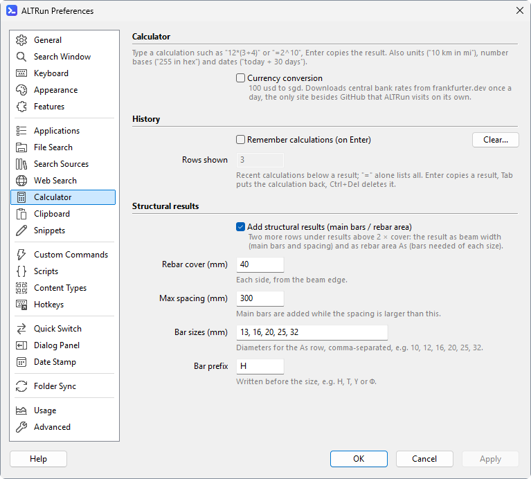
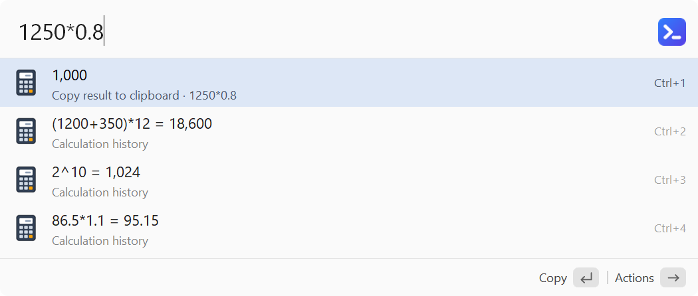

**English** · [中文](Calculator-zh)

# Calculator

Type an expression directly: `12*(3+4)`, `=2^10`; `Enter` copies the result. Supports `+ - * /` (or `×` `÷`; a letter `x` isn't a times sign, so `1920x1080` stays a file search), powers `^` (or `**`) and parentheses; results keep at most two decimals (`10/3` shows `3.33`; numbers below 0.005 keep one digit after the first significant digit, for example `0.004`).

What you can do with a result (`→` or right-click opens the actions panel):

| Key / action | Puts | Example for `12*(3+4)` |
|---|---|---|
| `Enter` | the result on the clipboard | `84` |
| `Ctrl+Enter` | the result into the window you came from | `84` |
| **Copy Calculation** (actions panel) | the calculation and the result on the clipboard, for notes and reports | `12*(3+4) = 84` |

**Copy Calculation** is there for calculations with an operator (not for `=5` alone), and for the rows of the calculation history too (see below). The calculation is copied as you typed it (`3×4 = 12`, `1,000*2 = 2,000`).

With "Add structural results (main bars / rebar area)" (`Features.Calculator.StructuralCalc`) turned on in Preferences → Calculator, two lines of structural results are added below when the result is more than 2 × the cover:
- The result as a **beam width (mm)**: number and spacing of main bars. Number = ⌈(width − 2 × cover) / max spacing⌉ + 1, spacing = (width − 2 × cover) / (number − 1)
- The result as a **rebar area As (mm²)**: bars needed for each size (⌈As / area of one bar⌉, area of one bar = π d² / 4)

For example `300*2` (600) shows `Beam width 600 mm: 3 main bars @ 260 c/c` and `As = 600 mm²: 5H13  3H16  2H20  2H25  1H32` by default. The parameters are on the same page:

| Setting | Key | Default | Description |
|---|---|---|---|
| Rebar cover (mm) | `RebarCover` | `40` | Each side, mm |
| Max spacing (mm) | `MaxBarSpacing` | `300` | mm; more main bars are added when the spacing would exceed it |
| Bar sizes (mm) | `BarSizes` | `[13, 16, 20, 25, 32]` | Diameters (mm) listed in the rebar area line |
| Bar prefix | `BarPrefix` | `H` | Bar designation, for example `T`, `Y`, `Φ` |

### Calculation history
Turn on "Remember calculations (on Enter)" (`Features.Calculator.History`, off by default) in Preferences → Calculator, and a calculation is remembered when you use its result (`Enter` to copy, `Ctrl+Enter` to paste, or an action), never while you type. Unit, number base and date conversions and single numbers aren't remembered.

- While you type a calculation, the newest calculations are listed below its result ("Rows shown", `HistoryCount`, default 3)
- Type `=` alone to list all of them (at most 50, newest first; using one again moves it to the top)
- On a history row: `Enter` copies the result, `Tab` puts the calculation back in the search box to change it, `Ctrl+Del` deletes it
- "Clear..." next to the check box deletes all of them; the history is kept in `Data\CalcHistory.json`

Calculation results never go into the recently used items of the empty search box.

### Unit and currency conversion
Syntax: number + unit + `in` / `to` / `=` / `->` / `转` + target unit; units are case-insensitive, and `m²` can be written `m2`. For example `10 km in mi`, `5ft to cm`, `100 f to c`, `3 亩 in m2`, `1 GB to MB`, `300 kN to kip`, `20 MPa in psi`. `Enter` copies the number.

| Category | Units |
|---|---|
| Length | mm cm m km in ft yd mi nmi (Chinese names work too) |
| Mass | mg g kg t lb oz 斤 两 |
| Area | mm2 cm2 m2 km2 ha acre ft2 in2 亩 |
| Volume | ml cl l m3 cm3 ft3 gal qt pt cup floz |
| Speed | m/s km/h mph knot ft/s |
| Time | ms s min h day week year |
| Data | bit B KB MB GB TB (powers of 1024) |
| Pressure / stress | Pa kPa MPa (N/mm2) bar psi ksi atm psf |
| Force | N kN lbf kip kgf tf |
| Energy / power | J kJ cal kcal Wh kWh / W kW hp |
| Temperature | C F K |

**Currency conversion** (`100 usd to sgd`) is off by default: tick "Currency conversion" in Preferences → Calculator (`Features.Calculator.Currency`). Once on, the reference rates published by the European Central Bank and other central banks are downloaded once a day from [Frankfurter](https://frankfurter.dev) (free, no sign-up) and saved in `Data\Currency.json`; apart from GitHub, this is the only website ALTRun contacts on its own (a web search's site is visited only when you click "Download Site Icon"). Results show the date of the rates.

About 160 currencies are covered, including TWD, VND and AED (since test build 2026.11.23.19; before that only the ECB's 30), plus a few crypto currencies and precious metals (BTC, ETH, XAU...), whose rates are a day behind. Write a currency as its 3-letter code (any case) or one of these Chinese names: 人民币 / 人民幣 / 元 / rmb, 美元 / 美金, 欧元 / 歐元, 日元 / 日圓 / 日幣, 英镑 / 英鎊, 港币 / 港幣 / 港元, 新币 / 新幣 / 新加坡元 / 新加坡幣, 马币 / 馬幣 / 令吉, 澳元 / 澳幣, 加元 / 加幣, 台币 / 台幣 / 臺幣 / 新台币 / 新台幣, 韩元 / 韓元, 泰铢 / 泰銖, 瑞士法郎.

| You type | You get |
|---|---|
| `100 usd to sgd` | the amount in SGD, with the date of the rates |
| `1000 新台幣 to 美金` | the amount in USD |
| `100 usd to xyz` (a code with no rate) | "No exchange rate for XYZ" |
| `100 usd to sgd` before the first download has finished | "Exchange rates have not been downloaded yet" |
| `100 usd to sgd` with currency conversion off | press Enter to open Preferences → Calculator |
