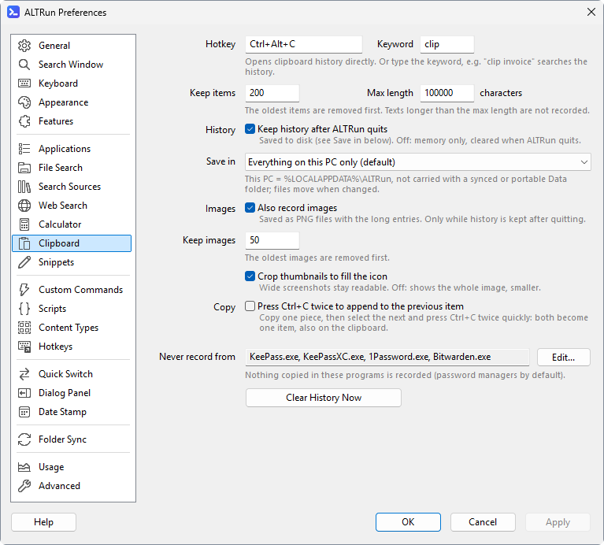

[English](Clipboard) · **中文**

# 剪贴板历史

## 打开和粘贴
按 `Ctrl+Alt+C` 或输入 `clip` 列出复制过的文字、文件和图片 (还没输完整时, 例如 `cli`, 列表最后有一行提示, 按 `Enter` 补全成 `clip `), `clip 关键词` 过滤, `Enter` 粘贴到前台窗口, `Ctrl+Del` 从历史中删除。粘贴的这一条会排到最前面并留在剪贴板里 (和 Ditto、Windows 的 `Win+V` 一样), 之后直接按 `Ctrl+V` 还能再粘贴, 不用再打开 ALTRun。

| 要做的事 | 按键 / 输入 |
|---|---|
| 打开历史 | `Ctrl+Alt+C` (在 偏好设置 → 剪贴板历史 里改), 或输入 `clip` 加空格 |
| 找一条 | `clip 关键词`, 例如 `clip 发票`; `clip 图片` 只列图片 |
| 粘贴到原来的窗口 | `Enter` |
| 只复制不粘贴 | `→` → 复制 |
| 删除一条 | `Ctrl+Del` |
| 更多操作 | `→` (`F3` 是下表里的第一个操作) |

## 记录哪些内容
| 复制的是 | 显示 | `Enter` | `F3` / `→` |
|---|---|---|---|
| 文字 | 文字的开头 | 粘贴文字 | 保存为片段 / 复制, 粘贴, 为它的内容类型设置的命令和脚本 (见下), 用各个搜索引擎搜索, 大字显示 |
| 文件 | 文件名 (多个文件用逗号隔开); 一个图片文件时显示缩略图 (QQ、微信等聊天软件里复制的图片一般是它们缓存里的文件) | 粘贴文件 (在资源管理器里就是复制过去) | 添加到自定义命令 / 一个文件时有打开、在文件管理器中显示、复制路径等操作 |
| 图片 (截图、网页上的图片...) | "图片 1920 × 1080" 和缩略图 | 粘贴图片 | - / 用看图程序打开、在文件管理器中显示 |

## 对复制过的文字运行自己的命令
(测试版 2026.11.23.22 起。) 文字项按 `→` 打开的面板里, 在 复制 和 粘贴 后面列出为它的 [内容类型](Content-Types-zh) 设置的自定义命令和脚本, 和在程序里选中这段文字再按选中内容热键时一样. 以前复制过的文字不用再找出来重新选中. 在这一项上按 `Enter` 仍是粘贴.

| 复制的文字 | 你的设置 | `→` 面板里 |
|---|---|---|
| `PO12345` | 内容类型 "PO" (`^PO\d+$`), 命令 "Open PO" `https://erp.example.com/po/{query}` 设给这个类型 | "Open PO" 打开 `https://erp.example.com/po/PO12345` |
| `https://example.com` | 为内置类型 Url 设置的命令 | 这个命令, 带上这个地址 |
| 任意文字 | 它的类型没有设置命令 | 只有平常那几行 (没有 "为这类内容添加命令...": 它只在选中内容的面板里) |
| 多行, 或命令行收不下的 `"` / shell 特殊字符 | 会把它们放进命令行的命令 | 这一行照样显示并说明原因 (和选中内容一样), 不会运行 |

历史里的图片和文件没有这些行.

## 图片
- 图片存成 PNG 放在 `Clipboard\` 文件夹 (默认在本机的 `%LOCALAPPDATA%\ALTRun\Clipboard`, Data 在同步盘里时不用每次上传), 默认最多 50 张 (`MaxImages`), 只在 "退出后保留历史" 打开时记录; 不想记录图片可以在 偏好设置 → 剪贴板历史 关掉 "也记录图片"
- 输入 `clip 图片` 或 `clip image` 只看图片
- 缩略图填满图标方格, 裁出中间部分, 宽截图不会缩成一条细线; 想缩小显示整张图, 在 偏好设置 → 剪贴板历史 关掉 "缩略图裁切填满图标" (`FillThumbnails`)。看大图: 按 `→` 用看图程序打开
## 搜索、置顶、纯文本粘贴、合并
- **搜索这段文字**: 选中一条文字按 `→`, 可以用 [网页搜索](Web-Search-zh) 里的每个网站搜索它
- **置顶**: 选中一条按 `→`, 选 "置顶"。置顶的条目一直排在最前面 (图标右下角有一个图钉), 超过条数时不会被挤掉, "清空剪贴板历史" 时也保留; 常用的地址、账号等可以放在这里
- **粘贴为纯文本**: 系统命令 "粘贴为纯文本" 把剪贴板里的内容去掉格式 (字体、颜色、表格...) 粘贴, 剪贴板随后还原。在 [自定义热键](Hotkeys-zh) 里设成 `Ctrl+Shift+V` 最方便
- **连续复制合并** (默认关闭, 偏好设置 → 剪贴板历史 → "快速按两次 Ctrl+C: 接到上一条后面"): 先复制一段, 再选中下一段快速按两次 `Ctrl+C`, 两段合成一条 (中间换行), 剪贴板里也是合并后的文字, 可以直接粘贴。和 Alfred 的 Merging 一样, 适合从几个地方摘抄。注意: DeepL 等翻译软件也用 "按两次 Ctrl+C" 呼出, 打开后两边会同时响应

## 隐私和保存位置
- 密码管理器 (KeePass、1Password、Bitwarden...) 复制的内容不会记录; 带 "不要加入剪贴板历史" 标记的内容也不会记录
- 复制后约 0.15 秒才去读剪贴板, 读完马上关掉 (图片在关掉之后再存成 PNG): 截图工具等写完剪贴板马上又要用它的程序不会被挡住
- `Features.Clipboard.IgnoreApps` 可以加上其它不想记录的程序
- `Persist = 0` 时只保存在内存里, 退出即清空 (也不记录图片); 在偏好设置里关掉时会问要不要把之前保存的历史也删掉; 否则只保存在这台电脑上, 即 `%LOCALAPPDATA%\ALTRun\ClipboardHistory.json` (很长的条目和图片单独存在 `%LOCALAPPDATA%\ALTRun\Clipboard\`), 不跟着同步盘或 U 盘里的 Data 文件夹走。偏好设置 → 剪贴板 → "保存位置" 可以改成把文字历史放在 Data 文件夹 (`LocalFiles = 1`), 或者全部放在 Data 文件夹 (`LocalFiles = 0`)
- 偏好设置 → 剪贴板历史 里可以清空历史 ("立即清空历史" 先确认, 写明要删几条; 置顶的保留)

## 设置
在 偏好设置 → 剪贴板历史 里改, 或改 `ALTRun.json` 的 `Features.Clipboard`; 全部键和默认值见 [设置文件参考](Configuration-zh#clipboard-剪贴板历史)。

| 设置 | 默认值 | 作用 |
|---|---|---|
| `Hotkey` | `^!c` (`Ctrl+Alt+C`) | 直接打开历史的热键 |
| `Keyword` | `clip` | 列出历史的关键字 |
| `MaxItems` | 200 | 保留多少条; 先去掉最旧的未置顶条目 |
| `Images` / `MaxImages` | 1 / 50 | 是否记录图片, 最多几张 |
| `Persist` / `LocalFiles` | 1 / 2 | 退出后是否保留, 保存在哪里 (见上) |
| `MergeDoubleCopy` | 0 | 按两次 `Ctrl+C` 接到上一条后面 |
| `IgnoreApps` | KeePass, KeePassXC, 1Password, Bitwarden | 这些程序复制的内容不记录 |

## 相关页面
- [文字片段](Snippets-zh): 常用的文字, 带占位符, `;关键字` 展开; 文字项按 `F3` 可以存成片段
- [内容类型](Content-Types-zh): 复制或选中的文字可以用哪些命令
- [自定义热键](Hotkeys-zh): 把 "粘贴为纯文本" 等系统命令设到热键上
- [数据文件](Data-Files-zh): `ClipboardHistory.json` 和 `Clipboard\` 文件夹在哪里
