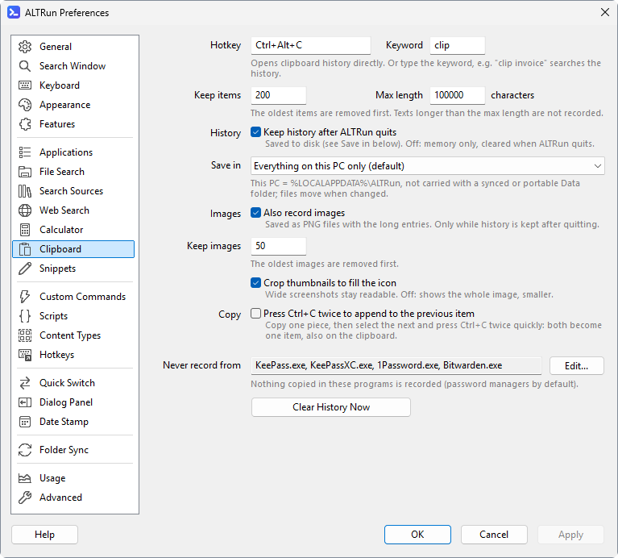

**English** · [中文](Clipboard-zh)

# Clipboard history

## Open and paste
Press `Ctrl+Alt+C` or type `clip` to list the text, files and images you copied (while typing, e.g. `cli`, a hint at the end of the list completes `clip `); `clip keywords` filters, `Enter` pastes into the front window, and `Ctrl+Del` removes an item from the history. The item you paste moves to the top and stays on the clipboard (like Ditto and Windows' `Win+V`), so `Ctrl+V` pastes it again without opening ALTRun.

| To do this | Press / type |
|---|---|
| Open the history | `Ctrl+Alt+C` (change it in Preferences → Clipboard), or type `clip` and a space |
| Find an item | `clip keywords`, e.g. `clip invoice`; `clip image` lists images only |
| Paste into the window you came from | `Enter` |
| Copy without pasting | `→` → Copy |
| Remove an item | `Ctrl+Del` |
| More actions | `→` (or `F3` for the first one in the table below) |

## What is recorded
| What was copied | Shown as | `Enter` | `F3` / `→` |
|---|---|---|---|
| Text | The beginning of the text | Pastes the text | Save as a snippet / copy, paste, your commands and scripts for its content types (see below), search with each web search engine, large type |
| Files | The file names (separated by commas); one image file (a picture copied in QQ, WeChat and other chat programs is usually a file in their cache) with a thumbnail | Pastes the files (in Explorer that copies them there) | Add to custom commands / for one file: open, reveal in the file manager, copy path and more |
| Image (screenshot, picture from a web page...) | "Image 1920 × 1080" with a thumbnail | Pastes the image | - / open in the image viewer, reveal in the file manager |

## Running your commands on copied text
(Since test build 2026.11.23.22.) The `→` panel of a text item lists, right after Copy and Paste, the custom commands and scripts set for its [content types](Usage#actions-on-selected-content), the same rows as when you select that text in a program and press the selection hotkey. So text you copied earlier doesn't have to be found and selected again. `Enter` on the item itself still pastes.

| Copied text | Your settings | In the `→` panel |
|---|---|---|
| `PO12345` | a content type "PO" (`^PO\d+$`) and a command "Open PO" `https://erp.example.com/po/{query}` set for it | "Open PO" opens `https://erp.example.com/po/PO12345` |
| `https://example.com` | a command set for the built-in type Url | that command, with the address |
| any text | nothing set for its types | only the usual rows (no "Add a Command for This Content...": that is in the selection's panel) |
| several lines, or `"` / shell characters a command can't take | a command that would get them in its command line | the row is shown with the reason, as for a selection, and doesn't run |

Images and files in the history don't get these rows.

## Images
- Images are saved as PNG files in the `Clipboard\` folder (by default on this PC in `%LOCALAPPDATA%\ALTRun\Clipboard`, so they aren't uploaded every time when `Data\` is in a synced folder), at most 50 by default (`MaxImages`), and only recorded while "Keep history after ALTRun quits" is on; to stop recording images, turn off "Also record images" in Preferences → Clipboard
- Type `clip image` to see only images
- Thumbnails fill the icon square, cropped to the middle, so a wide screenshot doesn't become a thin strip; to see the whole image shrunk instead, turn off "Crop thumbnails to fill the icon" in Preferences → Clipboard (`FillThumbnails`). To see an image at full size, press `→` and open it in the image viewer
## Search, pin, paste as plain text, merge
- **Search the text**: select a text item and press `→` to search it on each site from [Web Search](Web-Search)
- **Pin**: select an item, press `→` and choose "Pin". Pinned items always stay at the top (with a pin at the bottom right of the icon), are never pushed out when the history is full, and are kept by "Clear Clipboard History"; good for addresses, account names and the like
- **Paste as plain text**: the system command "Paste as Plain Text" pastes the clipboard content without formatting (fonts, colors, tables...) and restores the clipboard afterwards. It's handiest as `Ctrl+Shift+V` in [custom hotkeys](Hotkeys)
- **Merge copies** (off by default, Preferences → Clipboard → "Press Ctrl+C twice to append to the previous item"): copy one piece, then select the next and press `Ctrl+C` twice quickly; both become one item (separated by a line break) and the clipboard holds the merged text, ready to paste. Like Alfred's Merging, handy for collecting bits from several places. Note: translators such as DeepL also use "press Ctrl+C twice", so with this on both react

## Privacy and where it is stored
- Content copied from password managers (KeePass, 1Password, Bitwarden...) is never recorded, nor is content marked "don't add to clipboard history"
- The clipboard is read about 0.15 s after a copy and closed right away (images are saved as PNG after it is closed), so screen capture tools and other programs that use the clipboard again right after writing it are not blocked
- Add other programs you don't want recorded to `Features.Clipboard.IgnoreApps`
- With `Persist = 0` the history is kept in memory only and is gone when ALTRun quits (no images either); turning it off in Preferences asks whether to delete the history saved so far too; otherwise it's saved on this PC only, in `%LOCALAPPDATA%\ALTRun\ClipboardHistory.json` (very long items and images separately in `%LOCALAPPDATA%\ALTRun\Clipboard\`), so it doesn't travel with a synced or portable Data folder. Preferences → Clipboard → "Save in" can keep the text history in the Data folder instead (`LocalFiles = 1`), or everything (`LocalFiles = 0`)
- Preferences → Clipboard can clear the history ("Clear History Now" first says how many items it deletes; pinned items are kept)

## Settings
Preferences → Clipboard, or `Features.Clipboard` in `ALTRun.json`; every key with its default is in the [settings reference](Configuration#clipboard).

| Setting | Default | What it does |
|---|---|---|
| `Hotkey` | `^!c` (`Ctrl+Alt+C`) | Opens the history directly |
| `Keyword` | `clip` | Keyword that lists the history |
| `MaxItems` | 200 | Items kept; the oldest unpinned ones go first |
| `Images` / `MaxImages` | 1 / 50 | Record images, and how many |
| `Persist` / `LocalFiles` | 1 / 2 | Keep the history after quitting, and where (see above) |
| `MergeDoubleCopy` | 0 | `Ctrl+C` twice appends to the previous item |
| `IgnoreApps` | KeePass, KeePassXC, 1Password, Bitwarden | Programs whose copies are never recorded |

## Related pages
- [Snippets](Snippets): text you paste often, with placeholders and `;keyword` expansion; `F3` on a text item saves it as one
- [Content types](Usage#actions-on-selected-content): the commands offered for copied or selected text
- [Custom hotkeys](Hotkeys): "Paste as Plain Text" and other system commands on a key
- [Data files](Data-Files): where `ClipboardHistory.json` and the `Clipboard\` folder are
