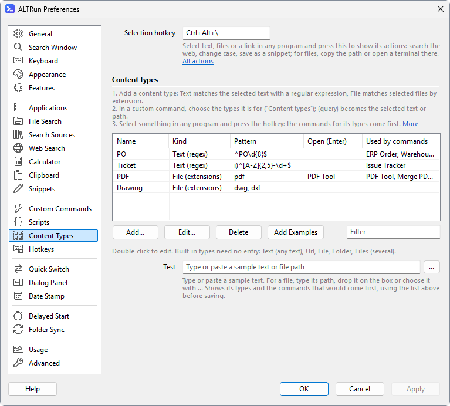

[English](Content-Types) · **中文**

# 内容类型和选中内容的操作

**内容类型** 说明一段文字或一个文件是什么: 订单号、邮箱地址、PDF 文件... 定义好一个类型后, 为它设置的自定义命令和脚本会在这类内容出现的地方排在最前面, 同一个订单号按两下键就能送到几个系统。和 Alfred 的 Universal Actions 一样。

## 在哪里用到内容类型
| 在哪里 | 怎么做 | 得到什么 |
|---|---|---|
| 任何程序 | 选中文字、文件或网址, 按 `Ctrl+Alt+\` | [选中内容的操作面板](Usage-zh#选中内容的操作): 先列出为它的类型设置的命令和脚本, 再列内置操作 |
| 搜索结果 | 在文件或文件夹上按 `→` (也包括置顶、最近使用和浏览文件夹时的项目) | 为它的类型设置的命令和脚本, 排在 打开 后面 |
| [剪贴板历史](Clipboard-zh#对复制过的文字运行自己的命令) | 在文字项上按 `→` | 为它的类型设置的命令和脚本, 排在 复制、粘贴 后面 |
| 搜索结果 | 在设了 **打开 (回车)** 的类型的文件上按 `Enter` | 用那个命令打开 ([见下](#用自己选的程序打开某类文件)) |
| [脚本](Scripts-zh#选中内容用的脚本) | 脚本开头写 `@altrun.selection PO` | 这类内容的面板里列出这个脚本, 排在自定义命令后面 |
| [自定义热键](Hotkeys-zh) | "在 ALTRun 中搜索", 搜索内容 `po {selection}` | 搜索窗口只列出这一类的命令 ([见下](#给一类内容设一个热键)) |

分两步: 先定义一次类型, 再选哪些自定义命令用于它 (脚本在自己开头写类型)。一个类型的命令排在它的操作面板最前面, `Enter` 运行第一个。

## 定义内容类型
在 偏好设置 → 内容类型 → 内容类型 里定义一次 **内容类型** (添加): 名称、种类和规则。`文字 (正则)` 是正则表达式, 和去掉首尾空格、换行后的选中文字比较 (例如 `^PO\d{8}$`; 开头加 `i)` 不分大小写); `文件 (扩展名)` 是扩展名 (例如 `pdf, docx`)。新安装自带几个常用类型, 每个都有一条默认命令用于它: Email → Send Email、IP → Ping、Coordinates (例如 `1.3521, 103.8198`) → Google Maps、Text files → Notepad、Images → Paint。**添加示例** 会补上列表里没有的类型, 同时把对应的命令带到自定义命令里 (没有的命令会添加; 同名但还没设类型的命令会设为用于这个类型)。列表下面的 **测试** 框显示一段示例属于哪些类型、会显示哪些命令: 输入或粘贴文字; 文件可以输入路径、拖到框里或点 `...` 选择。"使用的命令" 一列显示每个类型用在哪些命令上。

**内置类型** 不用定义: `Text` (任何文字)、`Url`、`File`、`Folder`、`Files` (多个文件或文件夹)。

规则的例子:

| 名称 | 种类 | 规则 | 能匹配 |
|---|---|---|---|
| PO | 文字 (正则) | `^PO\d{8}$` | `PO12345678` |
| 发票 | 文字 (正则) | `i)^INV-\d{4,}$` | `INV-2041`、`inv-10233` (`i)` 不分大小写) |
| 图号 | 文字 (正则) | `^[A-Z]{2}-\d{3}(-[A-Z])?$` | `ST-101`、`AR-205-B` |
| Office | 文件 (扩展名) | `docx, xlsx, pptx` | `报告.docx`、`预算.xlsx` |
| CAD | 文件 (扩展名) | `dwg, dxf` | `三层平面.dwg` |

在 `ALTRun.json` (`F4`) 里保存成:
```jsonc
"ContentTypes": [
  { "Name": "PO",  "Kind": "Text", "Pattern": "^PO\\d{8}$" },
  { "Name": "PDF", "Kind": "File", "Pattern": "pdf, docx", "OpenCommand": "k3x9a2mq" }
]
```

## 给类型设置命令
在自定义命令的编辑窗口里, 在 **内容类型** 选它用于哪些类型: **类型** 按钮打开菜单, 列出内置类型和你自己的类型, 点一下勾选或取消 (也可以直接输入类型名, 用逗号分隔)。保存时如果有不存在的类型名会提醒。在 `ALTRun.json` 里保存成 `"ContentTypes"`:
```jsonc
{ "Title": "ERP 查订单", "Type": "Url", "Target": "https://erp.example.com/order?id={query}", "ContentTypes": "PO" },
{ "Title": "用 PDF 工具打开", "Type": "File", "Target": "C:\\Tools\\PdfTool.exe", "ContentTypes": "PDF" }
```
`{query}` 换成选中的文字或路径 (`Url` 里会编码); 多个文件换成 `"a" "b"` (每个带引号)。`File` / `Command` 没有写 `{query}` 时, 选中的内容加在参数最后, 带引号。

## 例子: 一个订单号, 几个系统
假设订单号像 `PO12345678`, 要在 ERP 和仓库系统里查:

| 步骤 | 在哪里 | 做什么 |
|---|---|---|
| 1 | 偏好设置 → 内容类型 → 添加 | 名称 `PO`, 种类 `文字 (正则)`, 规则 `^PO\d{8}$`; 在 **测试** 框输入 `PO12345678` 检查 |
| 2 | 偏好设置 → 自定义命令 → 添加 | "ERP 查订单", 类型 网址 / 链接, `https://erp.example.com/order?id={query}`, 内容类型 `PO` |
| 3 | 偏好设置 → 自定义命令 → 添加 | "WMS 查订单", 类型 网址 / 链接, `https://wms.example.com/find?po={query}`, 内容类型 `PO` |

选中 `PO12345678` 按 `Ctrl+Alt+\`: "ERP 查订单" 排在最前面, 照常可以打字筛选。这些命令在搜索框里也和以前一样能用 (按名称或关键字)。[脚本](Scripts-zh) 也可以按内容类型出现 (脚本开头写 `@altrun.selection PO`): 排在自定义命令后面, 选中的内容作为第一个参数传给它。

## 搜索结果里的文件
在搜到的文件或文件夹上 (也包括置顶、最近使用的项目和浏览文件夹时列出的项目) 按 `→`, 它的内容类型的命令和脚本排在 "打开" 后面, 和 `Ctrl+Alt+\` 一样。

## 用自己选的程序打开某类文件
类似 Total Commander 的内部关联, 文件类型的 **打开 (回车)** 指定用哪条自定义命令打开这类文件。在搜索结果里的这类文件上按 `Enter` 就运行它, 它也排在文件操作面板的最前面; 面板里的 "打开" 仍按 Windows 关联打开, Windows 自己的设置不会被改。可以选任何运行程序的自定义命令, 不管它有没有列出这个类型 (`ALTRun.json` 里是 `"OpenCommand"`, 命令的 `Id`)。程序和快捷方式 (`.exe`、`.lnk` 等) 始终照常启动。适合 Windows 不认识某类文件的便携环境, 例如用便携编辑器打开的 `.md`:
1. 偏好设置 → 自定义命令 → 添加: 名称 `Typora`, 类型 文件, 目标 `A_ScriptDir\..\Typora\Typora.exe` (ALTRun 文件夹旁边的路径, U 盘换了盘符也能用)
2. 偏好设置 → 内容类型 → 添加: 名称 `Markdown`, 种类 `文件 (扩展名)`, 规则 `md, markdown`, **打开 (回车)** 选 `Typora`

类型列表里能看到每个类型的 **打开 (回车)**, 命令的编辑窗口里 "触发方式" 一行也会显示。

## 从选中的内容开始
选中内容的类型还没有设任何命令或脚本时, 面板最后有 **为这种内容添加命令...** (打开命令编辑窗口, "内容类型" 已经填好: 选中内容符合你自己的类型就填它, 否则填内置的 `Text`、`File` 等)。不符合你的任何类型时还有 **用它新建内容类型...**: 打开类型编辑窗口, 规则按选中的内容猜好 (纯数字 `^\d{8}$`; 字母加数字 `^PO\d+$`; 邮箱地址; 网址按网站 `^https?://(www\.)?github\.com(/|$)`; 其他文字原样匹配; 文件按扩展名), 编辑时有一行显示选中的内容是否符合。确定后接着打开这个类型的命令编辑窗口, 取消就只保存类型。在面板里输入文字可以找到它们 (例如 `content`)。

## 给一类内容设一个热键
这一类的命令设成同一个关键字, 目标里写 `{query}` (例如 "ERP 查订单" 和 "WMS 查订单" 的关键字都是 `po`), 再在 偏好设置 → 热键 里加一个热键, 操作选 "在 ALTRun 中搜索", 搜索内容填 `po {selection}`。选中订单号按这个热键: 搜索窗口只列出这几条命令, 编号已经填好; 回车运行第一个, ↓ 选别的。这种方法只取选中的文字 (合成一行, 最多 100 个字, 见 [热键](Hotkeys-zh)), 下面对 shell 的检查也不适用 (和自己在搜索框里打字一样); 选中文件时用 `Ctrl+Alt+\`, 这个文件类型的命令排在最前面。

## 命令不能接收的内容
为了不让选中的文字执行别的命令: 文字里有换行或双引号时, 命令不能接收它 (`Url` 命令除外, 会编码); 命令运行的是 shell (`cmd`, 批处理, PowerShell 等; 也包括写成 `%ComSpec%`, 或通过别的程序启动, 例如 `wt.exe` 参数里有 `cmd /k ...`) 而文字里有它的特殊字符 (例如 `&` `|` `%`, PowerShell 还有 `( ) { } ' $ ;`) 时也不能。这时命令仍留在面板里, 并说明是哪些字符; 按 Enter 只显示这条说明。直接启动的 PowerShell (目标是 `powershell.exe` 或 `pwsh.exe`) 在文字只当文字用的位置可以接收这些字符: 在 `-Command` 里把 `{query}` 放在单引号中, 例如 `-Command "Get-ChildItem D:\Videos -Filter '*{query}*'"` (文字里的单引号会自动写成两个; 命令把字符串再当代码运行时不行, 例如用了 `Invoke-Expression`), 或者用 `-File` 传给脚本, 例如 `-File D:\Tools\find.ps1 "{query}"`。

## 设置
| 设置 | 在哪里 | 默认值 | 说明 |
|---|---|---|---|
| `SelectionHotkey` (在 `General` 里) | 偏好设置 → 内容类型 → "选中内容热键" | `^!\` (`Ctrl+Alt+\`) | 打开选中内容的操作面板; 空 = 关闭 |
| `ContentTypes` | 偏好设置 → 内容类型 → 内容类型 | Email、IP、Coordinates、Text files、Images | 自己的类型列表: `Name`、`Kind` (`Text` / `File`)、`Pattern`、`OpenCommand` |
| 自定义命令的 `ContentTypes` | 命令编辑窗口 → 内容类型 | 空 | 这个命令用于哪些类型, 用逗号隔开 |

类型和命令和偏好设置里的其他列表一样: 选中一行按 `Alt+↑` / `Alt+↓` 调整顺序 (见 [列表的右键菜单](Configuration-zh#列表的右键菜单)); 命令的顺序就是面板里的顺序。



## 相关页面
- [搜索与快捷键 → 选中内容的操作](Usage-zh#选中内容的操作): 文字、网址、文件的内置操作
- [自定义命令](Custom-Commands-zh): 命令类型、`{query}` 和默认值
- [脚本扩展](Scripts-zh#选中内容用的脚本): 类型用的脚本收到什么
- [剪贴板历史](Clipboard-zh): 对以前复制的文字运行自己的命令
