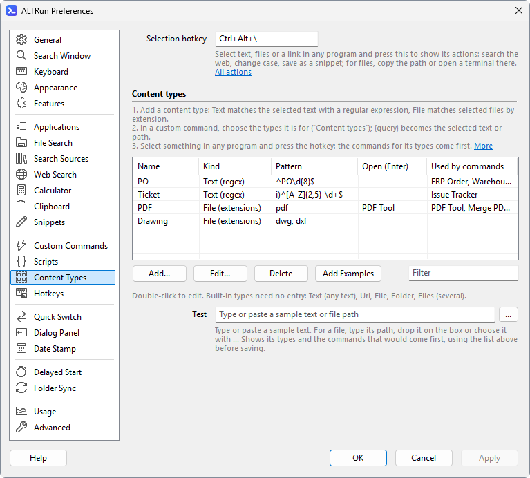

**English** · [中文](Content-Types-zh)

# Content types and actions on a selection

A **content type** says what a piece of text or a file is: an order number, an email address, a PDF file... Once you describe a type, the custom commands and scripts you set for it are offered wherever that kind of content shows up, first in the list, so one order number can go to several systems in two keystrokes. Like Alfred's Universal Actions.

## Where content types are used
| Where | What you do | What you get |
|---|---|---|
| Any program | Select text, files or a URL and press `Ctrl+Alt+\` | The [action panel for the selection](Usage#actions-on-selected-content): your commands and scripts for its types first, then the built-in actions |
| Search results | `→` on a file or folder (also pinned, recent and browsed items) | Your commands and scripts for its types, right after Open |
| [Clipboard history](Clipboard#running-your-commands-on-copied-text) | `→` on a text item | Your commands and scripts for its types, after Copy and Paste |
| Search results | `Enter` on a file whose type has **Open (Enter)** | That command opens it ([see below](#opening-a-type-of-file-with-a-program-of-your-choice)) |
| [Scripts](Scripts#scripts-for-selected-content) | `@altrun.selection PO` at the top of a script | The script is offered for that type, after the custom commands |
| [Custom hotkeys](Hotkeys) | "Search in ALTRun" with `po {selection}` | The search window with just the commands for one type ([see below](#a-hotkey-for-one-content-type)) |

It takes two steps: describe the type once, then choose which custom commands are for it (scripts name their types themselves). The commands for a type come first in its action panel, and `Enter` runs the first one.

## Defining your types
Describe your **content types** once in Preferences → Content Types → Content types (Add): a name, the kind and the pattern. `Text (regex)` types are a regular expression, matched against the selected text without leading and trailing spaces and line breaks (for example `^PO\d{8}$`; start it with `i)` to ignore case); `File (extensions)` types are extensions (for example `pdf, docx`). New installs come with typical types, each with a default command set for it: Email → Send Email, IP → Ping, Coordinates (such as `1.3521, 103.8198`) → Google Maps, Text files → Notepad, Images → Paint. **Add Examples** adds the types missing from your list and brings their commands into Custom Commands too (a missing command is added; your command of the same name that isn't set for any type yet gets the type). The **Test** box below the list shows which types a sample has and which commands it would show: type or paste text, or for a file type its path, drop the file on the box or choose it with `...`. The "Used by commands" column shows the commands set for each type.

**Built-in types** need no definition: `Text` (any text), `Url`, `File`, `Folder`, `Files` (several files or folders).

Some patterns:

| Name | Kind | Pattern | Matches |
|---|---|---|---|
| PO | Text (regex) | `^PO\d{8}$` | `PO12345678` |
| Invoice | Text (regex) | `i)^INV-\d{4,}$` | `INV-2041`, `inv-10233` (`i)` ignores case) |
| Drawing | Text (regex) | `^[A-Z]{2}-\d{3}(-[A-Z])?$` | `ST-101`, `AR-205-B` |
| Office | File (extensions) | `docx, xlsx, pptx` | `Report.docx`, `Budget.xlsx` |
| CAD | File (extensions) | `dwg, dxf` | `Level 3.dwg` |

In `ALTRun.json` (`F4`) the types are kept as:
```jsonc
"ContentTypes": [
  { "Name": "PO",  "Kind": "Text", "Pattern": "^PO\\d{8}$" },
  { "Name": "PDF", "Kind": "File", "Pattern": "pdf, docx", "OpenCommand": "k3x9a2mq" }
]
```

## Setting commands for a type
In a custom command's edit dialog, choose the types it is for in **Content types**: the **Types** button opens a menu of the built-in and your own types; click one to check or uncheck it (or type the names, separated by commas). Saving warns about a name that isn't a type. In `ALTRun.json` it is kept as `"ContentTypes"`:
```jsonc
{ "Title": "ERP order", "Type": "Url", "Target": "https://erp.example.com/order?id={query}", "ContentTypes": "PO" },
{ "Title": "Open in PDF tool", "Type": "File", "Target": "C:\\Tools\\PdfTool.exe", "ContentTypes": "PDF" }
```
`{query}` becomes the selected text or path (encoded in a `Url`); several files become `"a" "b"` (each quoted). A `File` / `Command` without `{query}` gets the selection added as its last argument, in quotes.

## Example: one order number, several systems
Say order numbers look like `PO12345678` and you look them up in an ERP and a warehouse system:

| Step | Where | What |
|---|---|---|
| 1 | Preferences → Content Types → Add | Name `PO`, kind `Text (regex)`, pattern `^PO\d{8}$`; type `PO12345678` in **Test** to check it |
| 2 | Preferences → Custom Commands → Add | "ERP order", type Url, `https://erp.example.com/order?id={query}`, Content types `PO` |
| 3 | Preferences → Custom Commands → Add | "WMS order", type Url, `https://wms.example.com/find?po={query}`, Content types `PO` |

Select `PO12345678` and press `Ctrl+Alt+\`: "ERP order" comes first, and typing filters the list as usual. The commands still work as before in the search box (by name or keyword). [Scripts](Scripts) can be offered for content types too (`@altrun.selection PO` at the top of the script): they come after the custom commands, and the selection is passed as their first argument.

## Files in the search results
Press `→` on a file or folder found by a search (or a pinned or recent item, or one in a folder you are browsing) and the commands and scripts for its content types come right after Open, as with `Ctrl+Alt+\`.

## Opening a type of file with a program of your choice
Like Total Commander's internal associations, a File type's **Open (Enter)** names the custom command that opens its files. `Enter` on such a file in the search results runs it, and it comes first in the file's action panel; Open there still uses Windows' association, and Windows' own settings aren't changed. Any custom command that runs a program can be chosen, whether or not it lists the type (in `ALTRun.json`: `"OpenCommand"`, the command's `Id`). Programs and shortcuts (`.exe`, `.lnk`...) always start as usual. This is for portable setups where Windows doesn't know a type, for example `.md` files opened by a portable editor:
1. Preferences → Custom Commands → Add: name `Typora`, type File, target `A_ScriptDir\..\Typora\Typora.exe` (a path next to ALTRun's folder, which still works when the USB drive letter changes)
2. Preferences → Content Types → Add: name `Markdown`, kind `File (extensions)`, pattern `md, markdown`, **Open (Enter)** `Typora`

The types list shows each type's **Open (Enter)**, and the command's edit dialog shows it on its "Triggers" line.

## Starting from a selection
When no command or script is set for the selection's types, the panel ends with **Add a Command for This Content...** (the command edit dialog with "Content types" filled in: your own type when the selection has one, otherwise the built-in one such as `Text` or `File`). When none of your types match, **Make a Content Type from It...** comes too: the type edit dialog with a pattern guessed from the selection (digits `^\d{8}$`; letters then digits `^PO\d+$`; an email address; a link by its site, `^https?://(www\.)?github\.com(/|$)`; other text exactly as it is; files by their extension), and a line saying whether the selection matches while you edit it. After OK the command dialog for the new type opens; cancel it to keep only the type. Type to find them in the panel (for example `content`).

## A hotkey for one content type
Give the commands for that type the same keyword with `{query}` (for example `po` for "ERP order" and "WMS order"), then add a hotkey in Preferences → Hotkeys with the action "Search in ALTRun" and the search text `po {selection}`. Select an order number and press it: the search window lists just those commands with the number filled in; Enter runs the first, ↓ picks another. This uses the selected text only (on one line, at most 100 characters; see [Hotkeys](Hotkeys)), and the check for shells below doesn't apply there, as when you type the text yourself; for files, use `Ctrl+Alt+\`, where the commands for the file's type come first.

## What a command can't take
So that selected text can't run something else, a command can't take the text when it has a line break or a double quote (except for `Url` commands, where it is encoded), or when the command runs a shell (`cmd`, a batch file, PowerShell...; also through `%ComSpec%` or another program, such as `wt.exe` with `cmd /k ...` in the arguments) and the text has that shell's special characters (such as `&` `|` `%`, and for PowerShell also `( ) { } ' $ ;`). The command stays in the panel and says which characters are the reason; Enter on it only shows that message. PowerShell started directly (the target is `powershell.exe` or `pwsh.exe`) takes its special characters where the text is only text to it: put `{query}` in single quotes in `-Command`, for example `-Command "Get-ChildItem D:\Videos -Filter '*{query}*'"` (single quotes in the text are doubled automatically; not when the command runs a string as code again, such as with `Invoke-Expression`), or pass it to a script after `-File`, for example `-File D:\Tools\find.ps1 "{query}"`.

## Settings
| Setting | Where | Default | Description |
|---|---|---|---|
| `SelectionHotkey` (in `General`) | Preferences → Content Types → "Selection hotkey" | `^!\` (`Ctrl+Alt+\`) | Opens the action panel for the selection; empty = off |
| `ContentTypes` | Preferences → Content Types → Content types | Email, IP, Coordinates, Text files, Images | The list of your types: `Name`, `Kind` (`Text` / `File`), `Pattern`, `OpenCommand` |
| `ContentTypes` of a custom command | The command's edit dialog → Content types | empty | The types the command is offered for, separated by commas |

The types and commands are lists like the others in Preferences: select a row and press `Alt+↑` / `Alt+↓` to change the order (see [Working with lists](Configuration#working-with-lists)); the order of the commands is the order in the panel.



## Related pages
- [Search and shortcuts → Actions on selected content](Usage#actions-on-selected-content): the built-in actions for text, URLs and files
- [Custom commands](Custom-Commands): command types, `{query}` and its defaults
- [Scripts](Scripts#scripts-for-selected-content): what a script for a type receives
- [Clipboard history](Clipboard): running your commands on text you copied earlier
