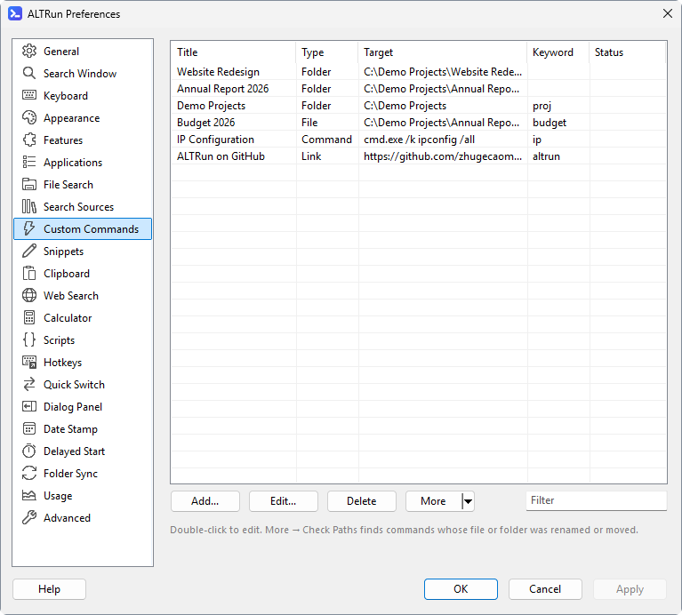
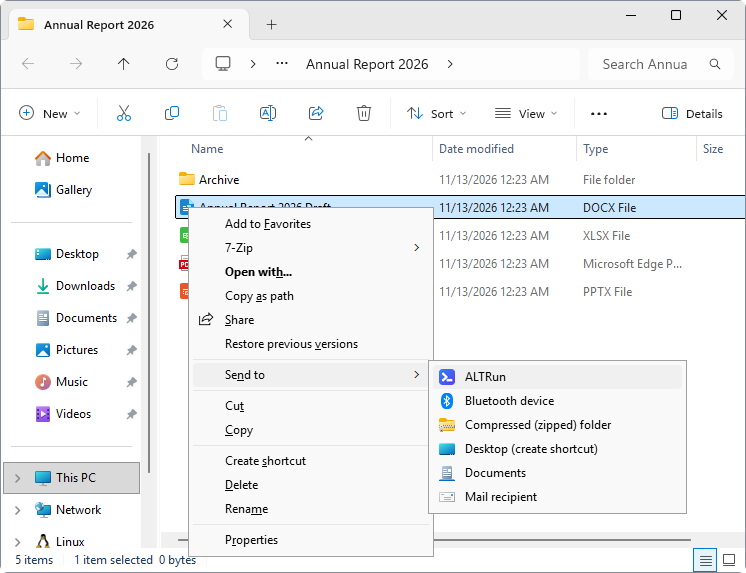

[English](Custom-Commands) · **中文**

# 自定义命令
把常用的文件、文件夹、程序或网址加进 ALTRun, 用名字或关键字打开。

## 添加
- 搜索结果里选中应用 / 文件 / 文件夹 / 网址, 按 `F3` (或 `→` → "添加到自定义命令...")
- 没有搜到结果时按 `F3`, 用输入的文字新建一条
- 资源管理器里右键 → 发送到 → ALTRun: 选中 **1 个** 文件 / 文件夹时弹出编辑对话框, 名称、类型、目标已经填好, 改好名称或加上关键字后按 `Enter`; 取消则不添加。选中 **多个** 时全部直接添加 (不会一个个弹对话框), 已经有的命令不重复添加。发送一个已经有的文件 / 文件夹时, 打开已有的那条命令修改。偏好设置开着时, 新命令加进 偏好设置 → 自定义命令 的列表, 按 确定 / 应用 保存
- 偏好设置 → 自定义命令 → 添加
- 偏好设置 → 自定义命令 → 更多 ▾ → **添加示例**: 补上还没有的默认命令 (标题或关键字相同的算已有), 并提示添加了几个、跳过了几个; 点 "确定" / "应用" 后保存

已有的命令: 搜索到后按 `F3` 修改, `Ctrl+Del` 删除; 或在偏好设置里双击编辑。命令多的时候, 在列表右下角的 **筛选** 框里输入名称、路径或关键字里的词, 只显示匹配的命令 (文字片段、网页搜索、自定义热键的列表也有)。

## 检查路径
文件夹改名、文件移走后, 指向它的命令就失效了。偏好设置 → 自定义命令 → **更多 ▾ → 检查路径** 会检查每条命令的目标是否还在, 结果显示在 "状态" 列, 并选中第一条有问题的命令, 双击即可修改路径:

| 状态 | 含义 |
|---|---|
| 正常 | 目标存在 |
| 找不到 | 文件或文件夹不在了 (改名、移动或删除), 需要修改路径或删除命令 |
| 无法访问 | 所在的驱动器或网络位置现在连不上 (例如网络盘没有连接), 无法判断, 连上后再检查 |
| - | 网址和 `shell:` 等位置不检查 |

`Command` 类型只写程序名 (例如 `cmd.exe`) 时, 在 PATH 和系统登记的程序 (App Paths) 里查找。检查结果只显示在偏好设置里, 不会修改或删除任何命令。

## 字段
编辑对话框里每个字段下面都有一行灰色的说明。

| 字段 | 说明 |
|---|---|
| 名称 (Title) | 显示的名称, 按它搜索 |
| 类型 (Type) | `File` 文件 / 程序, `Folder` 文件夹, `Command` 程序 + 参数, `Url` 网址 / 链接 (网页, 或 `ms-settings:windowsupdate`、`mailto:` 这样的链接) |
| 目标 (Target) | 路径、程序或网址 |
| 参数 (Arguments) | 运行程序时附带的命令行参数, 例如 `/k ipconfig /all` |
| 关键字 (Keyword) | 可选。输入完全相同的关键字时排在最前面。可以写几个, 用逗号分隔, 例如 `np, ㅜㅔ` (经常切换键盘布局 / 输入法时, 输入哪个都行) |
| 选中内容类型 (Selection) | 可选。偏好设置 → 选中内容 里定义的类型 (例如 `IP, Text files`)。选中内容后按 `Ctrl+Alt+\` 时, 这个命令排在最前面的类型 (用 **类型** 菜单勾选), 见 [自己的操作 (内容类型)](Usage-zh#自己的操作-内容类型) |
| 触发方式 | 不保存: 一行说明除了按名称搜索, 这个命令还能怎样运行, 例如 `关键字 ping · 选中内容 IP · 热键 Ctrl+Alt+P`。**设热键...** 为这个命令打开 [热键窗口](Hotkeys-zh) (新命令保存前也能设); 已经有热键时弹出菜单, 可以修改或删除每一个, 或再加一个。热键在按 **确定** 时和命令一起保存 (按 取消 也一起不要)。在偏好设置里按 **应用** 时保存; 从搜索窗口 (`F3`) 打开时, 热键有变化 ALTRun 会重新启动, 马上生效 |

搜索时除了名称和关键字, `File` / `Folder` 类型还会匹配目标的文件名 (不含扩展名) 或文件夹名: Target 是 `D:\Demo\Projects\P1001 - Riverside Park`, 名称是 `Tower A, B, C`, 输入 `riverside` 或 `1001` 也能找到。同样的匹配程度, 名称匹配排在前面。

文件夹用 偏好设置 → 通用 → 文件管理器 打开 (默认资源管理器, 也可以设为 Total Commander 等); 那里勾选 "在新标签页中打开文件夹" 时, 在已打开的资源管理器窗口 (Windows 11 22H2 及以上) 或 Total Commander 里用新标签页打开。

## 带参数的命令 ({query})
目标或参数里写 `{query}`, 再设一个关键字, 输入 "关键字 文字" 时 `{query}` 换成后面的文字 (网址里自动编码), 和网页搜索的关键字一样用:

| 名称 | 类型 | 目标 | 参数 | 关键字 | 输入 |
|---|---|---|---|---|---|
| Jira | 网址 | `https://jira.example.com/browse/{query}` | | `jira` | `jira ABC-123` |
| Ping | 命令行 | `cmd.exe` | `/k ping {query}` | `ping` | `ping 10.0.0.1` |
| 项目文件夹 | 文件夹 | `D:\Projects\{query}` | | `pj` | `pj 2026-05` |
| Google Maps | 网址 | `https://www.google.com/maps/search/{query}` | | `maps` | `maps Changi Airport` |

新安装时默认命令里已经有 Ping、Google Maps、Send Email (`mailto:{query}`; 地址里的 `@` 不编码) 和 Documents subfolder (`docs 文件夹名` 打开 "文档" 里的子文件夹) 四个例子。只输入名称搜到这条命令时, 下面一行会说明接着输入什么 (例如 "在 'ping ' 后面输入内容, 再按 Enter"), 按 `Enter` 补全成 "关键字 ", 接着输入参数。没有关键字时 `{query}` 换成空。"检查路径" 不检查带 `{query}` 的路径。

## 呼出 ALTRun 之前的窗口 ({hwnd}, {pid})
目标或参数里的 `{hwnd}` 和 `{pid}` 会换成呼出 ALTRun 之前前台窗口的句柄和进程 ID (十进制), 脚本可以拿它对这个窗口做后续操作, 例如取它打开的文件:

| 名称 | 类型 | 目标 | 参数 |
|---|---|---|---|
| 窗口信息 | 命令行 | `C:\Tools\WindowInfo.ahk` | `{hwnd}` |
| 进程详情 | 命令行 | `powershell.exe` | `-NoExit -Command Get-Process -Id {pid} \| Format-List *` |

AutoHotkey 脚本里用 `WinGetTitle("ahk_id " A_Args[1])` 就能读这个窗口。建议用 `{hwnd}` 而不是 `{pid}`: 同一个程序常有好几个窗口, 句柄才是你刚才在用的那一个。每次运行命令时才填入, 从选中内容的动作面板 (`Ctrl+Alt+\`) 运行、置顶或最近使用的条目也一样。那个窗口已经关掉 (或者从托盘打开 ALTRun, 前台没有窗口) 时两个都换成空。"检查路径" 不检查带它们的路径。

## 路径里可以用的变量
| 写法 | 含义 |
|---|---|
| `A_Desktop` `A_DesktopCommon` | 桌面 / 公共桌面 |
| `A_MyDocuments` | 文档 |
| `A_AppData` | `%AppData%` |
| `A_Programs` `A_ProgramsCommon` | 开始菜单 "程序" (当前用户 / 所有用户) |
| `A_StartMenu` `A_StartMenuCommon` | 开始菜单 |
| `A_Startup` `A_StartupCommon` | 启动文件夹 |
| `A_ProgramFiles` `A_WinDir` `A_Temp` | Program Files / Windows / 临时文件夹 |
| `A_ScriptDir` | ALTRun 所在的文件夹 |
| `%Temp%` `%AppData%` `%UserProfile%` `%OneDrive%` | 环境变量 |

`A_` 变量要写在开头, 例如 `A_Desktop\Projects`。只写程序名 (例如 `notepad`) 时会在 PATH 里查找。
