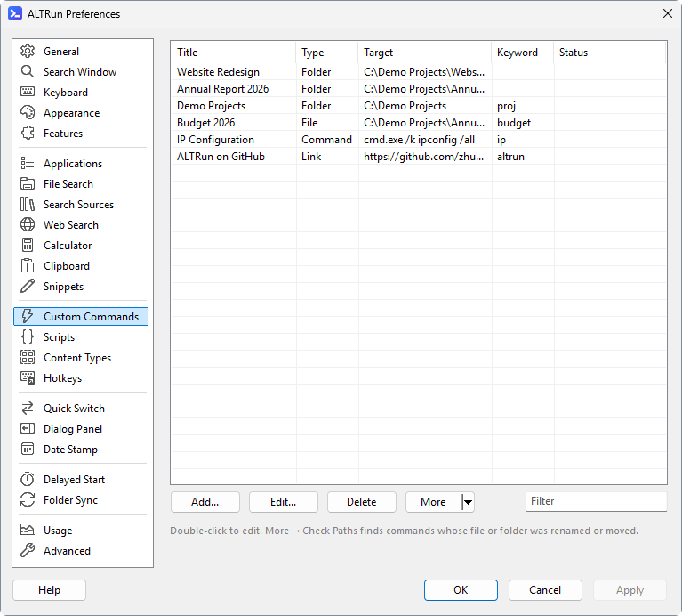
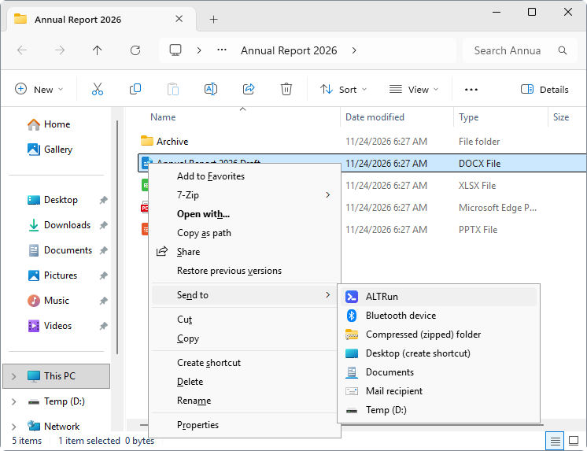
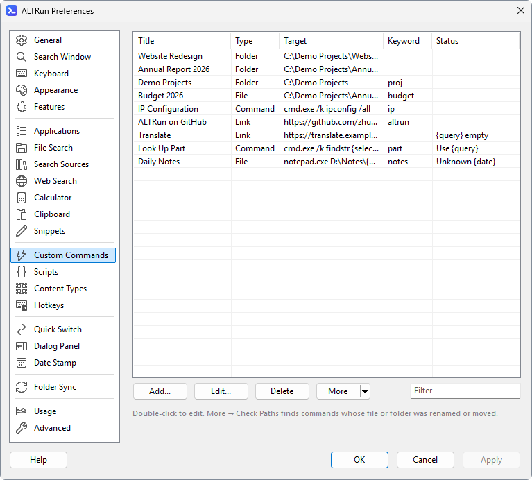

**English** · [中文](Custom-Commands-zh)

# Custom commands
Add the files, folders, programs or web addresses you use often to ALTRun and open them by name or keyword.

## Adding commands
- In the search results, select an app / file / folder / URL and press `F3` (or `→` → "Add to Custom Commands...")
- When nothing is found, press `F3` to create one from the text you typed
- In Explorer, right-click → Send to → ALTRun. With **one** file / folder selected, the edit dialog opens with the name, type and target already filled in; adjust the name or add a keyword and press `Enter` (Cancel adds nothing). With **several** selected, they're all added at once (no dialog for each one), and commands that already exist aren't added twice. Sending a file / folder that already has a command opens that command for editing. If Preferences is open, the new commands are added to the list in Preferences → Custom Commands and saved when you press OK / Apply
  - Sending a shortcut (`.lnk`) adds the program it points to, unless the shortcut starts it differently: then the shortcut itself is added, so its settings are kept (since test build 2026.11.23.20):

    | The shortcut has | The command's target |
    |---|---|
    | only a target (the working folder empty or the target's own folder) | the program it points to |
    | arguments, e.g. `--profile Work` | the shortcut |
    | another working folder ("Start in") | the shortcut |
    | Properties → Shortcut → Advanced → "Run as administrator" | the shortcut |

- Preferences → Custom Commands → Add...
- Preferences → Custom Commands → More ▾ → **Add Examples**: adds the default commands you don't have yet (a command with the same title or keyword counts as already there) and tells you how many were added and skipped; saved when you press OK / Apply

Existing commands: find one and press `F3` to edit it or `Ctrl+Del` to delete it, or double-click it in Preferences. Its actions panel (`→`) also has **Set Hotkey...**, or **Change Hotkey Ctrl+Alt+N...** for each hotkey it has: the [hotkey window](Hotkeys) for this command; on OK ALTRun saves it and restarts if the hotkey changed, so it works at once (a second hotkey: **Set Hotkey...** in the edit window). With many commands, type a word from the name, path or keyword into the **Filter** box at the bottom right of the list to show only matching commands (the snippet, web search and custom hotkey lists have one too).

## Checking paths
When a folder is renamed or a file is moved, the commands pointing to it stop working. Preferences → Custom Commands → **More ▾ → Check Paths** checks whether every command's target still exists, shows the result in the "Status" column and selects the first command with a problem; double-click it to fix the path:

| Status | Meaning |
|---|---|
| OK | The target exists |
| Not found | The file or folder is gone (renamed, moved or deleted); fix the path or delete the command |
| Offline | The drive or network location can't be reached right now (for example a network drive isn't connected), so it can't be checked; check again once it's connected |
| - | URLs and locations such as `shell:` aren't checked |

For the `Command` type with only a program name (for example `cmd.exe`), the program is looked up in PATH and the programs registered with Windows (App Paths). The results only appear in Preferences; no command is changed or deleted.

The Status column also points out placeholders that won't work, without checking (a path that Check Paths found missing or offline is shown instead). The edit window explains the same when you click OK and asks whether to save anyway:

| Status | Meaning |
|---|---|
| `{query} empty` | The command has `{query}`, but no keyword, content type, hotkey or default, so nothing fills it in (it's replaced by nothing). Give it one of them, or a default such as `{query\|}` (see [Commands with an argument](#commands-with-an-argument-query)) |
| `Use {query}` | `{selection}` is for the search text of hotkeys; in a command, the selected text comes in through `{query}` (from a content type or a hotkey), and `{selection}` stays as written |
| `Unknown {date}` | Commands only replace `{query}`, `{hwnd}` and `{pid}`; any other `{word}` is passed as written. That's fine when the program expects it (for example `{Enter}` for a script) |

## Fields
Each field in the edit dialog has a line of gray help text below it.

| Field | Description |
|---|---|
| Title | The name shown in results and used for searching |
| Type | `File` file / program, `Folder` folder, `Command` program + arguments, `Url` web address / link (a web page, or a link such as `ms-settings:windowsupdate` or `mailto:`) |
| Target | Path, program or web address. Can contain `{query}`, the text typed after the keyword (see [Commands with an argument](#commands-with-an-argument-query)), for example `https://jira.example.com/browse/{query}` |
| Arguments | Command-line arguments passed to the program, for example `/k ipconfig /all`. Can contain `{query}` too, also with a default for when nothing is typed after the keyword: `{query\|127.0.0.1}`, `{query\|clipboard}` (the text on the clipboard) or `{query\|}` (run without it); see [Commands with an argument](#commands-with-an-argument-query) |
| Keyword | Optional. Typing exactly this keyword puts the command first. Several keywords: separate with commas, for example `np, ㅜㅔ` (handy when you switch keyboard layouts: any of them works) |
| Content types (Selection) | Optional. Content types from Preferences → Content Types (for example `IP, Text files`; pick them from the **Types** menu) the command comes first for when you select something and press `Ctrl+Alt+\` (and in the action panel of such files in the search results; a file type's **Open (Enter)** can also name it), see [Your own actions for a selection](Usage#your-own-actions-for-a-selection) |
| Triggers | Not saved: one line saying how the command runs besides finding it by name, for example `Keyword ping · Selection IP · Hotkey Ctrl+Alt+P`. **Set Hotkey...** opens the [hotkey window](Hotkeys) for this command (a new command can have one before it is saved); with hotkeys already set it shows a menu to edit or delete each one or add another. The hotkeys are saved with the command when you click **OK** (Cancel drops them too). In Preferences they are saved on **Apply**; from the search window (`F3`) ALTRun restarts if a hotkey changed, so it works at once |

Besides the title and keyword, `File` / `Folder` commands also match the target's file name (without the extension) or folder name: with the Target `D:\Demo\Projects\P1001 - Riverside Park` and the title `Tower A, B, C`, typing `riverside` or `1001` finds it too. At the same match quality, a title match ranks first.

Folders open in Preferences → General → File manager (Explorer by default; Total Commander, Directory Opus, Arke and others work too, see [File managers](File-Managers)); "Open folders in a new tab" there opens them in a new tab of an Explorer window already open (Windows 11 22H2 or later), of Total Commander or of Arke.

## Commands with an argument ({query})
One command for many values: `ping 10.0.0.1`, `jira ABC-123`, `maps Changi Airport`. Write `{query}` where the value goes, and optionally a default for when you type only the keyword and a space: `{query|default}`, `{query|clipboard}` or `{query|}`.

### Step by step: a Ping command
1. Preferences → Custom Commands → **Add...** (or type `ping` in the search window and press `F3` when nothing is found)
2. Fill in: Title `Ping`, Type **Command line**, Target `cmd.exe`, Arguments `/k ping {query|127.0.0.1}`, Keyword `ping`
3. Click **OK** (in Preferences also **Apply** / **OK** on the page)
4. Try it in the search window:

| You type | Then | Result |
|---|---|---|
| `ping` | `Enter` | the box becomes `ping ` (with a space) and waits for the address; the line below says what to type |
| `ping 10.0.0.1` | `Enter` | a command prompt runs `ping 10.0.0.1` |
| `ping ` (nothing after the space) | `Enter` | runs `ping 127.0.0.1`, the default |

With `/k ping {query|clipboard}` instead, copy an IP address anywhere, type `ping ` and press `Enter`: it pings the address on the clipboard (the line shows it before you press `Enter`). With a plain `{query}`, `ping ` waits until you type the address.

### The rules
Put `{query}` in the target or arguments and give the command a keyword; typing "keyword text" replaces `{query}` with the text (URL-encoded in web addresses). The rules are the same as for [web search](Web-Search#adding-and-editing) URLs, so a command and a search engine written the same way behave the same:

| Written as | `ping` (only the keyword) | `ping ` (keyword and a space, nothing after it) | `ping 10.0.0.1` |
|---|---|---|---|
| `{query}` | `Enter` completes it to `ping ` | waits for the argument (the line below says what to type) | `10.0.0.1` |
| `{query\|127.0.0.1}` | `Enter` completes it to `ping ` | runs with the default, `127.0.0.1` | `10.0.0.1` |
| `{query\|clipboard}` | `Enter` completes it to `ping ` | runs with the text on the clipboard | `10.0.0.1` |
| `{query\|}` | `Enter` completes it to `ping ` | runs with nothing in place of `{query}` | `10.0.0.1` |

Typing only the keyword never runs the command, so you can still type an argument; the keyword and a space runs the default. Examples:

| Title | Type | Target | Arguments | Keyword | Type this |
|---|---|---|---|---|---|
| Jira | Link | `https://jira.example.com/browse/{query}` | | `jira` | `jira ABC-123` |
| Ping | Command line | `cmd.exe` | `/k ping {query\|127.0.0.1}` | `ping` | `ping 10.0.0.1`; `ping ` pings 127.0.0.1 |
| Project folder | Folder | `D:\Projects\{query\|2026}` | | `pj` | `pj 2026-05`; `pj ` opens `D:\Projects\2026` |
| Google Maps | Link | `https://www.google.com/maps/search/{query\|clipboard}` | | `maps` | `maps Changi Airport`; `maps ` searches the address on the clipboard |
| Notepad | File | `notepad.exe` | `{query\|}` | `np` | `np D:\notes.txt` opens the file; `np ` opens Notepad |

- **The default**: the text between `|` and `}` (it can't contain `}`), used as written; in web addresses it's encoded like typed text. All `{query}` in the target and arguments get the same text; if several defaults are written, the first one counts. `{query}` is not case-sensitive (`{Query|x}` works too)
- **`{query|clipboard}`**: the text on the clipboard, joined into one line and at most 200 characters, read as in [web search](Web-Search#searching-the-clipboard) (not read when files are copied, or when a password manager marks it private). The result line shows the text before you press `Enter`. In a file, folder or command line (not a link) the clipboard text gets the same checks as [selected text](Usage#actions-on-selected-content): a line break or a double quote is refused, and so are the characters cmd or PowerShell would run as code when the command line goes through them; the line then says why and can't be run. Text you type yourself is not checked. If the clipboard has no text, the line says "The clipboard has no text"
- **Found by its name** (not by the keyword): with a keyword, `Enter` completes it to "keyword " as above. Without a keyword, a command with a default runs with it, and a plain `{query}` is replaced by nothing
- **Selected text first**: from [Actions on selected content](Usage#actions-on-selected-content) (content types) or a [hotkey](Hotkeys), `{query}` becomes the selected text or path, whatever default is written; the default is used only when there is nothing to put there. With a hotkey and nothing selected, a command with a default runs with it (see [Hotkeys](Hotkeys))
- **Status column**: a plain `{query}` command without a keyword, content type or hotkey shows `{query} empty`, because nothing fills it in; a command with a default (also `{query|}`) doesn't. "Check Paths" skips paths containing `{query}` in any form

A new installation already has four examples among the default commands: Ping, Google Maps, Send Email (`mailto:{query}`; the address keeps its `@`) and Documents subfolder (`docs folder-name` opens a subfolder of Documents).

## The window you came from ({hwnd}, {pid})
`{hwnd}` and `{pid}` in the target or arguments become the handle and the process ID (in decimal) of the window that was in front before you opened ALTRun, so a script can work on that window, for example find the file it has open:

| Name | Type | Target | Arguments |
|---|---|---|---|
| Window info | Command line | `C:\Tools\WindowInfo.ahk` | `{hwnd}` |
| Process details | Command line | `powershell.exe` | `-NoExit -Command Get-Process -Id {pid} \| Format-List *` |

In an AutoHotkey script, `WinGetTitle("ahk_id " A_Args[1])` reads that window. Prefer `{hwnd}` to `{pid}`: one program often has several windows, and the handle is the one you were using. They are filled in each time the command runs, also from the actions panel for selected content (`Ctrl+Alt+\`) and when it's pinned or recently used. If that window has been closed meanwhile (or ALTRun was opened from the tray with no window in front), both become empty. "Check Paths" skips paths containing them.

## Variables in paths
| Write | Meaning |
|---|---|
| `A_Desktop` `A_DesktopCommon` | Desktop / public desktop |
| `A_MyDocuments` | Documents |
| `A_AppData` | `%AppData%` |
| `A_Programs` `A_ProgramsCommon` | Start menu "Programs" (current user / all users) |
| `A_StartMenu` `A_StartMenuCommon` | Start menu |
| `A_Startup` `A_StartupCommon` | Startup folder |
| `A_ProgramFiles` `A_WinDir` `A_Temp` | Program Files / Windows / temporary folder |
| `A_ScriptDir` | The folder ALTRun is in |
| `%Temp%` `%AppData%` `%UserProfile%` `%OneDrive%` | Environment variables |

`A_` variables must come first, for example `A_Desktop\Projects`. A bare program name (for example `notepad`) is looked up in PATH.
