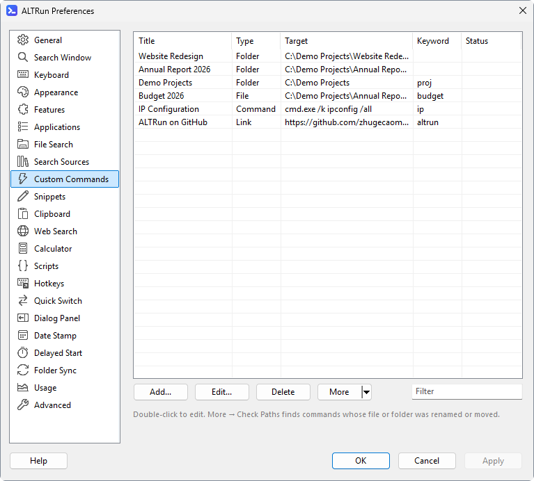
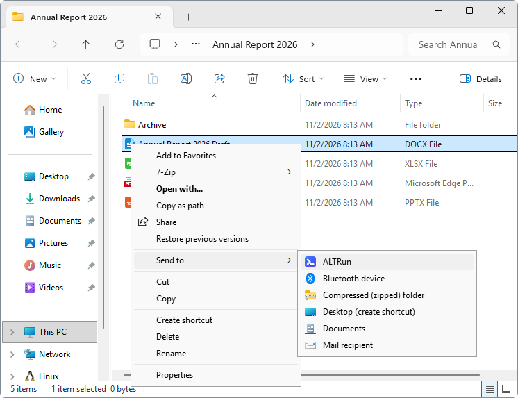
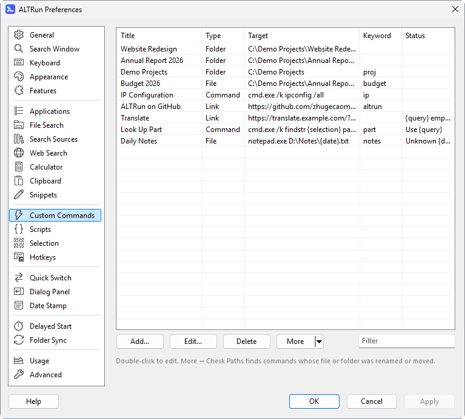

**English** · [中文](Custom-Commands-zh)

# Custom commands
Add the files, folders, programs or web addresses you use often to ALTRun and open them by name or keyword.

## Adding commands
- In the search results, select an app / file / folder / URL and press `F3` (or `→` → "Add to Custom Commands...")
- When nothing is found, press `F3` to create one from the text you typed
- In Explorer, right-click → Send to → ALTRun. With **one** file / folder selected, the edit dialog opens with the name, type and target already filled in; adjust the name or add a keyword and press `Enter` (Cancel adds nothing). With **several** selected, they're all added at once (no dialog for each one), and commands that already exist aren't added twice. Sending a file / folder that already has a command opens that command for editing. If Preferences is open, the new commands are added to the list in Preferences → Custom Commands and saved when you press OK / Apply
- Preferences → Custom Commands → Add...
- Preferences → Custom Commands → More ▾ → **Add Examples**: adds the default commands you don't have yet (a command with the same title or keyword counts as already there) and tells you how many were added and skipped; saved when you press OK / Apply

Existing commands: find one and press `F3` to edit it or `Ctrl+Del` to delete it, or double-click it in Preferences. Its actions panel (`→`) also has **Set Hotkey...**, or **Change Hotkey Ctrl+Alt+N...** for each hotkey it has: the [hotkey window](Hotkeys) for this command; on OK ALTRun saves it and restarts if the hotkey changed, so it works at once (a second hotkey: **Set Hotkey...** in the edit window). With many commands, type a word from the name, path or keyword into the **Filter** box at the bottom right of the list to show only matching commands (the snippet, web search and custom hotkey lists have one too).

## Checking paths
When a folder is renamed or a file is moved, the commands pointing to it stop working. Preferences → Custom Commands → **More ▾ → Check Paths** checks whether every command's target still exists, shows the result in the "Status" column and selects the first command with a problem; double-click it to fix the path:

| Status | Meaning |
|---|---|
| OK | The target exists |
| Not found | The file or folder is gone (renamed, moved or deleted); fix the path or delete the command |
| Offline | The drive or network location can't be reached right now (for example a network drive isn't connected), so it can't be checked; check again once it's connected |
| - | URLs and locations such as `shell:` aren't checked |

For the `Command` type with only a program name (for example `cmd.exe`), the program is looked up in PATH and the programs registered with Windows (App Paths). The results only appear in Preferences; no command is changed or deleted.

The Status column also points out placeholders that won't work, without checking (a path that Check Paths found missing or offline is shown instead):

| Status | Meaning |
|---|---|
| `{query} empty` | The command has `{query}`, but no keyword, content type or hotkey, so nothing fills it in (it's replaced by nothing). Give it one of them |
| `Use {query}` | `{selection}` is for the search text of hotkeys; in a command, the selected text comes in through `{query}` (from a content type or a hotkey), and `{selection}` stays as written |
| `Unknown {date}` | Commands only replace `{query}`, `{hwnd}` and `{pid}`; any other `{word}` is passed as written. That's fine when the program expects it (for example `{Enter}` for a script) |

## Fields
Each field in the edit dialog has a line of gray help text below it.

| Field | Description |
|---|---|
| Title | The name shown in results and used for searching |
| Type | `File` file / program, `Folder` folder, `Command` program + arguments, `Url` web address / link (a web page, or a link such as `ms-settings:windowsupdate` or `mailto:`) |
| Target | Path, program or web address |
| Arguments | Command-line arguments passed to the program, for example `/k ipconfig /all` |
| Keyword | Optional. Typing exactly this keyword puts the command first. Several keywords: separate with commas, for example `np, ㅜㅔ` (handy when you switch keyboard layouts: any of them works) |
| Selection types (Selection) | Optional. Content types from Preferences → Selection (for example `IP, Text files`; pick them from the **Types** menu) the command comes first for when you select something and press `Ctrl+Alt+\`, see [Your own actions for a selection](Usage#your-own-actions-for-a-selection) |
| Triggers | Not saved: one line saying how the command runs besides finding it by name, for example `Keyword ping · Selection IP · Hotkey Ctrl+Alt+P`. **Set Hotkey...** opens the [hotkey window](Hotkeys) for this command (a new command can have one before it is saved); with hotkeys already set it shows a menu to edit or delete each one or add another. The hotkeys are saved with the command when you click **OK** (Cancel drops them too). In Preferences they are saved on **Apply**; from the search window (`F3`) ALTRun restarts if a hotkey changed, so it works at once |

Besides the title and keyword, `File` / `Folder` commands also match the target's file name (without the extension) or folder name: with the Target `D:\Demo\Projects\P1001 - Riverside Park` and the title `Tower A, B, C`, typing `riverside` or `1001` finds it too. At the same match quality, a title match ranks first.

Folders open in Preferences → General → File manager (Explorer by default; Total Commander and others work too); "Open folders in a new tab" there opens them in a new tab of an Explorer window already open (Windows 11 22H2 or later) or of Total Commander.

## Commands with an argument ({query})
Put `{query}` in the target or arguments and give the command a keyword; typing "keyword text" replaces `{query}` with the text (URL-encoded in web addresses). It works just like a web search keyword:

| Title | Type | Target | Arguments | Keyword | Type this |
|---|---|---|---|---|---|
| Jira | Link | `https://jira.example.com/browse/{query}` | | `jira` | `jira ABC-123` |
| Ping | Command line | `cmd.exe` | `/k ping {query}` | `ping` | `ping 10.0.0.1` |
| Project folder | Folder | `D:\Projects\{query}` | | `pj` | `pj 2026-05` |
| Google Maps | Link | `https://www.google.com/maps/search/{query}` | | `maps` | `maps Changi Airport` |

A new installation already has four examples among the default commands: Ping, Google Maps, Send Email (`mailto:{query}`; the address keeps its `@`) and Documents subfolder (`docs folder-name` opens a subfolder of Documents). When you find such a command by its name, the line below it says what to type (for example "Type after 'ping ', then press Enter"), and `Enter` completes it to "keyword " so you can type the argument. Without a keyword, `{query}` is replaced by nothing, unless content types or a hotkey give it the selected text (with none of them, the Status column shows `{query} empty`). "Check Paths" skips paths containing `{query}`.

## The window you came from ({hwnd}, {pid})
`{hwnd}` and `{pid}` in the target or arguments become the handle and the process ID (in decimal) of the window that was in front before you opened ALTRun, so a script can work on that window, for example find the file it has open:

| Name | Type | Target | Arguments |
|---|---|---|---|
| Window info | Command line | `C:\Tools\WindowInfo.ahk` | `{hwnd}` |
| Process details | Command line | `powershell.exe` | `-NoExit -Command Get-Process -Id {pid} \| Format-List *` |

In an AutoHotkey script, `WinGetTitle("ahk_id " A_Args[1])` reads that window. Prefer `{hwnd}` to `{pid}`: one program often has several windows, and the handle is the one you were using. They are filled in each time the command runs, also from the actions panel for selected content (`Ctrl+Alt+\`) and when it's pinned or recently used. If that window has been closed meanwhile (or ALTRun was opened from the tray with no window in front), both become empty. "Check Paths" skips paths containing them.

## Variables in paths
| Write | Meaning |
|---|---|
| `A_Desktop` `A_DesktopCommon` | Desktop / public desktop |
| `A_MyDocuments` | Documents |
| `A_AppData` | `%AppData%` |
| `A_Programs` `A_ProgramsCommon` | Start menu "Programs" (current user / all users) |
| `A_StartMenu` `A_StartMenuCommon` | Start menu |
| `A_Startup` `A_StartupCommon` | Startup folder |
| `A_ProgramFiles` `A_WinDir` `A_Temp` | Program Files / Windows / temporary folder |
| `A_ScriptDir` | The folder ALTRun is in |
| `%Temp%` `%AppData%` `%UserProfile%` `%OneDrive%` | Environment variables |

`A_` variables must come first, for example `A_Desktop\Projects`. A bare program name (for example `notepad`) is looked up in PATH.
