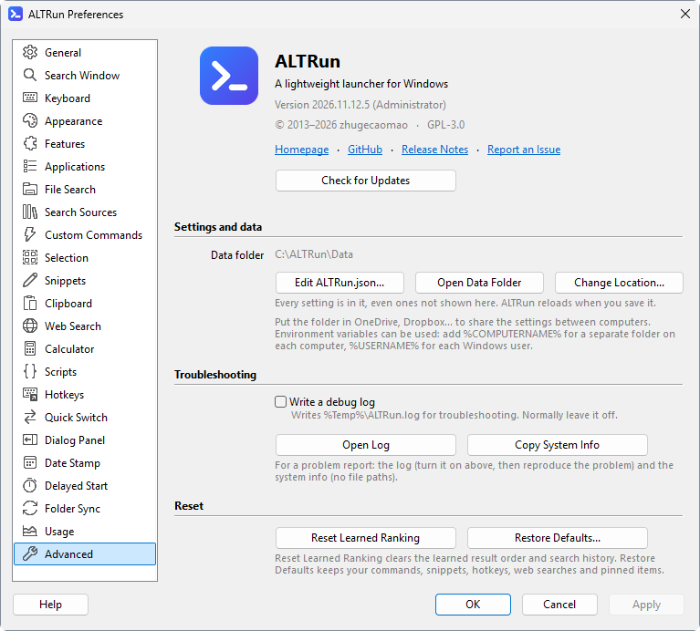

**English** · [中文](Data-Files-zh)

# Data files

## Where the data folder is
| Situation | Location |
|---|---|
| Default (the program folder is writable, portable) | `Data\` in the program folder |
| The program folder isn't writable (for example under `C:\Program Files`) | `%APPDATA%\ALTRun\Data\` |
| You picked another folder in Preferences → Advanced → Data → Change Location | That folder (the `ALTRun.json` in the default location only keeps a `DataLocation` entry pointing there; it can have environment variables, for example `%OneDrive%\ALTRun\Data-%COMPUTERNAME%` for a folder per PC), see [Using the same settings on several PCs](FAQ#using-the-same-settings-on-several-pcs) |

Preferences → Advanced → Data → "Open Data Folder" opens it.

## Files in the Data folder
| File | Contents | If you delete it |
|---|---|---|
| `ALTRun.json` | All settings, custom commands, snippets, hotkeys and web searches, see [Settings reference](Configuration) | Settings go back to defaults and your commands and snippets are gone (**this is the file to back up**) |
| `ALTRun.json.bak` | The settings as they were before the last save. When `ALTRun.json` can't be read (a format error, or damaged by a power cut), ALTRun offers to start with this backup instead of the defaults | No effect |
| `ALTRun.reset.backup.json` | Backup taken by Preferences → Advanced → "Restore Defaults" | No effect |
| `ALTRun.v<version>.backup.json` | Backup taken before the settings format was upgraded; `<version>` is the settings version before the upgrade (for example `ALTRun.v5.backup.json` when upgrading from 5 to 6) | No effect; use it to go back to an older version |
| `ALTRun.json.bad` | When the settings file has a format error, the original is kept under this name (and ALTRun offers `ALTRun.json.bak`); fix it and rename it back to `ALTRun.json`. A file that can't be opened at all (another program is using it, or a cloud file is offline) is not renamed: ALTRun tries for a couple of seconds, then asks whether to try again or quit, and changes nothing | No effect |
| `AppIndex.json` | App index | Rescanned at startup |
| `FileIndex.bin` | Built-in file index (used without Everything) | Rescanned in the background |
| `Knowledge.json` | Learned ranking, search history, recent items (pinned items are in `ALTRun.json`) | Ranking has to be learned again, recent items are cleared |
| `Knowledge.v1.backup.json` | `Knowledge.json` before it was converted to the format of settings version 7 (custom commands, snippets and sync tasks by their `Id`) | No effect; use it with `ALTRun.v6.backup.json` to go back to an older version, see [FAQ](FAQ#how-do-i-go-back-to-an-older-version) |
| `Usage.json` | Usage statistics (how often each feature was used each day) | Statistics start from zero |
| `ClipboardHistory.json` | Clipboard history (text; only here when Preferences → Clipboard → "Save in" isn't "Everything on this PC only"). When it can't be opened at startup it is left alone and read again before anything is saved; one with a format error is kept as `ClipboardHistory.json.bad` | History is cleared |
| `Clipboard\` | Images and very long items of the clipboard history (only here when "Save in" is "The Data folder") | Those items no longer show in the history |
| `Currency.json` | Exchange rates for currency conversion (only once it is turned on) | Downloaded again at the next start |
| `Update.json` | Time of the last update check, skipped versions | Checked again at the next start |
| `Icons\` | Web search icons saved by "Download Site Icon" | Those engines use the default icon |

Apart from `ALTRun.json`, every file is created at runtime and simply rebuilt if deleted.

## Files outside the Data folder
| Location | Contents |
|---|---|
| `%LOCALAPPDATA%\ALTRun\IconCache\` | Icon cache (`Icons-<size>.bin`) so icons show at once after a restart; one per PC, rebuilt automatically if deleted |
| `%LOCALAPPDATA%\ALTRun\ClipboardHistory.json`, `%LOCALAPPDATA%\ALTRun\Clipboard\` | Clipboard history, with its images and very long items in `Clipboard\` (kept here by default so it doesn't follow a sync folder or USB stick); with "Images and long items on this PC only", only `Clipboard\` is here |
| `Themes\` in the program folder (`%APPDATA%\ALTRun\Themes\` if it isn't writable) | Your own themes, see [Themes](Themes#custom-themes) |
| `Scripts\` in the program folder (`%APPDATA%\ALTRun\Scripts\` if it isn't writable) | Your own scripts, see [Scripts](Scripts) |
| `%Temp%\ALTRun.log` | Debug log, written only with Preferences → Advanced → "Write a debug log" on; an unexpected error (with where it happened) is written even when it is off |
| `%Temp%\ALTRun\SyncLogs\` | [Folder Sync](Sync-Tasks) logs (`<task>_<date>.log`) of the tasks without a log file of their own; those older than 30 days are deleted when a task runs |

For the startup, Start menu and "Send to" shortcuts, the administrator helper's scheduled task and the [Delayed Start](Delayed-Start) tasks, see [Uninstalling](Installation#uninstalling).

## Backups and moving to another PC
- **One file is enough**: `ALTRun.json` holds every setting, custom command and snippet. To take the learned ranking along too, back up the whole Data folder (the clipboard history is on this PC by default, see above)
- **New PC**: copy the whole program folder (including `Data\`); use [path variables](Custom-Commands#variables-in-paths) in paths so they still work with a different user name
- **Syncing several PCs**: move the data folder into a sync folder, see [Using the same settings on several PCs](FAQ#using-the-same-settings-on-several-pcs). Don't change settings on two PCs with ALTRun open at the same time, or the sync service may create conflict copies
- **Snippets only**: Preferences → Snippets → More ▾ → Export to CSV saves them as CSV, see [Snippets](Snippets#importing-and-exporting)
