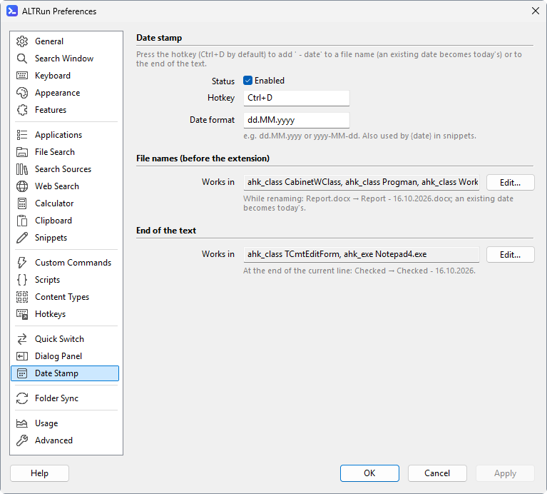

[English](Date-Stamp) · **中文**

# 一键加日期

重命名文件或写备注时按一个热键就加上今天的日期: `Report.docx` → `Report - 23.09.2026.docx`。图纸、报告、报价单在不同日期发出好几版时很方便。默认热键是 `Ctrl+D`, 在 偏好设置 → 一键加日期 里修改。

## 重命名文件
在编辑文件名时按热键 (资源管理器里按 `F2`、Total Commander 里按 `Shift+F6`, 桌面和打开 / 保存对话框也可以)。ALTRun 在扩展名前加上 ` - 日期`; 文件名末尾已经有日期时换成今天的, 不会出现两个日期。光标停在日期后面, 照常按 `Enter` 才真正改名。

| 原来的名字 | 按 `Ctrl+D` 后 (2026-09-23) | 原因 |
|---|---|---|
| `Report.docx` | `Report - 23.09.2026.docx` | 加在扩展名前 |
| `Report - 01.09.2026.docx` | `Report - 23.09.2026.docx` | 旧日期更新成今天 |
| `Report-01.09.2026.docx` | `Report - 23.09.2026.docx` | `-` 两边没有空格也认 |
| `项目资料` (文件夹) | `项目资料 - 23.09.2026` | 没有扩展名: 加在最后 |
| `图纸 1. DWG` | `图纸 1. DWG - 23.09.2026` | 扩展名是一个点加 1–4 个字母或数字, 不能全是数字, 也不能有空格 |
| `01.09.2026 报告.docx` | `01.09.2026 报告 - 23.09.2026.docx` | 只认名字末尾的日期 |

只认当前日期格式写的日期: 换了格式后, 旧格式的日期会保留, 再加一个新的。

热键只在焦点在重命名输入框里时起作用; 在文件列表里按 `Ctrl+D` 仍是原程序的操作 (例如资源管理器里是删除)。

## 在文本末尾添加日期
在 "追加" 列表里的窗口中, 按热键会跳到当前行末尾并输入 ` - 日期`: `已审核` 变成 `已审核 - 23.09.2026`。适合 Total Commander 的文件备注 (`Ctrl+Z`) 或文本编辑器里的记录。默认在 Total Commander 的备注窗口 (`ahk_class TCmtEditForm`) 和 Notepad4 里生效。

## 选择在哪里生效

偏好设置 → 一键加日期只有一个 "热键", 两种场景共用; 按下时做哪一种, 由所在的窗口在哪个 "生效的窗口" 列表里决定: 点 **编辑...**, 每行写一个窗口条件, 例如 `ahk_class CabinetWClass` (资源管理器)、`ahk_class TTOTAL_CMD` (Total Commander)、`ahk_exe notepad++.exe`。窗口的类名或程序名可以用 AutoHotkey 自带的 Window Spy 查, 程序名也可以在任务管理器里看。

| 列表 | 默认 |
|---|---|
| 重命名 (`RenameWindows`) | 资源管理器和桌面 (`CabinetWClass`、`Progman`、`WorkerW`)、打开 / 保存对话框 (`#32770`)、Total Commander 主窗口及其重命名和复制对话框 (`TTOTAL_CMD`、`TSTDTREEDLG`、`TCOMBOINPUT`) |
| 追加 (`AppendWindows`) | Total Commander 备注窗口 (`TCmtEditForm`)、Notepad4 (`ahk_exe Notepad4.exe`) |

如果你用的某个对话框自己要用 `Ctrl+D`, 见 [常见问题](FAQ-zh#用-altgr-打的字符-或对话框里的-ctrld-变成了别的功能)。

## 日期格式
格式用 [AutoHotkey FormatTime](https://www.autohotkey.com/docs/v2/lib/FormatTime.htm) 的字母写, 文字片段的 `{date}` 占位符也用它 (见 [文字片段](Snippets-zh)):

| 格式 | 2026 年 9 月 23 日 |
|---|---|
| `dd.MM.yyyy` (默认) | `23.09.2026` |
| `yyyy-MM-dd` | `2026-09-23` (在文件列表里按名字排序就是按日期) |
| `yyyyMMdd` | `20260923` |
| `yyyy年M月d日` | `2026年9月23日` |

格式里不要用 `/` 和 `:`: 文件名里不能有这两个字符。

## 设置
保存在 `Extensions.AutoDate`:

| 设置 | 默认值 | 作用 |
|---|---|---|
| `Enabled` | `1` | 是否启用一键加日期 |
| `Hotkey` | `^d` (`Ctrl+D`) | 热键, 重命名和追加日期共用 (设置版本 6 以前叫 `RenameHotkey`) |
| `RenameWindows` | 见上 | 允许重命名操作生效的窗口 (窗口条件列表) |
| `AppendWindows` | 见上 | 允许文本追加操作生效的窗口 (窗口条件列表) |
| `DateFormat` | `dd.MM.yyyy` | 日期格式, 也用于文字片段的 `{date}` 占位符 |
