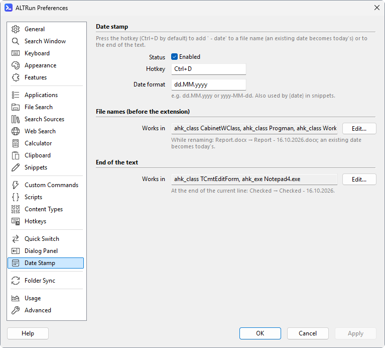

**English** · [中文](Date-Stamp-zh)

# Date Stamp

One hotkey adds today's date while you rename a file or type a note: `Report.docx` → `Report - 23.09.2026.docx`. Handy for versions of drawings, reports and quotations that are sent out on different days. The default hotkey is `Ctrl+D`; change it in Preferences → Date Stamp.

## Renaming files
Press the hotkey while the file name is being edited (`F2` in File Explorer, `Shift+F6` in Total Commander, on the desktop or in an Open / Save dialog). ALTRun puts ` - date` before the extension; a date that is already at the end of the name is replaced by today's, so the name never gets two dates. The cursor ends up after the date, and nothing is renamed until you press `Enter` as usual.

| The name before | After `Ctrl+D` (on 23.09.2026) | Why |
|---|---|---|
| `Report.docx` | `Report - 23.09.2026.docx` | Added before the extension |
| `Report - 01.09.2026.docx` | `Report - 23.09.2026.docx` | The old date is updated |
| `Report-01.09.2026.docx` | `Report - 23.09.2026.docx` | Also with no spaces around the `-` |
| `Project files` (a folder) | `Project files - 23.09.2026` | No extension: added at the end |
| `Drawing 1. DWG` | `Drawing 1. DWG - 23.09.2026` | An extension is a dot and 1–4 letters or digits, not all digits, and no space |
| `01.09.2026 Report.docx` | `01.09.2026 Report - 23.09.2026.docx` | Only a date at the end of the name counts |

Only a date written in the current date format is recognized: after changing the format, older dates in the other format are kept and a new one is added.

The hotkey only acts while the focus is in the rename box; in a file list, `Ctrl+D` still does what the program does with it (Delete in File Explorer, for example).

## Appending a date to text
In the windows of the "Append" list, the hotkey goes to the end of the current line and types ` - date`: `Checked` becomes `Checked - 23.09.2026`. Useful for Total Commander's file comments (`Ctrl+Z`) or a log in a text editor. By default this is on in Total Commander's comment window (`ahk_class TCmtEditForm`) and in Notepad4.

## Choosing where it works

Preferences → Date Stamp has one **Hotkey** for both actions; which one runs depends on the window you are in, set in the **Works in** list of each action: click **Edit...** and enter one window condition per line, for example `ahk_class CabinetWClass` (File Explorer), `ahk_class TTOTAL_CMD` (Total Commander) or `ahk_exe notepad++.exe`. To find a window's class or program, use Window Spy, which comes with AutoHotkey, or the program name in Task Manager.

| List | By default |
|---|---|
| Rename (`RenameWindows`) | File Explorer and the desktop (`CabinetWClass`, `Progman`, `WorkerW`), Open / Save dialogs (`#32770`), Total Commander's main window and its rename and copy dialogs (`TTOTAL_CMD`, `TSTDTREEDLG`, `TCOMBOINPUT`) |
| Append (`AppendWindows`) | Total Commander's comment window (`TCmtEditForm`), Notepad4 (`ahk_exe Notepad4.exe`) |

If a dialog you use needs `Ctrl+D` itself, see the [FAQ](FAQ#a-character-typed-with-altgr-or-ctrld-in-a-dialog-does-something-else).

## Date format
The format is written with [AutoHotkey FormatTime](https://www.autohotkey.com/docs/v2/lib/FormatTime.htm) letters and is also used by the `{date}` placeholder of [snippets](Snippets):

| Format | 23 September 2026 |
|---|---|
| `dd.MM.yyyy` (default) | `23.09.2026` |
| `yyyy-MM-dd` | `2026-09-23` (sorts by date in a file list) |
| `yyyyMMdd` | `20260923` |
| `d MMM yyyy` | `23 Sep 2026` |

Avoid `/` and `:` in the format: they aren't allowed in file names.

## Settings
Stored under `Extensions.AutoDate`:

| Setting | Default | Purpose |
|---|---|---|
| `Enabled` | `1` | Whether Date Stamp is enabled |
| `Hotkey` | `^d` (`Ctrl+D`) | The hotkey, for both renaming and appending (`RenameHotkey` before settings version 6) |
| `RenameWindows` | see above | Windows where renaming is enabled (a list of window conditions) |
| `AppendWindows` | see above | Windows where appending a date is enabled (a list of window conditions) |
| `DateFormat` | `dd.MM.yyyy` | Date format, also used by the snippet `{date}` placeholder |
