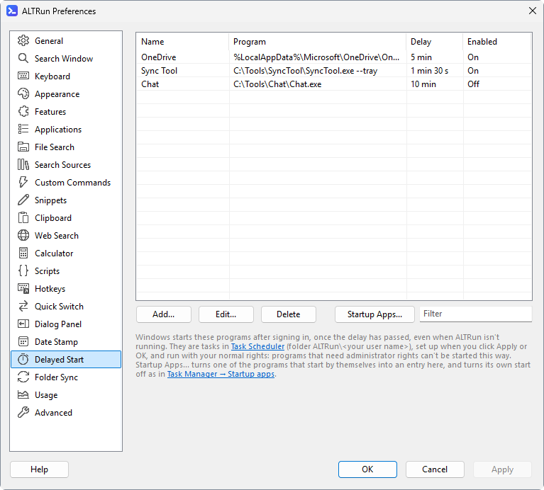

[English](Delayed-Start) · **中文**

# 延迟启动

偏好设置 → 延迟启动：登录 Windows 一段时间后再启动程序。不需要马上用的程序 (OneDrive、同步工具、聊天软件) 晚几分钟启动，桌面就能更快可用。

| 字段 | 示例 | 说明 |
|---|---|---|
| 名称 | `OneDrive` | 显示在列表里，也是任务计划程序里的任务名 |
| 程序 | `%LocalAppData%\Microsoft\OneDrive\OneDrive.exe` | 要启动的程序或脚本。可以用环境变量、`A_AppData` 这类 `A_` 文件夹、相对 ALTRun 文件夹的路径和 `PATH` 里的程序名 (`notepad.exe`) |
| 参数 | `/background` | 可选 |
| 延迟 (秒) | `300` | 登录后多少秒启动；`300` = 5 分钟，`0` = 立即 |
| 登录后启动 | 勾选 | 取消勾选可以保留这一项但不启动 |

点 **应用** 或 **确定** 后设置生效。



## 工作方式
- 每一项是 Windows 任务计划程序里的一个任务 (页面上的 **任务计划程序** 按钮可以打开它)，放在文件夹 `ALTRun\<你的用户名>` 里，在你登录时、过了延迟时间后启动。程序由 Windows 启动，所以 ALTRun 没有运行也会启动，延迟从登录开始算。
- 任务在你的会话里用你的普通权限运行，和你自己启动程序一样，不保存密码。需要管理员权限的程序不能这样启动。
- 和任务计划程序的默认设置不同，这些任务用电池时也会启动、拔掉电源不会停止、没有运行时间限制，并以正常优先级运行。
- 这个文件夹归 ALTRun 管：ALTRun 会让它和列表一致，在任务计划程序里对这些任务的修改会被替换。列表清空后文件夹会被删除。
- 列表不为空时，ALTRun 启动 30 秒后会检查这些任务：在另一台电脑上用同一个设置文件 (例如放在 OneDrive 里) 时，那台电脑也会按它自己的路径设置好任务。
- 电脑上的每个用户有自己的任务，看不到其他用户的任务。

## 自己会自启动的程序
很多程序登录时会自己启动 (OneDrive、Teams 等)，这样它会立即启动，不会等延迟时间。添加这样的程序时，ALTRun 会提示它从哪里启动 (`Run: OneDrive`、`Startup: Teams.lnk`)；请在 任务管理器 → 启动应用 或程序自己的设置里关掉它的自启动。

示例，5 分钟后启动 OneDrive：
1. 在 OneDrive 的设置里关掉 "登录 Windows 时自动启动 OneDrive" (或在 任务管理器 → 启动应用 里禁用 OneDrive)。
2. 添加一项：程序 `%LocalAppData%\Microsoft\OneDrive\OneDrive.exe`，参数 `/background` (启动时不打开 OneDrive 窗口)，延迟 `300`。

## 设置文件里的写法
```jsonc
"DelayedStart": [
  { "Name": "OneDrive", "Target": "%LocalAppData%\\Microsoft\\OneDrive\\OneDrive.exe", "Arguments": "/background", "Delay": 300, "Enabled": 1 }
]
```
