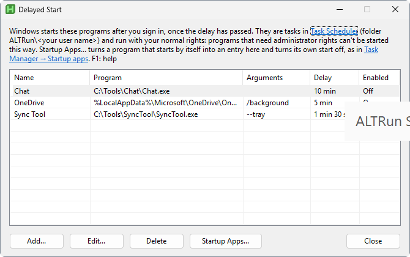
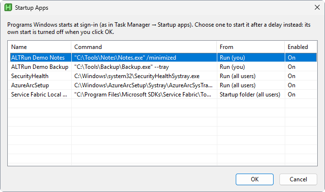

[English](Delayed-Start) · **中文**

# 延迟启动

登录 Windows 一段时间后再启动程序。不需要马上用的程序 (OneDrive、同步工具、聊天软件) 晚几分钟启动，桌面就能更快可用。

延迟启动是[脚本库](https://zhugecaomao.github.io/ALTRun/#scripts)里的一个[脚本](Scripts-zh)：把 `Delayed Start.ahk` 下载到 `Scripts\` 文件夹，在搜索窗口输入 `delayedstart` 就能打开。不用装 AutoHotkey，由 ALTRun 运行 (不经过 ALTRun 直接运行要装 AutoHotkey v2)。中文 Windows (简体) 上窗口是中文，其他是英文。按 `F1` 打开这一页。

2026.11.16.23 及以前的版本里它是 ALTRun 内置的 (偏好设置 → 延迟启动)。那里建好的任务照常运行，脚本窗口里原样列出，不用迁移。脚本不再做的一件事：以前 ALTRun 启动 30 秒后会按列表补齐任务，所以多台电脑共用一个设置文件 (例如放在 OneDrive) 时，另一台电脑也会自动建好任务；用脚本时，要在每台电脑上运行一次脚本，在那里添加。

**添加...** / **编辑...** (或双击) 打开编辑窗口；**删除** (或按 `Delete` 键) 删除选中的项目。点确定时就在任务计划程序里改好。

| 字段 | 示例 | 说明 |
|---|---|---|
| 名称 | `OneDrive` | 显示在列表里，也是任务计划程序里的任务名 |
| 程序 | `%LocalAppData%\Microsoft\OneDrive\OneDrive.exe` | 要启动的程序或脚本。可以用环境变量和 `PATH` 里的程序名 (`notepad.exe`)；相对路径从脚本所在文件夹算起 |
| 参数 | `/background` | 可选 |
| 延迟 (秒) | `300` | 登录后多少秒启动；`300` = 5 分钟，`0` = 立即 |
| 登录后启动 | 勾选 | 不勾选可以保留这一项但不启动 |

## 工作方式
- 每一项是 Windows 任务计划程序里的一个任务 (窗口里的 "任务计划程序" 链接可以打开)，在文件夹 `ALTRun\<你的用户名>` 里，在你登录时、过了延迟时间启动。程序由 Windows 启动，所以 ALTRun 和脚本都不用在运行，延迟从登录时算起。
- 任务就是列表：脚本不另存任何东西，窗口列出这个文件夹里的任务；列表清空时删除这个文件夹。
- 任务在你的会话里用你的普通权限运行，和你自己启动程序一样，不保存密码。需要管理员权限的程序不能这样启动。
- 和任务计划程序的默认值不同：用电池时也启动、拔掉电源不停止、没有运行时间限制、普通优先级。
- 这台电脑的每个用户有自己的任务，看不到别的用户的任务。

## 自己会启动的程序
很多程序登录时会自己启动 (OneDrive、Teams…)，就是任务管理器 → 启动应用 里列出的那些。这样的程序会立即启动，不会等延迟时间。两种办法把它改成延迟启动：

- 点 **启动项...**：列出 Windows 登录时启动的程序 (Run 注册表项和启动文件夹，已经禁用的也列出)，已经在列表里的除外。选一个，编辑窗口打开时已填好名称、程序、参数，延迟 5 分钟。
- 手动添加的程序如果自己也会启动：脚本会说出它从哪里启动，并问要不要关掉。

点确定时，脚本先设置好延迟启动的任务，再像任务管理器那样 (启动应用 → 禁用) 关掉程序自己的启动：不删除任何东西，可以在任务管理器里重新打开。如果任务没能设置好，程序自己的启动保持不变，仍会启动。删除一项时，如果它的程序自己的启动是关着的，会问要不要让它重新自己启动。

为**所有用户**启动的程序 (所有用户的 Run、所有用户的启动文件夹) 需要管理员权限才能关掉：脚本设置好延迟启动的任务后，会问要不要打开 任务管理器 → 启动应用，在那里禁用。登录时启动的商店应用 (打包应用的启动任务) 不列出。

例子，OneDrive 登录 5 分钟后启动：点 **启动项...**，选 OneDrive，确认参数是 `/background` (启动时不打开 OneDrive 窗口)、延迟是 `300`，点确定。

## 不再使用
在脚本窗口里删除所有项目：任务计划程序里的任务和文件夹都会删除；对自己的启动被关掉的程序，会问要不要让它重新自己启动。然后删除脚本。(手动：在任务计划程序里删除 `ALTRun` 文件夹，在 任务管理器 → 启动应用 里重新打开那些程序。)
