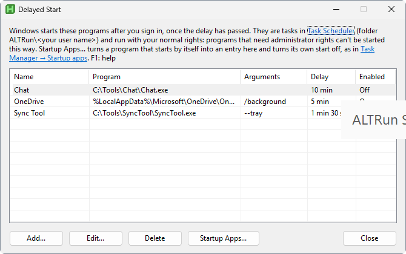
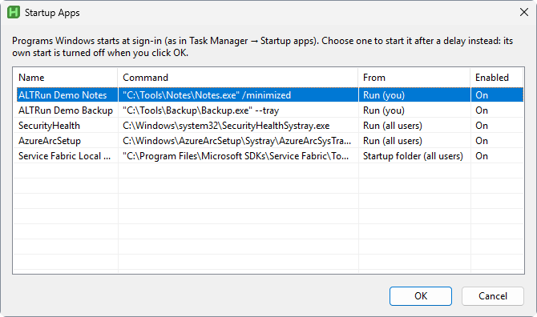

**English** · [中文](Delayed-Start-zh)

# Delayed Start

Start programs a while after you sign in to Windows. Programs that don't need to be there at once (OneDrive, sync tools, chat apps) then wait a few minutes, and the desktop is ready sooner.

Delayed Start is a [script](Scripts) in the [script library](https://zhugecaomao.github.io/ALTRun/#scripts): download `Delayed Start.ahk` into the `Scripts\` folder, then type `delayedstart` in the search window. No AutoHotkey installation is needed: ALTRun runs it (to run it without ALTRun, install AutoHotkey v2). The window is in English, or in Simplified Chinese on a Chinese Windows. `F1` opens this page.

Until version 2026.11.16.23 it was built into ALTRun (Preferences → Delayed Start). The tasks set up there keep working and are listed in the script's window as they are; there is nothing to move. What the script doesn't do: ALTRun used to set the tasks up again 30 seconds after it started, so with the same settings file on another PC (for example in OneDrive) the tasks appeared there too. With the script, run it once on each PC and add the entries there.

**Add...** / **Edit...** (or double-click) opens the edit window; **Delete** (or the `Delete` key) removes the selected entry. Each change is made in Task Scheduler when you click OK.

| Field | Example | Description |
|---|---|---|
| Name | `OneDrive` | Shown in the list; also the name of the task in Task Scheduler |
| Program | `%LocalAppData%\Microsoft\OneDrive\OneDrive.exe` | The program or script to start. Environment variables and program names in `PATH` (`notepad.exe`) work; a relative path is taken from the script's folder |
| Arguments | `/background` | Optional |
| Delay (seconds) | `300` | Seconds after signing in; `300` = 5 minutes, `0` = at once |
| Start it after signing in | ticked | Untick to keep the entry without starting it |

## How it works
- Each entry is a task in Windows Task Scheduler (the Task Scheduler link in the window opens it), in the folder `ALTRun\<your user name>`, which starts when you sign in, after the delay. Windows starts the programs, so neither ALTRun nor the script has to be running, and the delay counts from signing in.
- The tasks are the list: the script saves nothing else. Its window lists the tasks in that folder; an empty list deletes the folder.
- The tasks run in your session with your normal rights, like programs you start yourself. No password is stored. Programs that need administrator rights can't be started this way.
- Unlike Task Scheduler's defaults, the tasks also start on battery, keep running when you unplug, have no time limit and run at normal priority.
- Each user of the PC has their own tasks; other users' tasks can't be seen.

## Programs that start by themselves
Many programs start by themselves at sign-in (OneDrive, Teams...), as listed in Task Manager → Startup apps. Such a program would start at once, not after the delay. Two ways to move one to delayed start:

- **Startup Apps...** lists the programs Windows starts at sign-in (the Run keys and the Startup folders, also those already turned off), except those already in the list. Choose one: the edit window opens with its name, program and arguments filled in and a delay of 5 minutes.
- Adding a program by hand that also starts by itself: the script says where it starts from and offers to turn that off.

When you click OK, the script first sets up the delayed start task and then turns the program's own start off the same way Task Manager does (Startup apps → Disable): nothing is deleted, and you can turn it on again in Task Manager. If the task can't be set up, the program's own start is left as it is, so it still starts. Deleting an entry whose program has its own start turned off asks whether to let it start by itself again.

Programs started for **all users** (Run for all users, the all-users Startup folder) need administrator rights to turn off: the script sets up the delayed start task, then offers to open Task Manager → Startup apps so you can turn them off there. Store apps that start at sign-in (startup tasks of packaged apps) aren't listed.

Example, OneDrive after 5 minutes: click **Startup Apps...**, choose OneDrive, check the arguments are `/background` (starts without opening the OneDrive window) and the delay `300`, then click OK.

## Removing it
Delete every entry in the script's window: the tasks and the folder in Task Scheduler are deleted, and for each program whose own start is turned off you are asked whether to let it start by itself again. Then delete the script. (By hand: delete the `ALTRun` folder in Task Scheduler and turn the programs on again in Task Manager → Startup apps.)
