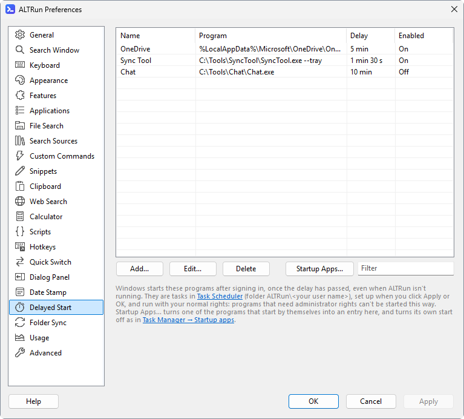

**English** · [中文](Delayed-Start-zh)

# Delayed Start

Preferences → Delayed Start: start programs a while after you sign in to Windows. Programs that don't need to be there at once (OneDrive, sync tools, chat apps) then wait a few minutes, and the desktop is ready sooner.

| Field | Example | Description |
|---|---|---|
| Name | `OneDrive` | Shown in the list; also the name of the task in Task Scheduler |
| Program | `%LocalAppData%\Microsoft\OneDrive\OneDrive.exe` | The program or script to start. Environment variables, `A_` folders such as `A_AppData`, paths relative to the ALTRun folder and program names in `PATH` (`notepad.exe`) work |
| Arguments | `/background` | Optional |
| Delay (seconds) | `300` | Seconds after signing in; `300` = 5 minutes, `0` = at once |
| Start it after signing in | ticked | Untick to keep the entry without starting it |

Click **Apply** or **OK** to set the programs up.



## How it works
- Each entry becomes a task in Windows Task Scheduler (the Task Scheduler link below the list opens it), in the folder `ALTRun\<your user name>`, which starts when you sign in, after the delay. Windows starts the programs, so they start even when ALTRun isn't running, and the delay counts from signing in.
- The tasks run in your session with your normal rights, like programs you start yourself. No password is stored. Programs that need administrator rights can't be started this way.
- Unlike Task Scheduler's defaults, the tasks also start on battery, keep running when you unplug, have no time limit and run at normal priority.
- The folder belongs to ALTRun: ALTRun makes it match the list, so changes made to these tasks in Task Scheduler are replaced. An empty list deletes the folder.
- ALTRun checks the tasks 30 seconds after it starts, when the list isn't empty: with the same settings file on another PC (for example in OneDrive), the tasks are set up there too, with that PC's paths.
- Each user of the PC has their own tasks; other users' tasks can't be seen.

## Programs that start by themselves
Many programs start by themselves at sign-in (OneDrive, Teams...), as listed in Task Manager → Startup apps. Such a program would start at once, not after the delay. Two ways to move one to delayed start:

- **Startup Apps...** on the page lists the programs Windows starts at sign-in (the Run keys and the Startup folders, also those already turned off). Choose one: the edit dialog opens with its name, program and arguments filled in and a delay of 5 minutes.
- Adding a program by hand that also starts by itself: ALTRun says where it starts from and offers to turn that off.

When you click **Apply** or **OK**, ALTRun first sets up the delayed start task and then turns the program's own start off the same way Task Manager does (Startup apps → Disable): nothing is deleted, and you can turn it on again in Task Manager. If a task can't be set up, the program's own start is left as it is, so it still starts. Removing such an entry later asks whether to let the program start by itself again.

Programs started for **all users** (Run for all users, the all-users Startup folder) need administrator rights to turn off: ALTRun sets up the delayed start task, then offers to open Task Manager → Startup apps so you can turn them off there. Store apps that start at sign-in (startup tasks of packaged apps) aren't listed.

Example, OneDrive after 5 minutes: click **Startup Apps...**, choose OneDrive, check the arguments are `/background` (starts without opening the OneDrive window) and the delay `300`, then click OK and Apply.

## In the settings file
```jsonc
"DelayedStart": [
  { "Name": "OneDrive", "Target": "%LocalAppData%\\Microsoft\\OneDrive\\OneDrive.exe", "Arguments": "/background", "Delay": 300, "Enabled": 1, "Source": "HKCU|OneDrive" }
]
```
`Source` (only for entries made from a startup app) says which one: `HKCU` / `HKLM` / `HKLM32` (Run for you / for all users / for all users, 32-bit) or `User` / `Common` (the Startup folder for you / for all users), then its name.
