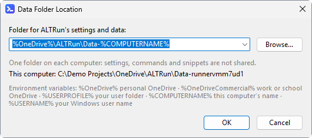

**English** · [中文](FAQ-zh)

# FAQ

### Nothing happens when I press Alt+Space
- Make sure the ALTRun icon is in the notification area (if not, run it again)
- Another program (an input method, PowerToys Run, another launcher) may use the same hotkey. Pick another one in Preferences → General, or set a "Second hotkey". If the other program only uses the right `Alt` (or the left), tick "Tell left and right Ctrl / Alt / Shift / Win apart" there and record the hotkey again with the other side, see [Setting hotkeys](Hotkeys#setting-hotkeys)
- Programs running as administrator don't pass hotkeys to an ALTRun running with normal rights. Run ALTRun as administrator if you need that

### A character typed with AltGr, or Ctrl+D in a dialog, does something else
- On keyboard layouts with an `AltGr` key (German, French, Polish and others), Windows sends `AltGr` as `Ctrl+Alt`, so ALTRun's default `Ctrl+Alt` hotkeys (`Ctrl+Alt+C` clipboard history, `Ctrl+Alt+\` selection actions, and those on the Hotkeys page such as `Ctrl+Alt+F` / `R` / `D`) catch the characters typed with `AltGr` and the same key. Change or clear them on the Clipboard, Selection and Hotkeys pages of Preferences; or tick "Tell left and right Ctrl / Alt / Shift / Win apart" (General) and record them with the left `Ctrl` and the left `Alt`: `AltGr` is the right `Alt`, so it no longer triggers them
- The date stamp hotkey `Ctrl+D` works in File Explorer, on the desktop, in Total Commander and in every standard dialog (Open, Save as...). A dialog that uses `Ctrl+D` itself loses it: pick another key on the Date Stamp page of Preferences, or take that window out of "Works in" there, see [Date stamp](Date-Stamp)

### A program can't be found
1. Make sure its shortcut is in the Start menu or on the desktop (or add its folder to Preferences → Applications → Folders)
2. Check whether its name is filtered out by "Exclude (regex)", or whether it's in the "Hidden apps" list
3. Search `rebuild` and run "Rebuild ALTRun Index"

Simpler: add it as a [custom command](Custom-Commands), optionally with a keyword.

### Files can't be found
Normal searches don't show files by default. Press `Space` in an empty search box first (or use `'report` / `open report`) to start a file search. Without Everything running, ALTRun only looks in Desktop, Documents and Downloads; install and run [Everything](https://www.voidtools.com/) to search all disks. See [File search](File-Search).

### The result I use most isn't first
Pick it a few more times and ALTRun remembers your choice ([learned ranking](Usage#learned-ranking)). You can also add it as a custom command with a short keyword: typing exactly that keyword always puts it first.

### Results include apps I don't want
Select one and press `Ctrl+Del`. The program isn't uninstalled, and you can restore it in Preferences → Applications → "Hidden apps".

### My antivirus flags it
Programs compiled with AutoHotkey are sometimes reported by mistake. Add the ALTRun folder to your antivirus' trusted list, or install AutoHotkey v2 and run the source `ALTRun.ahk` directly (the code is fully public).

### How do I send a debug log?
1. Preferences → Advanced → Troubleshooting → tick "Write a debug log", click Apply
2. Reproduce the problem
3. Back in Preferences → Advanced, click "Open Log" (or type `log` in the search box and run "Open ALTRun Log"): `%Temp%\ALTRun.log` opens in the default program for `.log` files (Notepad unless you changed it)
4. Copy the lines around the time of the problem into your [issue](https://github.com/zhugecaomao/ALTRun/issues/new/choose), and paste "Copy System Info" with them (versions, Windows version, display scale, language, theme; no file paths). The log never contains what you type in the search box, but it does contain file paths and program names: remove anything private first

### ALTRun is slow or doesn't respond right after Windows starts
Just after Windows starts, Explorer and OneDrive (or another sync tool) are often busy for a while. ALTRun asks Windows for icons and shortcuts, so it has to wait for them too: the search window may open slowly, or ignore typing for a few seconds. It recovers by itself once Windows has settled down. To check, turn on the debug log: lines starting with `Perf: startup:` show how long each startup step took, and `Perf: icon ... ms` lines show icons that took a long time to load. If it happens every time, look in Task Manager at what is using the CPU or disk after startup (OneDrive syncing many files is a common cause).

### Searching is awkward with a Chinese input method
In Preferences → Keyboard, set "Switch to English" to "English (US) keyboard" (the keyboard needs to be added in Windows) or "English mode of the current input method" (keeps your input method and only turns it to English). Chinese names can also be searched by their pinyin initials ("wx" → 微信).

### Snippet expansion doesn't work
- Make sure the snippet has a keyword in Preferences → Snippets and "Expand automatically when typed" is ticked
- Type the prefix: `;keyword` by default
- Some programs (games, Remote Desktop, programs running as administrator) don't receive simulated input

### Caps Lock and other features don't work in windows running as administrator
Windows doesn't let programs with normal rights control windows running as administrator. While such a window is in front, switching the input method with Caps Lock, double-tapping Ctrl, snippet expansion, pasting a result into that window and Quick Switch for its dialogs don't work; showing ALTRun, searching and opening programs work as usual. A hotkey that tells left and right apart (such as `LAlt+Space`) doesn't work there either: Windows' system hotkeys can't tell the sides apart, so it goes through the keyboard hook; the same hotkey without a side (`Alt+Space`) does work.

**Just switching the input method with Caps Lock**: tick "Also in windows running as administrator" in Preferences → Keyboard. Only a small helper that handles Caps Lock runs as administrator; ALTRun itself keeps normal rights, without the side effects below. See [Caps Lock switches the input method](Hotkeys#caps-lock-switches-the-input-method).

If you need the other features often too, run all of ALTRun as administrator:
- **As administrator at sign-in** (no UAC prompt): turn off "Launch ALTRun at login" in Preferences → General, then open Task Scheduler → Create Task:
  - General: tick "Run with highest privileges"
  - Triggers: New → Begin the task "At log on"
  - Actions: New → Start a program, program `ALTRun.exe`, arguments `-Startup`
  - Conditions: untick "Start the task only if the computer is on AC power"
  - Settings: untick "Stop the task if it runs longer than"
- **Just this once**: right-click `ALTRun.exe` → Run as administrator (it replaces the ALTRun that's running)

When ALTRun runs as administrator, the tray icon tooltip and the version in Preferences → Advanced show "(Administrator)". Keep in mind:
- Programs opened from ALTRun run as administrator too: they don't see network drives mapped with normal rights (create the DWORD value `EnableLinkedConnections` = 1 under `HKEY_LOCAL_MACHINE\SOFTWARE\Microsoft\Windows\CurrentVersion\Policies\System` and restart), and dragging files into them from Explorer is refused
- Any program can edit ALTRun's settings file (for example add a custom command), and what you open from ALTRun then runs as administrator. Use normal rights when you don't need this

### I messed up my settings; how do I go back to the defaults?
Preferences → Advanced → "Restore Defaults...": every option goes back to its default, while your custom commands, snippets, hotkeys, web searches and pinned items are kept; the old settings are saved as `Data\ALTRun.json.bak` first (to go back, quit ALTRun and rename it to `ALTRun.json`). To reset only the learned ranking: Preferences → Advanced → Reset Learned Ranking.

### Does ALTRun go online or collect data?
It doesn't collect or upload any data. By default it only goes online to check for updates (shortly after startup and every 6 hours) and for one-key updates, both only to GitHub (with currency conversion on, it also downloads exchange rates from frankfurter.dev when they are over 12 hours old; "Download Site Icon" in a web search's editor visits that site once, only when you click it); a one-key update checks the SHA256 checksum before replacing anything. Clipboard history, usage statistics and the learned ranking stay in the `Data\` folder on your PC. The full list (where each kind of network access goes and how to turn it off, which files are stored locally) is in [Privacy and network access](Privacy).

### How do I upgrade to a new version?
ALTRun checks in the background at startup and every 6 hours after. When there's a new version, open the search window to see "Update Available: ALTRun x" and press `Enter` (or tray icon → Check for Updates); settings and data are kept. With Scoop, use `scoop update altrun`. See [Installation and upgrades](Installation#upgrading).

### Using the same settings on several PCs
Two ways:
- **Sync only the settings and data**: Preferences → Advanced → Settings and data → **Change Location...**, and pick a folder in a synced drive (OneDrive, Dropbox...). Your current settings and data are copied there, and ALTRun reloads and uses that folder. On the other PC, pick the same folder; when it says the folder already has ALTRun settings, choose **Yes** to use them. The dialog lists typical places found on this PC (`%OneDrive%\ALTRun\Data`, `%OneDriveCommercial%\ALTRun\Data` for a work or school OneDrive, `%USERPROFILE%\Dropbox\ALTRun\Data`...); you can also type a folder or use **Browse...**. Environment variables are kept as you write them, so the same entry works on PCs where the OneDrive path differs, and the dialog shows where the folder is on this PC. The location is kept in `"DataLocation"` in `Data\ALTRun.json` at the default location; pick the default (the last entry in the list) to go back
- **Keep the whole folder on a USB stick or a synced drive**: ALTRun is portable, so the program and `Data\` travel together

**A separate folder on each PC** (for example a work PC and a home PC that should not share commands): add `%COMPUTERNAME%` to the folder, for example `%OneDrive%\ALTRun\Data-%COMPUTERNAME%`. Each PC then uses its own folder (`Data-WORK-PC`, `Data-HOME-PC`), still backed up by OneDrive; settings, commands and snippets are not shared. In the same way `%USERNAME%` gives each Windows user their own folder (only needed when several users share a portable copy: the installed version already keeps each user's data in their own `%APPDATA%`). If ALTRun itself is in OneDrive, both PCs read the same default `Data\ALTRun.json`, so the entry must have `%COMPUTERNAME%` in it: a plain full path would send both PCs to the same folder. If a variable doesn't exist on a PC (no OneDrive there), ALTRun uses the default folder on that PC and says so in Preferences → Advanced.

Avoid running ALTRun and changing settings on two PCs at the same time with data in a synced folder, or the sync service may create conflicting copies. Keep ALTRun at the same version on those PCs: when one was updated first and the settings format changed, the older ALTRun says the settings were saved by a newer version; it keeps the newer settings in the file but can't use them until it is updated too. Use [path variables](Custom-Commands#variables-in-paths) (for example `A_Desktop`, `%OneDrive%`) where you can, so paths work on every PC.

### Does clipboard history travel with the Data folder?
Not by default: the clipboard history is kept on this PC only (`%LOCALAPPDATA%\ALTRun`), so it doesn't go along when you copy the folder to a USB stick or keep it in a synced drive. To take the text history along, set Preferences → Clipboard → "Save in" to "Images and long items on this PC only" (text history in `Data\ClipboardHistory.json`), or to "The Data folder" for everything (see `LocalFiles` in [Clipboard settings](Configuration#clipboard)). Settings files from before 2026.11.09 keep the text history in the Data folder. To keep no history on disk at all, set `Persist` to 0: it stays in memory and is gone when ALTRun quits. Programs listed in `IgnoreApps` (password managers by default), and content that apps mark as private, are never recorded.

### My commands are gone after upgrading from 2.x
User commands from 2.x are imported from `ALTRun.ini` as custom commands, and the built-in commands are replaced by [system commands](System-Commands#system-commands). The import happens only once, when there's no `ALTRun.json` yet: to import again, quit ALTRun, rename `Data\ALTRun.json` and run it again. `ALTRun.ini` is never changed; see [Installation and upgrades](Installation#upgrading-from-2x-v20260812-and-earlier-to-30).

---
Didn't find an answer? [Open an issue](https://github.com/zhugecaomao/ALTRun/issues/new/choose) or ask in [Discussions](https://github.com/zhugecaomao/ALTRun/discussions).
