[English](Features) · **中文**

# 功能一览

ALTRun 的全部功能, 每个配一张截图, 一两句话说明, 细节和设置见 "详情" 链接的页面。按 `?` 可以在程序里查看全部输入语法和快捷键。

## 搜索

### 搜索窗口
按 `Alt+Space` (或 `Alt+R`), 输入几个字母, 按 `Enter`。输入即出结果, 每条有标题和路径; 状态栏写着 `Enter` 和 `→` 会做什么。[详情](Usage-zh#搜索窗口)

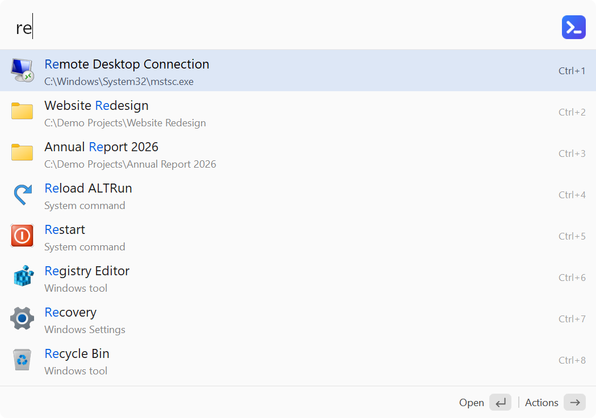

### 匹配和学习排序
匹配连续字母、单词首字母 (`vsc` → Visual Studio Code) 和拼音首字母 (`jsb` → 记事本), 并高亮匹配的部分。ALTRun 记住每次输入后选了哪一项, 下次排在最前。[详情](Usage-zh#怎样匹配)

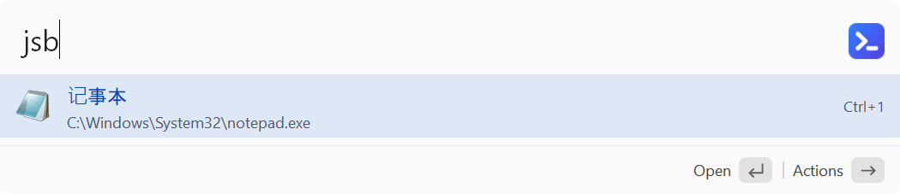

### 应用
自动收录开始菜单、桌面和 Microsoft Store 应用, 新装的程序几秒后就能搜到。不想要的按 `Ctrl+Del` 隐藏。[详情](Usage-zh#应用索引自动更新)

### 文件和文件夹
`空格` + 名称 (或 `'名称`) 搜文件: 开着 Everything 时毫秒级搜遍全盘, 否则用内置索引。`doc report`、`pdf 发票`、`folder 名称` 限定类型; `recent 报告` 搜你在任何程序里最近打开的文件。[详情](File-Search-zh)

### 浏览文件夹
输入路径, 例如 `D:\Projects\`: `Tab` 进入文件夹, `Backspace` 返回上一级, 打字筛选。[详情](File-Search-zh#浏览文件夹)

### 置顶和最近使用
还没输入时, 列出你置顶的项目, 也可以列出最近打开的项目。[详情](Recent-zh)

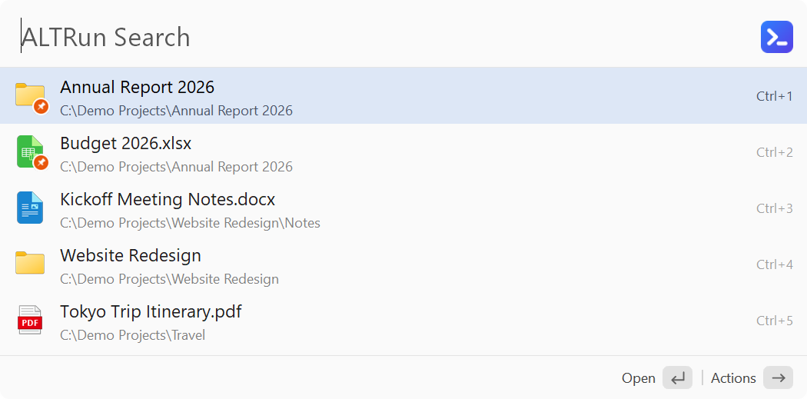

### 网页搜索
`g 关键词` (Google)、`bd 关键词` (百度) 和自己加的搜索引擎; 一个关键字可以同时打开几个网站; 没有其他结果时提供网页搜索。[详情](Web-Search-zh)

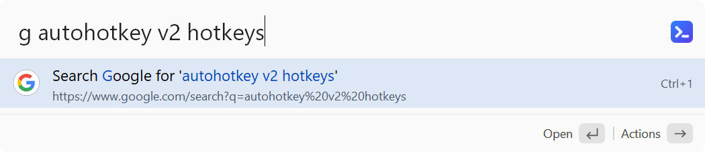

### 书签和浏览器历史
Chrome、Edge、Brave、Vivaldi 的书签出现在结果里 (`bm` 只搜书签); `h 关键词` 搜浏览器历史记录。[详情](Bookmarks-zh)

### 窗口切换
`w` + 标题或程序名切换到已经打开的窗口; `w ` 列出全部窗口。[详情](Window-Switching-zh)

### 计算器
直接输入算式: `12*(3+4)`、`10 km in mi`、`255 in hex`、`today + 30 days`、`100 usd to cny` (货币换算可选)。`Enter` 复制结果; 可以打开计算历史。[详情](Calculator-zh)

### 系统命令和终端
锁屏、睡眠、关机、清空回收站、音量和媒体控制、Windows 工具和 40 多个设置页面; 文字转换; `>ipconfig /all` 在终端里运行命令。[详情](System-Commands-zh)

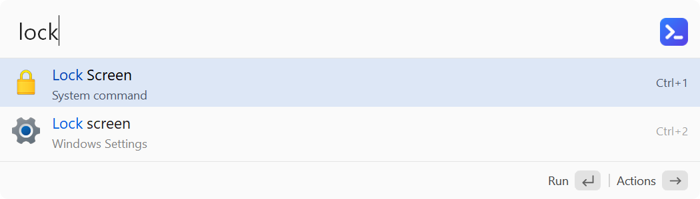

### 速查表
输入 `?` 列出全部输入语法和快捷键; `? 文件` 筛选。[详情](Usage-zh#输入语法)

## 对结果的操作

### 操作面板
选中结果按 `→` (或右键): 用管理员身份运行、打开所在文件夹、复制路径、在这里打开终端、属性... `Ctrl+Enter` 直接打开所在文件夹。[详情](Usage-zh#操作面板)

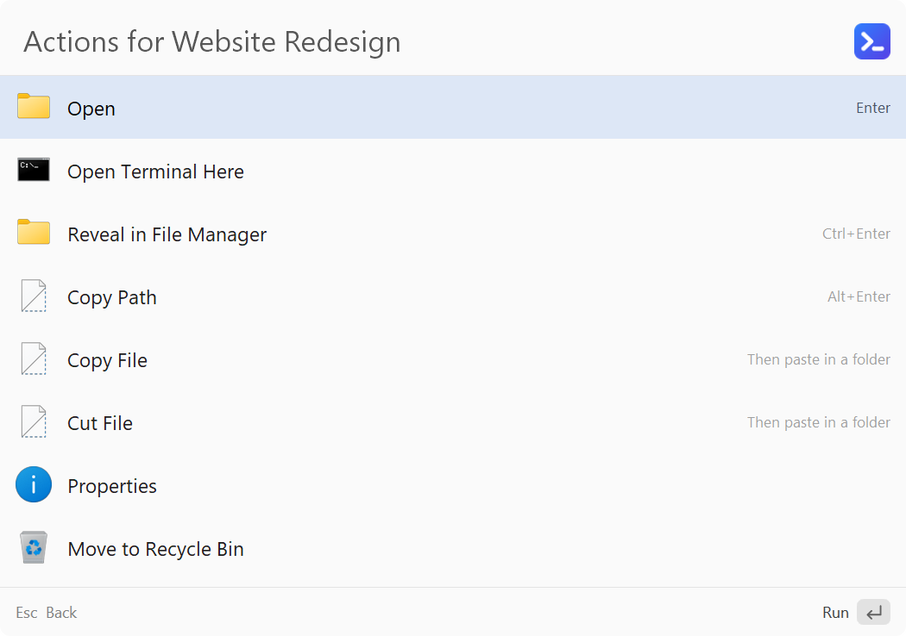

### Windows 右键菜单
打开后, 操作面板也能打开资源管理器的右键菜单, 包括 7-Zip、Git 等程序加的项目 (`Shift+→`)。[详情](Usage-zh#操作面板)

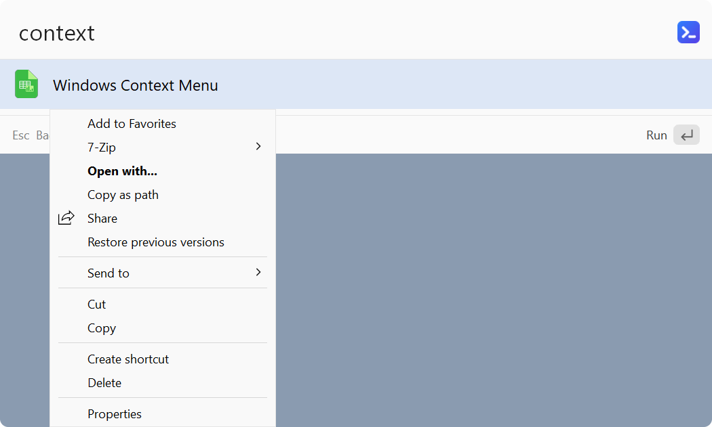

### 直接编辑
`F3` 编辑选中的命令、片段或搜索引擎, 或把应用、文件、网址变成自定义命令; `Ctrl+Del` 删除或隐藏。[详情](Usage-zh#在结果里编辑和删除)

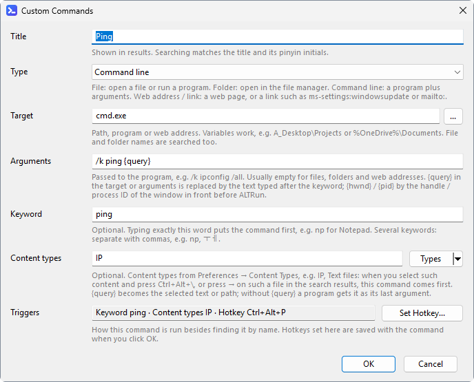

### 大字显示、拖放
`Ctrl+L` 全屏大字显示结果 (电话号码、计算结果); 把文件结果拖到聊天窗口、邮件或文件夹里。[详情](Usage-zh#快捷键)

## 自己的命令和文字

### 自定义命令
文件、文件夹、带参数的程序和网址, 可以设关键字; `{query}` 接收关键字后面输入的内容。在资源管理器里右键 → 发送到 → ALTRun 添加。[详情](Custom-Commands-zh)

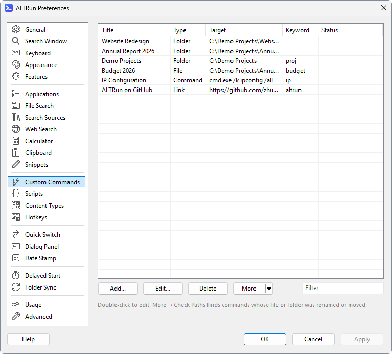

### 内容类型和选中内容的操作
在任何程序里选中文字、文件或网址, 按 `Ctrl+Alt+\`。定义一次某类内容 (订单号、PDF 文件...), 为它设的命令就排在最前, 结果里的文件和复制过的文字也一样。[详情](Content-Types-zh)

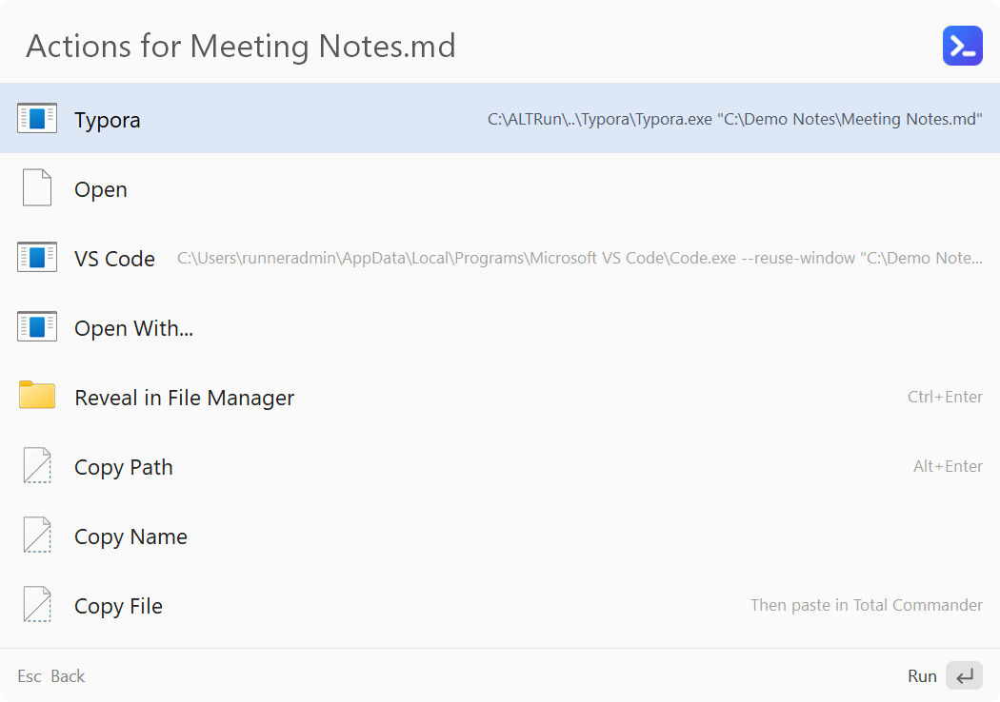

### 文字片段
常用的文字, 带 `{date}`、`{clipboard}`、`{cursor}` 等占位符; 在任何程序里输入 `;关键字` 展开; 可以从 Excel / CSV 导入。[详情](Snippets-zh)

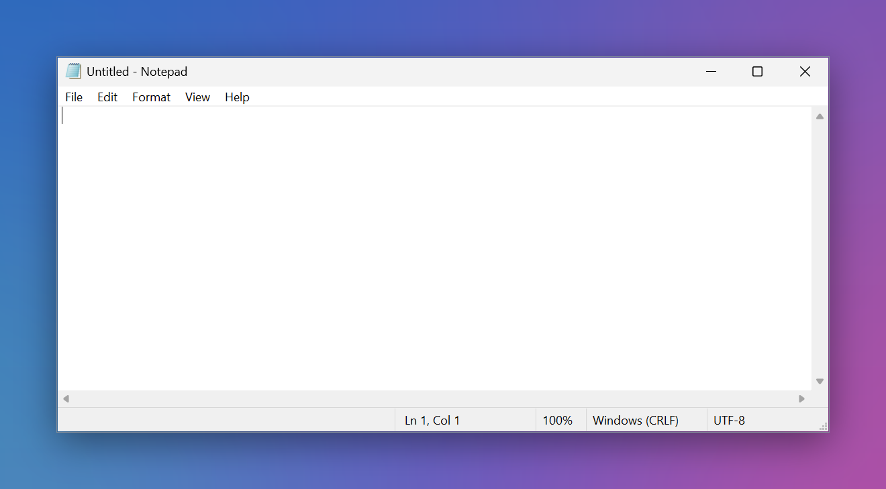

### 剪贴板历史
`Ctrl+Alt+C` 列出复制过的文字、文件和图片; 筛选、粘贴、置顶、纯文本粘贴; 密码管理器复制的内容不记录。[详情](Clipboard-zh)

### 自定义热键
把系统命令、自定义命令或脚本设到热键上, 可以只在某些程序里生效; 或者用 `folder {selection}` 这样的搜索打开 ALTRun。[详情](Hotkeys-zh)

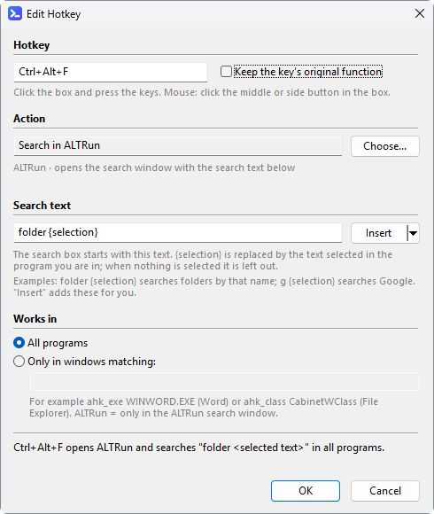

### CapsLock 切换输入法
和 Mac 一样: 短按切换输入法或中 / 英模式, 按住才开关大写。[详情](Hotkeys-zh#capslock-切换输入法)

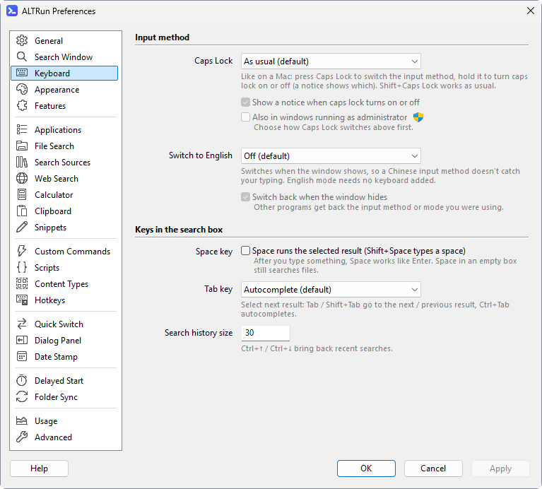

## 对话框和文件管理器

### 对话框快速跳转
在打开 / 保存对话框里按 `Ctrl+G`, 跳到最近用过的文件管理器的文件夹: 资源管理器、Total Commander、Directory Opus 或 Arke。[详情](Quick-Switch-zh)

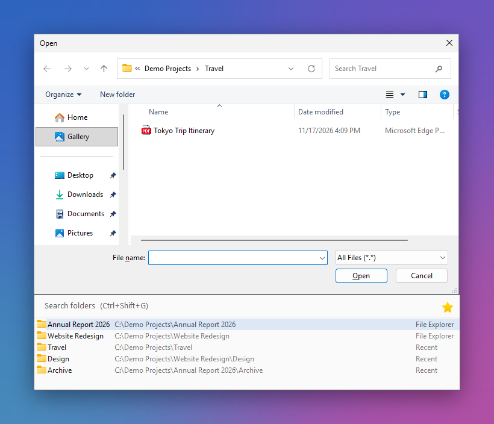

### 对话框文件夹面板
对话框旁边的面板列出所有打开的和最近用过的文件夹, ☆ 菜单里是收藏的文件夹; 可以打字搜索。[详情](Quick-Switch-Panel-zh)

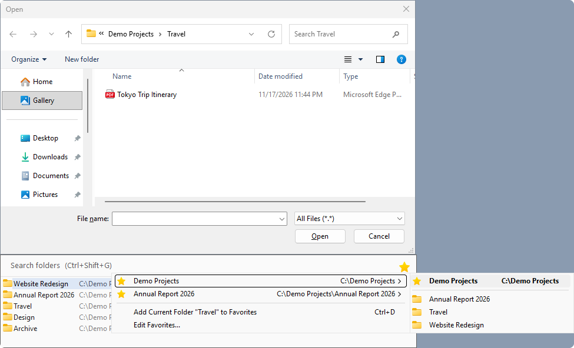

### 文件管理器
文件夹可以改在 Total Commander、Directory Opus 或 Arke 里打开, 也可以开新标签页。[详情](File-Managers-zh)

### 一键加日期
重命名时按 `Ctrl+D` 在扩展名前加上或更新日期: `Report.docx` → `Report - 23.09.2026.docx`。[详情](Date-Stamp-zh)

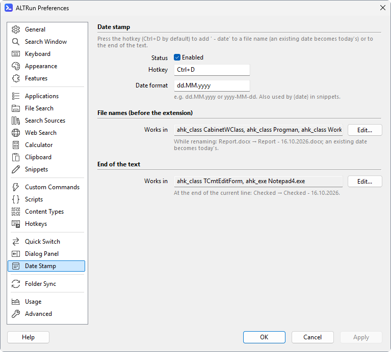

## 脚本和自动化

### 脚本
把 `.ahk`、`.ps1`、`.py` 或 `.bat` 脚本放进 `Scripts\` 文件夹, 在搜索窗口里运行, 可以带参数、在后台运行或显示输出; [脚本库](https://zhugecaomao.github.io/ALTRun/#scripts) 里有现成的。[详情](Scripts-zh)

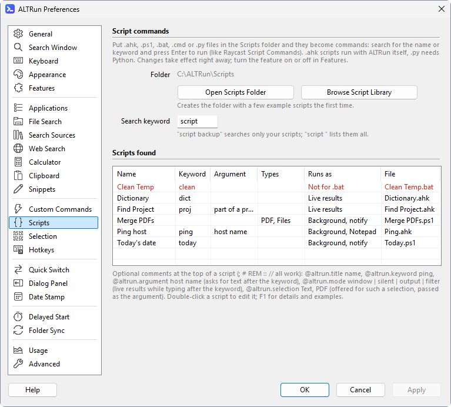

### 脚本实时结果
脚本可以在你打字时列出结果, 和 Alfred 的 Script Filter 一样: 项目、服务器、Total Commander 命令、翻译...[详情](Scripts-zh#实时结果)

### 文件夹同步
用 Windows 自带的 robocopy 让两个文件夹保持一致; 镜像前先预览会删除什么, 同步窗口显示进度。[详情](Sync-Tasks-zh)

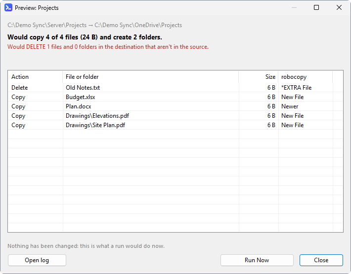

### 延迟启动
登录几分钟后再启动 OneDrive 等程序, 让桌面更快可用 (脚本库里的脚本)。[详情](Delayed-Start-zh)

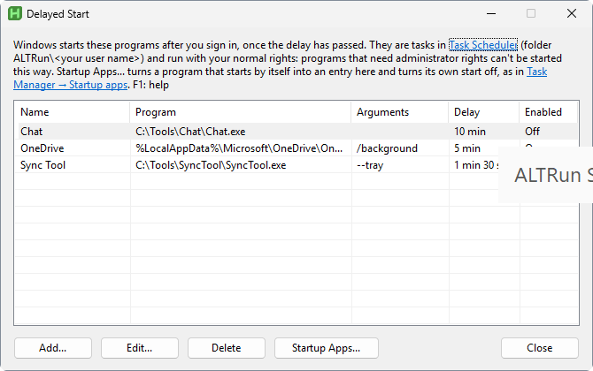

### PT 工具箱
给结构工程师: 钢筋和网片面积、所需钢筋根数、SPF2M 预应力束线型 (脚本库里的两个脚本)。[详情](PT-Tools-zh)

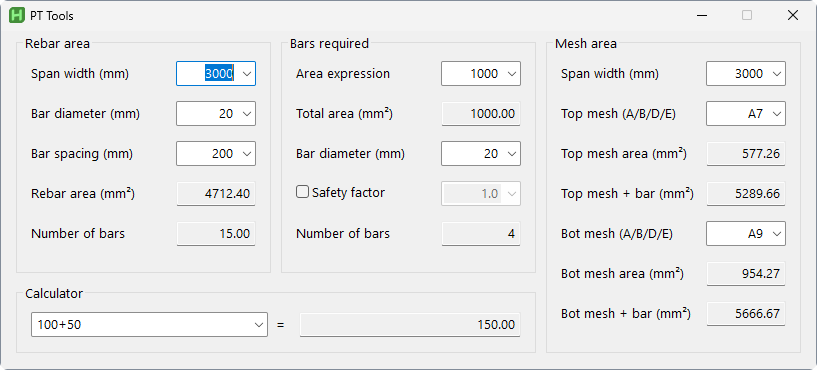

## 外观和设置

### 主题和语言
22 套内置主题, 每套三种密度, 可以跟随 Windows 浅色 / 深色模式, 也可以自己做; 简体中文、繁體中文、English、日本語界面。[详情](Themes-zh)

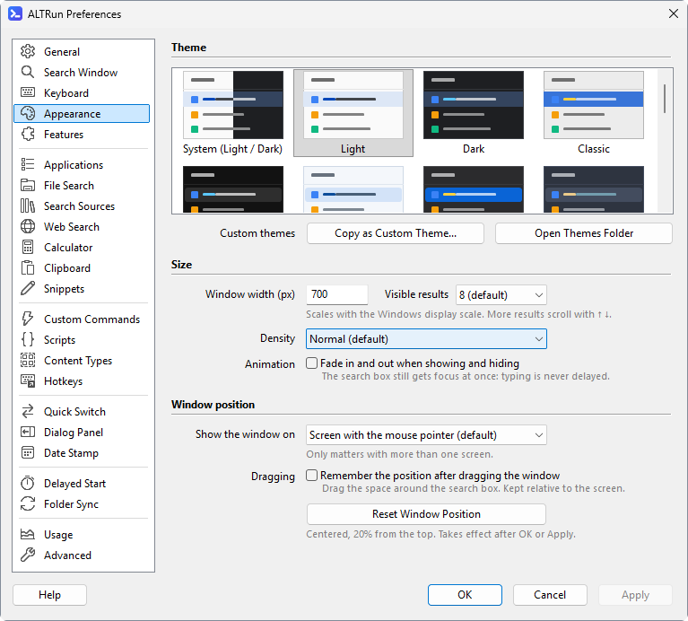

### 偏好设置和设置文件
所有设置都在偏好设置里 (`Ctrl+,`), 每项下面有一行说明, `F1` 打开对应的说明页; 也可以直接改 `ALTRun.json` (`F4`), 保存后自动重新加载。[详情](Configuration-zh)

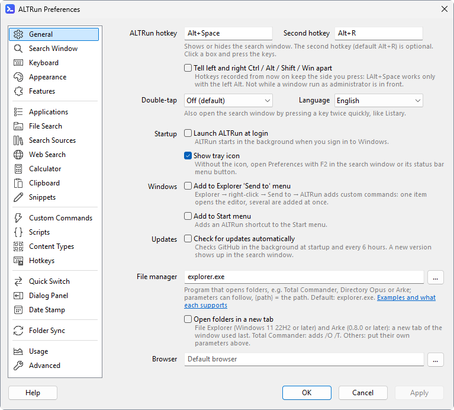

### 使用统计
每天用了每个功能多少次; 只记次数。[详情](Usage-zh#使用统计)

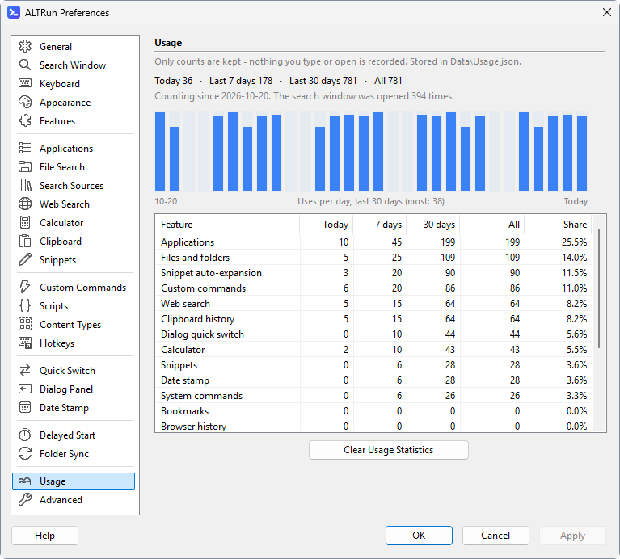

### 更新、便携、隐私
一键更新, 保留设置; 设置和数据在 `Data\` 文件夹 (默认在程序旁边); 不收集遥测数据。[详情](Installation-zh#一键更新)
