**English** · [中文](Features-zh)

# Features

Everything ALTRun does, each with a screenshot and a sentence or two; the "More" link leads to the page with the details and settings. Press `?` in ALTRun for every search syntax and shortcut.

## Search

### Search window
Press `Alt+Space` (or `Alt+R`), type a few letters and press `Enter`. Results appear as you type, with a title and a path for each; the status bar says what `Enter` and `→` will do. [More](Usage#search-window)

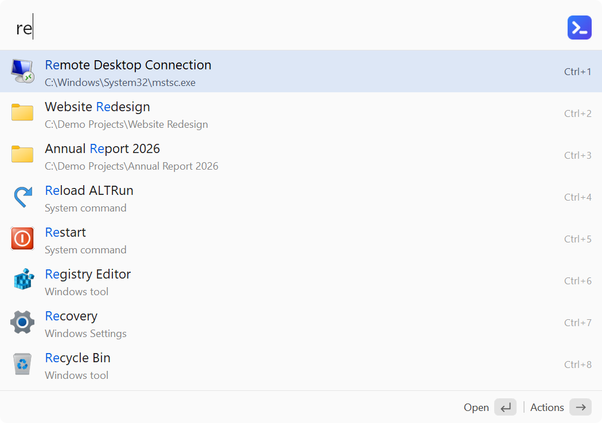

### Matching and learned ranking
ALTRun matches consecutive letters, word initials (`vsc` → Visual Studio Code) and pinyin initials (`jsb` → 记事本), and highlights the matched characters. ALTRun remembers which result you pick for what you type and puts it first next time. [More](Usage#how-matching-works)

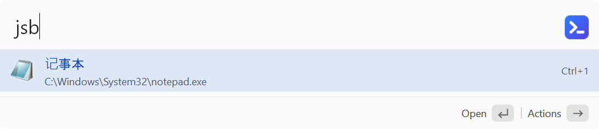

### Apps
Start menu, desktop and Microsoft Store apps are indexed automatically, and new programs show up within seconds. `Ctrl+Del` hides one you don't want. [More](Usage#automatic-app-index-updates)

### Files and folders
`Space` + a name (or `'name`) searches files: every disk in milliseconds with Everything running, or the built-in index otherwise. `doc report`, `pdf invoice`, `folder name` limit the type; `recent report` searches files you opened recently in any program. [More](File-Search)

### Browse folders
Type a path such as `D:\Projects\`: `Tab` goes into a folder, `Backspace` goes up, typing filters. [More](File-Search#browsing-folders)

### Pinned and recent items
Before you type, the window lists the items you pinned and, if you like, the ones you opened recently. [More](Recent)

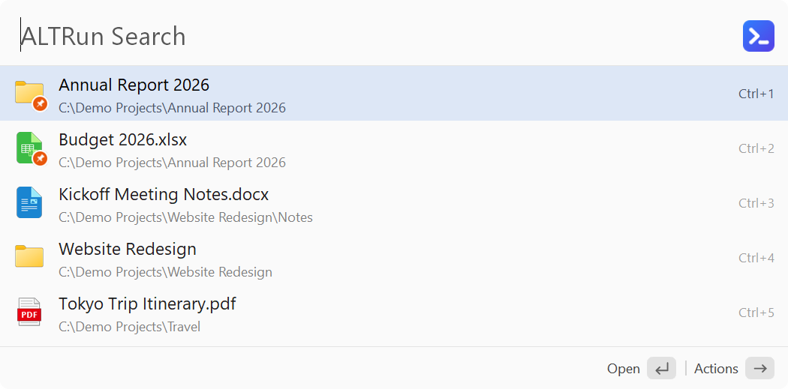

### Web search
`g keywords` (Google), `bd keywords` (Baidu) and engines of your own; one keyword can open several sites; a web search is offered when nothing else matches. [More](Web-Search)

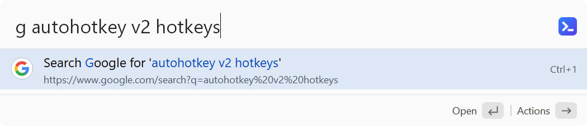

### Bookmarks and browser history
Bookmarks of Chrome, Edge, Brave and Vivaldi show up in the results (`bm` for bookmarks only); `h keywords` searches the browser history. [More](Bookmarks)

### Window switching
`w` + a title or program name switches to an open window; `w ` lists them all. [More](Window-Switching)

### Calculator
Type an expression: `12*(3+4)`, `10 km in mi`, `255 in hex`, `today + 30 days`, `100 usd to sgd` (currency conversion is optional). `Enter` copies the result; an optional history keeps your calculations. [More](Calculator)

### System commands and terminal
Lock, sleep, shut down, empty the Recycle Bin, volume and media control, Windows tools and 40+ Settings pages; text conversions; `>ipconfig /all` runs a command in a terminal. [More](System-Commands)

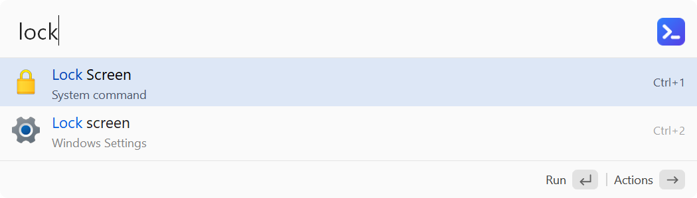

### Cheat sheet
Type `?` to list every search syntax and shortcut; `? file` filters the list. [More](Usage#search-syntax)

## Acting on results

### Action panel
Select a result and press `→` (or right-click): run as administrator, open the containing folder, copy the path, open a terminal there, properties... `Ctrl+Enter` opens the containing folder directly. [More](Usage#action-panel)

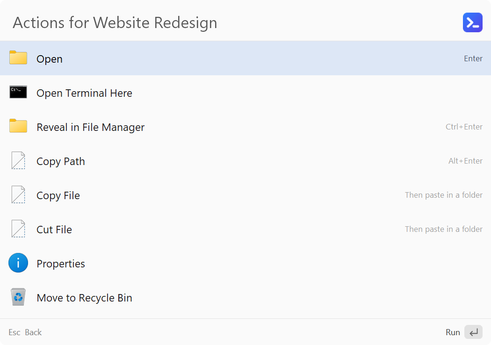

### Windows context menu
When turned on, the action panel also opens the Explorer context menu, with the items 7-Zip, Git and other programs add (`Shift+→`). [More](Usage#action-panel)

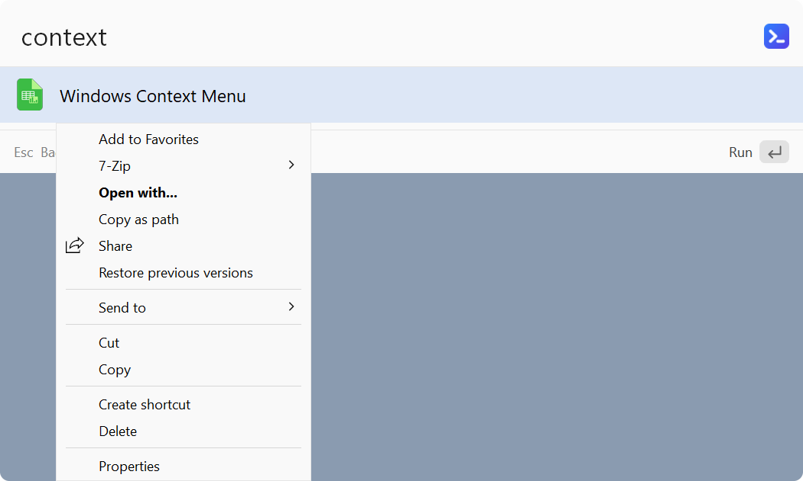

### Edit in place
`F3` edits the selected command, snippet or search engine, or turns an app, file or URL into a custom command; `Ctrl+Del` deletes or hides. [More](Usage#editing-and-deleting-in-the-results)

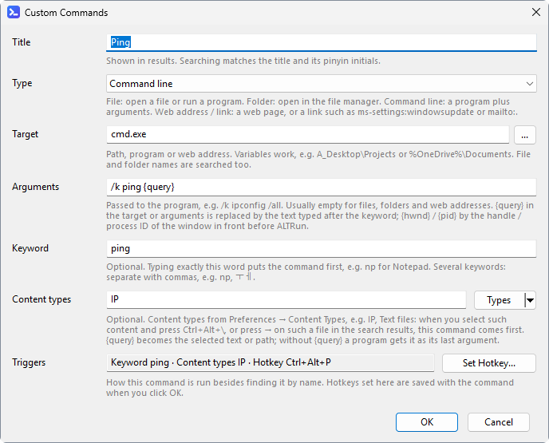

### Large type, drag and drop
`Ctrl+L` shows a result in full-screen large type (phone numbers, results); drag a file result out to a chat, an email or a folder. [More](Usage#shortcuts)

## Your commands and text

### Custom commands
Commands for files, folders, programs (with arguments) and web addresses, each with optional keywords; `{query}` takes what you type after the keyword. Add them from Explorer with right-click → Send to → ALTRun. [More](Custom-Commands)

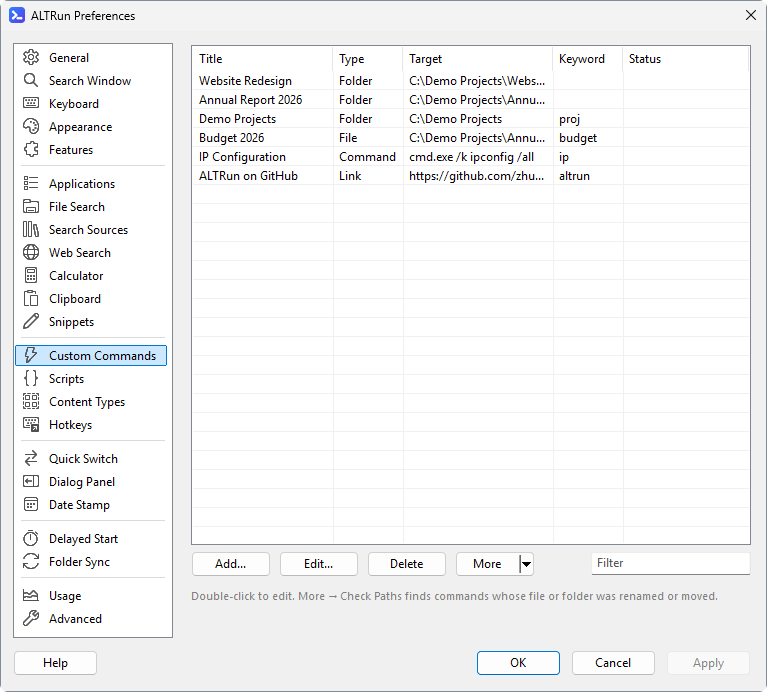

### Content types and actions on a selection
Select text, files or a URL in any program and press `Ctrl+Alt+\`. Describe a kind of content once (an order number, PDF files...) and the commands you set for it come first; the same goes for files in the results and copied text. [More](Content-Types)

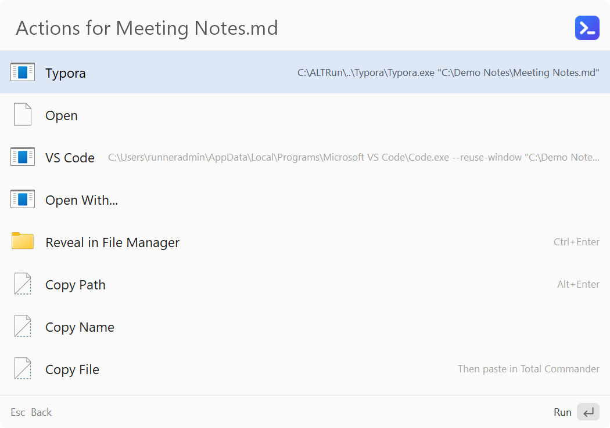

### Snippets
Text you use often, with placeholders such as `{date}`, `{clipboard}`, `{cursor}`; type `;keyword` in any program to expand one; import from Excel / CSV. [More](Snippets)

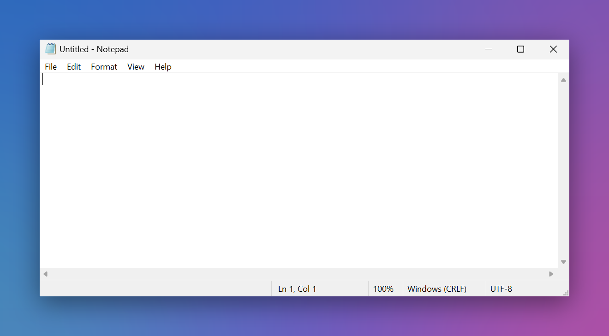

### Clipboard history
`Ctrl+Alt+C` lists copied text, files and images; filter, paste, pin, paste as plain text; nothing from password managers is recorded. [More](Clipboard)

### Custom hotkeys
Put any system command, custom command or script on a hotkey, optionally only in some programs; or open ALTRun with a search such as `folder {selection}`. [More](Hotkeys)

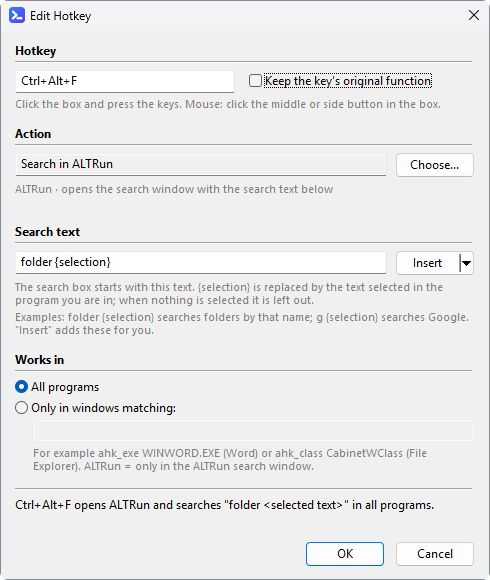

### Caps Lock switches the input method
Like on a Mac: a short press switches the input method or its Chinese / English mode; holding it turns Caps Lock on or off. [More](Hotkeys#caps-lock-switches-the-input-method)

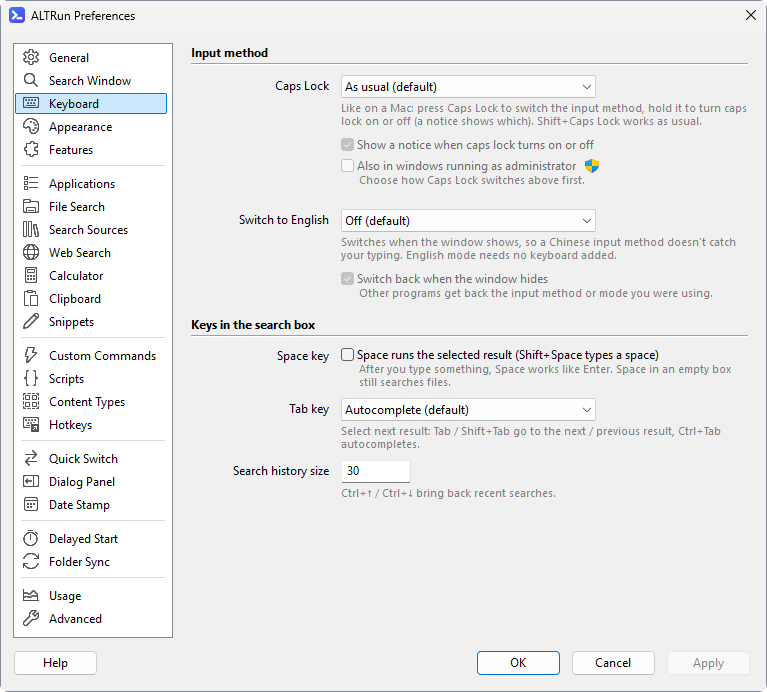

## Dialogs and file managers

### Quick Switch
In an Open / Save dialog, `Ctrl+G` jumps to the folder of the file manager you used last: File Explorer, Total Commander, Directory Opus or Arke. [More](Quick-Switch)

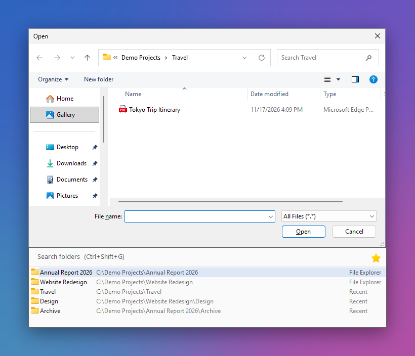

### Dialog folder panel
A panel next to the dialog lists every open and recently used folder, with your favorite folders in its star menu; type to search. [More](Quick-Switch-Panel)

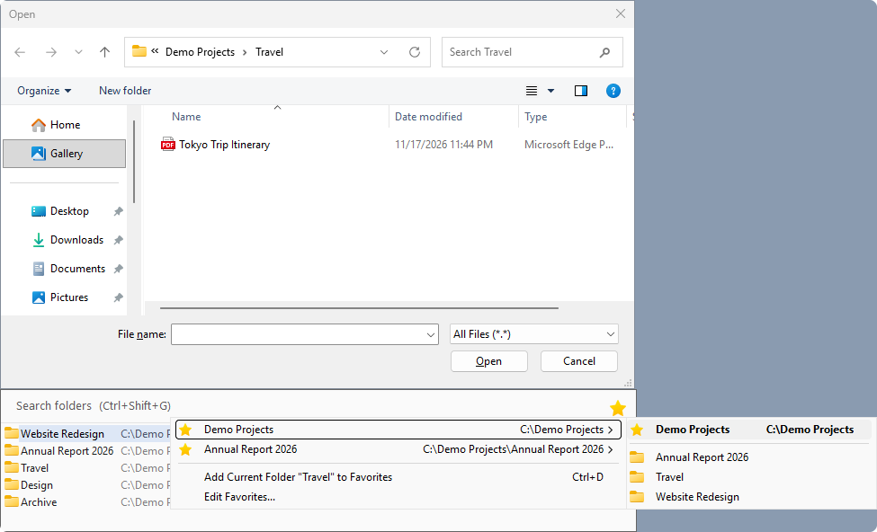

### File managers
Open folders in Total Commander, Directory Opus or Arke instead of File Explorer, in a new tab if you like. [More](File-Managers)

### Date stamp
While renaming, `Ctrl+D` adds or updates a date before the extension: `Report.docx` → `Report - 23.09.2026.docx`. [More](Date-Stamp)

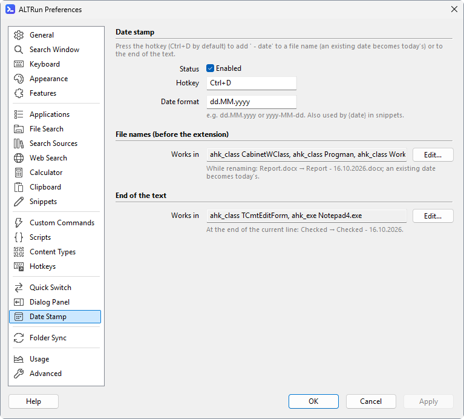

## Scripts and automation

### Scripts
Put `.ahk`, `.ps1`, `.py` or `.bat` scripts into the `Scripts\` folder and run them from the search window, with an argument, in the background or with their output shown; ready-made ones are in the [script library](https://zhugecaomao.github.io/ALTRun/#scripts). [More](Scripts)

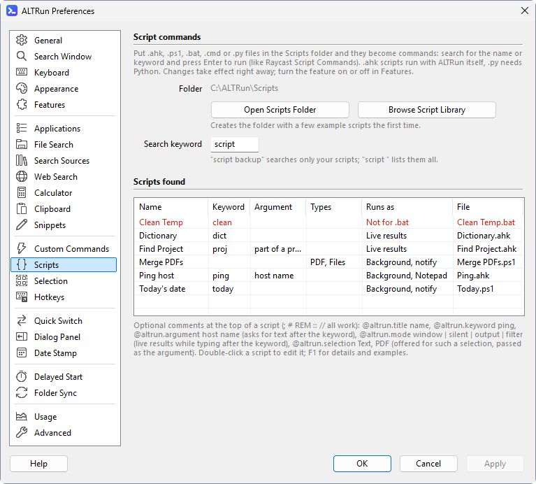

### Live results from a script
A script can list results while you type, like Alfred's Script Filter: projects, servers, Total Commander commands, translations... [More](Scripts#live-results)

### Folder sync
Keep a folder in step with another one using Windows' robocopy; a preview lists what a mirror would delete first, and the sync window shows the progress. [More](Sync-Tasks)

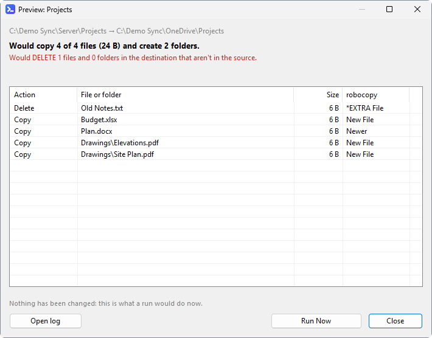

### Delayed start
Start programs such as OneDrive a few minutes after signing in, so the desktop is ready sooner (a script in the library). [More](Delayed-Start)

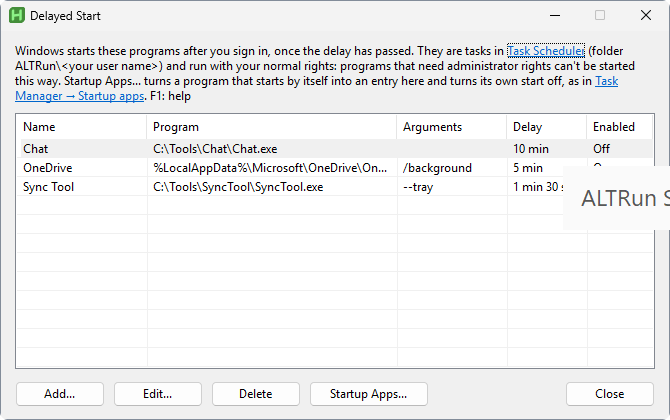

### PT Tools
For structural engineers: rebar and mesh areas, bars required, SPF2M post-tensioning tendon profiles (two scripts in the library). [More](PT-Tools)

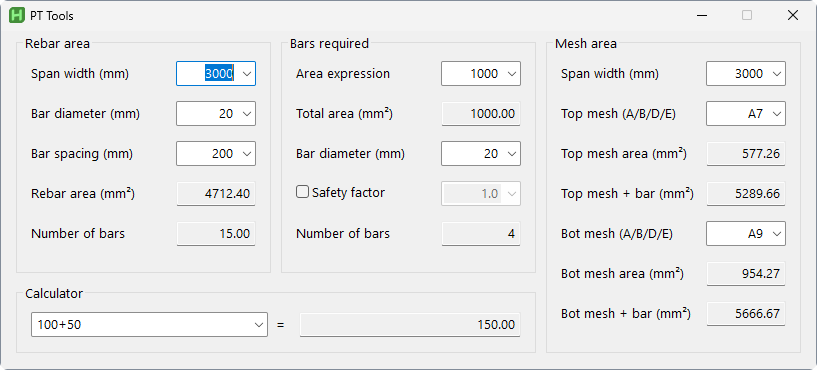

## Appearance and settings

### Themes and languages
22 built-in themes in three densities, optionally following the Windows light / dark mode, plus themes of your own; the interface is in English, Simplified Chinese, Traditional Chinese or Japanese. [More](Themes)

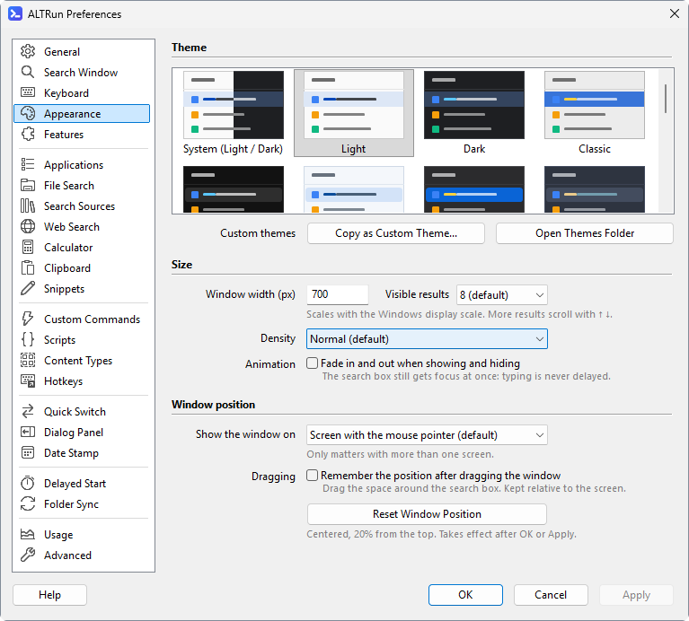

### Preferences and the settings file
Every setting is in Preferences (`Ctrl+,`), with a line of help under each and `F1` for its page; or edit `ALTRun.json` directly (`F4`), reloaded when you save. [More](Configuration)

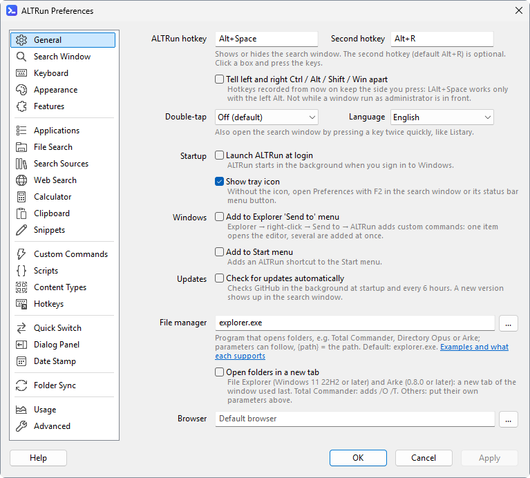

### Usage statistics
How many times you used each feature per day; only counts are kept. [More](Usage#usage-statistics)

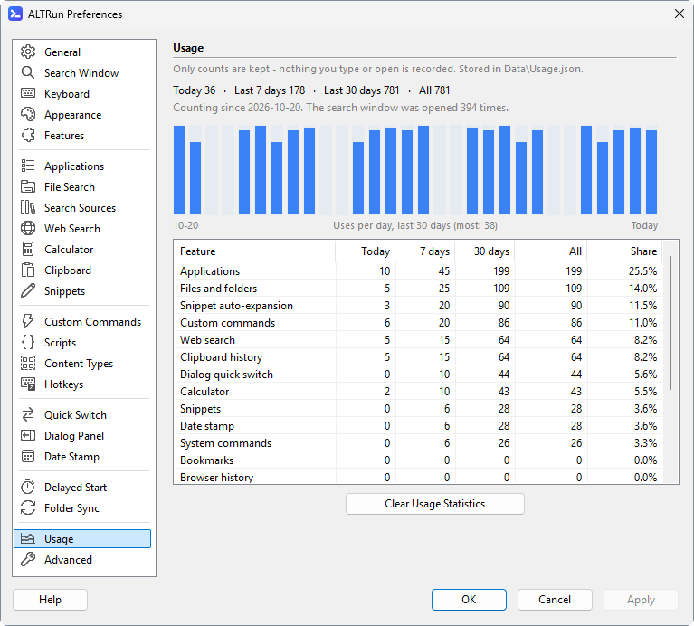

### Updates, portable data, privacy
One-key updates that keep your settings; settings and data in the `Data\` folder (next to the program by default); no telemetry. [More](Installation#one-key-updates)
