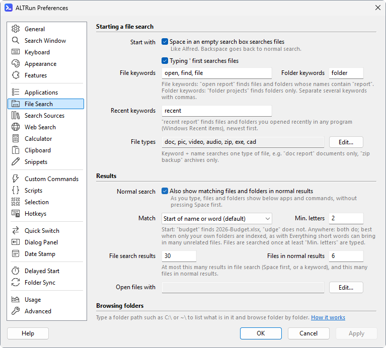
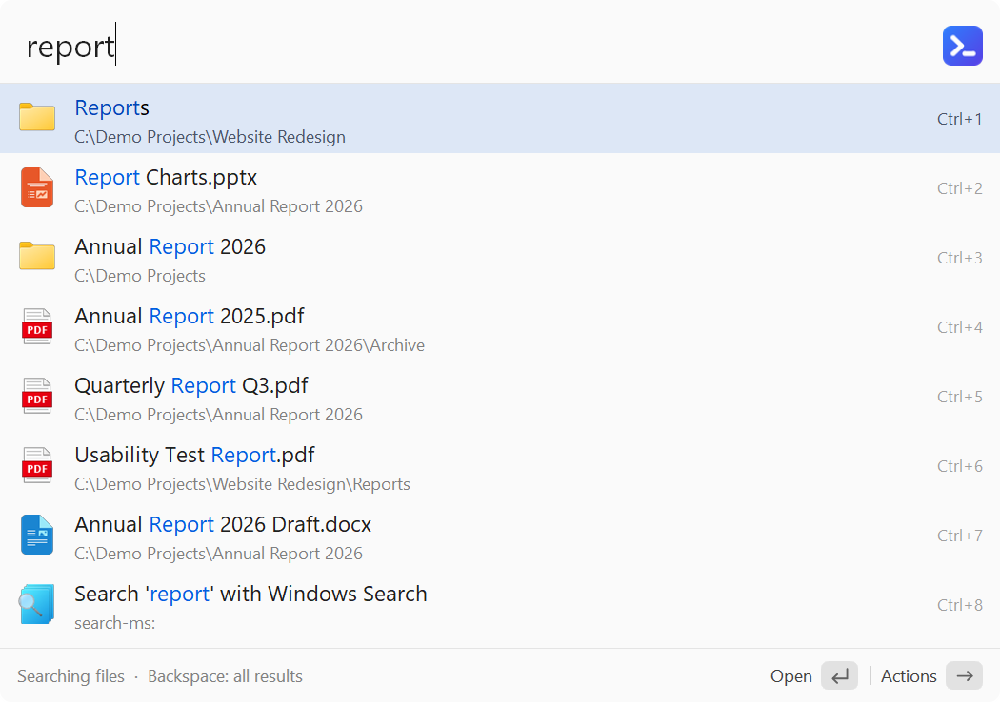
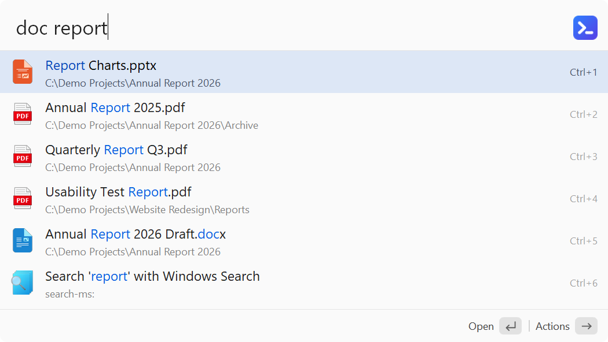
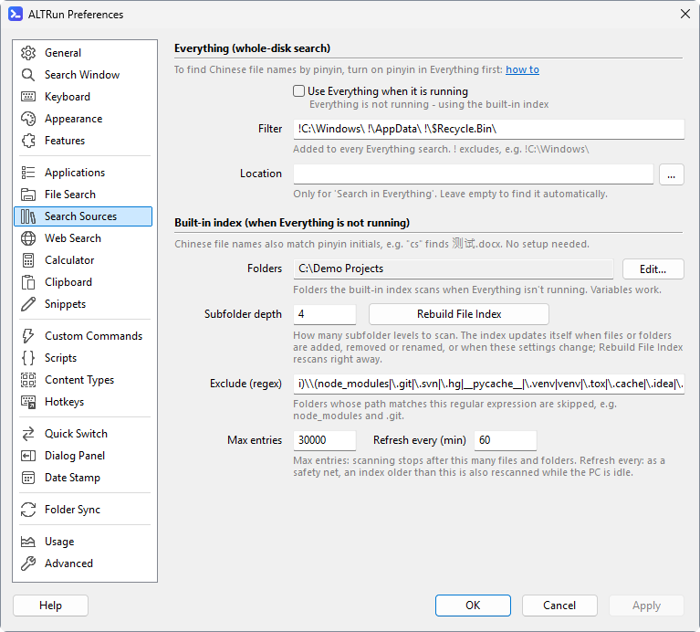

[English](File-Search) · **中文**

# 文件搜索

## 怎样搜索文件
普通搜索只显示应用、命令、片段等, **不会**混进全盘的文件 (避免 `NIRMALA.TTF` 这类无关文件)。要搜文件时:

- **空格**: 在空的搜索框里先按 `空格`, 输入框出现灰色的 "搜索文件...", 再输入名称。已经输入了文字时, 把光标移到最前面 (`Home`) 再按 `空格`, 文字保留并改用文件搜索。输入框为空或光标在最前面时按 `Backspace` 回到普通搜索。和 Alfred 的 Quick File Search 一样
- **`file 报告`**、**`open 报告`**、**`find 报告`** 或 **`'报告`**: 效果相同
- **只搜文件夹**: **`folder 预算`** (关键字可以在 偏好设置 → 文件搜索 → "文件夹搜索关键字" 修改); 文件搜索模式里也可以输入 `folder 预算`。有 Everything 时相当于 Everything 的 `folder:预算`

- **最近打开的文件**: **`recent 报告`** 搜最近在任何程序里打开过的文件和文件夹 (Windows 的 "最近使用的项目"), 最新的在前, 本地和网络上的都有; 只输入 **`recent `** (后面不跟文字) 列出最新的几个。直接读 Windows 的 "最近使用的项目" 文件夹, 不需要 Everything, 也不用内置索引 (Everything 默认搜不到这些: 偏好设置 → 搜索来源 → "过滤条件" 里排除了 `\AppData\`)。关键字可以在 偏好设置 → 文件搜索 → "最近文件关键字" 修改; 文件搜索模式里也可以输入 `recent 报告`。网络上的文件不去访问网络, 网络慢或断开时列表也不会卡住
- **按类型搜索** (和 Listary 的筛选一样): **`doc 报告`** 只搜文档, 还有 `pic` 图片、`video` 视频、`audio` 音频、`zip` 压缩包、`exe` 程序、`cad` (dwg / dxf / dgn / rvt / ifc / skp...)。文件搜索模式里也可以输入 `doc 报告`。关键字和扩展名在 偏好设置 → 文件搜索 → "文件类型" → **编辑...** 里修改, 每行一个 `关键字 = 扩展名 扩展名 ...` (设置页上那一行只显示关键字)。有 Everything 时相当于 `ext:doc;docx;...`

### 默认文件类型和扩展名

| 关键字 | 扩展名 |
|---|---|
| `doc` 文档 | `doc docx xls xlsx xlsm csv ppt pptx pdf txt md rtf odt ods` |
| `pic` 图片 | `jpg jpeg png gif bmp tif tiff webp svg ico heic` |
| `video` 视频 | `mp4 mkv avi mov wmv flv webm m4v` |
| `audio` 音频 | `mp3 wav flac aac m4a ogg wma` |
| `zip` 压缩包 | `zip rar 7z tar gz tgz bz2 xz iso` |
| `exe` 程序 | `exe msi bat cmd ps1 lnk` |
| `cad` CAD 文件 | `dwg dxf dgn dwf rvt ifc skp` |

这些规则可以自行修改. 每行由一个关键字、等号和以空格分隔的扩展名组成. 扩展名前面的点可以省略, 也可以用逗号或分号分隔. 不含 `=` 的行会被忽略.
- 按修改日期找可以直接写 Everything 的语法, 例如 `空格` + `dm:today 报告`、`dm:2days`

关键字后面要有空格才进入文件搜索: 只输入 `folder`、`open`、`recent`、`doc` 时, 名字里带这个词的命令、应用照常显示, 另有一行这个关键字的提示。名字以这个词开头的应用和命令 (例如 `doc` 对应的 Docker) 排在提示前面, 按 `Enter` 照样打开它们; 没有的话提示排第一。在提示上按 `Enter`、`Tab` 或双击, 补全成关键字加空格 (例如 `recent `)。关键字还没输完整时 (至少 3 个字母, 例如 `fol`、`rec`、`vid`), 提示显示在列表最后。

结果按名称的匹配程度排序: 完全相同 > 名称开头 > 单词开头 (例如 `2026-Budget`) > 包含 (例如 `NewBudget`); 同样的匹配程度, 文件夹排在文件前面, 再按修改时间 (新的在前)。用 Everything 时, ALTRun 先取 Everything 的前 300 条结果再排序, 所以名称最匹配的文件夹不会因为不是最近修改的而漏掉。

Everything 运行时, ALTRun 会把搜索语法原样交给 Everything. 例如 `空格` + `folder:budget 2024`、`ext:pdf report` 或 `dm:today report`.

## Everything 搜索语法参考

Everything 有一套查询语法, 可以按文件名、文件夹和已索引属性搜索. ALTRun 通过 Everything 的 IPC 接口直接传递查询, 不自行解析或扩展这套语法. 实际结果取决于安装的 Everything 版本及其索引设置.

> **版本说明:** voidtools 当前的 Search Syntax、Search Functions 和 Search Modifiers 官方文档均标注为需要 Everything 1.5. ALTRun 的 IPC 接口通过 Everything 1.4 和 1.5 测试, 但这不代表 1.4 支持所有 1.5 搜索函数. 使用高级表达式前, 请先确认版本要求.

### 1. 查询结构

一个搜索条件的基本结构:

`[!][search-modifier:][search-function:]<value>`

- `!` 表示排除该条件.
- `search-modifier:` 修改条件的匹配方式.
- `search-function:` 指定搜索属性, 例如扩展名、大小或修改日期.
- `value` 是要匹配的文字或属性值.
- 不带搜索函数的文字默认搜索文件名和文件夹名; 如果 Everything 开启 Match Path, 也会匹配完整路径.

| 查询 | 含义 |
|---|---|
| `report budget` | 同时包含 report 和 budget (AND) |
| `report \| budget` | 包含 report 或 budget (OR) |
| `!draft` | 排除匹配 draft 的结果 |
| `"annual report"` | 引号内按普通文字处理 |
| `<report budget> \| invoice` | 分组: (report AND budget) OR invoice |

默认情况下, OR 的优先级高于 AND. 使用 `< >` 明确分组和运算顺序. `|` 前后的空格可以省略.

### 2. 通配符和特殊字符

| 写法 | 含义 |
|---|---|
| `*` | 匹配零个或多个字符, 但不跨越路径分隔符 |
| `**` | 匹配零个或多个字符, 包括路径分隔符 |
| `?` | 匹配一个字符, 但不跨越路径分隔符 |

例如: `*.pdf`、`report*` 和 `*report*`. 使用通配符时匹配整个文件名. 在属性搜索中使用 `wildcards:` 可启用扩展通配符: `#` 匹配一个数字, `[abc]` 匹配集合中的一个字符, `[!abc]` 匹配集合以外的一个字符. 反斜杠用于转义下一个字符.

需要搜索特殊字符本身时, 可使用双引号或 Everything 字符实体, 例如 `&sp:` (空格)、`&vert:` (竖线)、`&excl:` (感叹号)、`&lt:`、`&gt:` 和 `&quot:`. Unicode 字符可用 `&#<十进制>:` 或 `&#x<十六进制>:` 表示.

### 3. 文件、文件夹和扩展名

| 搜索条件 | 含义 | 示例 |
|---|---|---|
| `file:` | 只搜索文件 | `file:report` |
| `folder:` | 只搜索文件夹 | `folder:budget` |
| `ext:` | 按完整扩展名筛选 | `ext:pdf` |
| `ext:` 多个值 | 匹配任意一个扩展名 | `ext:pdf;docx;xlsx` |
| `extension:` | 搜索扩展名属性 | `extension:pdf` |
| `stem:` | 搜索不含扩展名的文件名 | `stem:report` |
| `path:` 修饰符 | 匹配完整路径和名称 | `path:Projects report` |
| `no-path:` 修饰符 | 只匹配名称 | `no-path:report` |

Everything 内置类型宏还包括 `audio:`、`zip:`、`doc:`、`exe:`、`image:` 和 `video:`. `doc:` 使用 Everything 自己的文档分类; ALTRun 的 `doc report` 使用偏好设置 → 文件搜索 → 文件类型中配置的扩展名列表. 两者的筛选定义不同.

`ext:` 会忽略扩展名前面的 `.`, `*` 和 `*.`, 并支持 `*` / `?` 通配符, 例如 `ext:*.doc*`. `ext:` 参数为空时匹配没有扩展名的文件. 文件夹没有扩展名, 只搜文件夹请用 `folder:`.

路径包含空格时用引号括起来, 例如 `"C:\Program Files"`.

### 4. 常用属性搜索函数

| 函数 | 搜索属性 | 示例 |
|---|---|---|
| `ext:` | 文件扩展名 | `ext:pdf;docx` |
| `size:` | 文件大小 | `size:>10mb` |
| `date-modified:` (`dm:`) | 修改日期 | `dm:today` |
| `date-created:` (`dc:`) | 创建日期 | `dc:yesterday` |
| `date-accessed:` | 最后访问日期 | `date-accessed:7days` |
| `attributes:` | Windows 文件属性 | `attributes:RH` |
| `content:` | 文件内容 | `content:"annual report"` |
| `width:`、`height:` | 图片尺寸 | `width:>=1920` |
| `length:` | 媒体时长 | `length:>10mins` |
| `kind:` | 文件或文件夹类别 | `kind:document` |

属性函数使用 `function:value` 格式. 函数名中的连字符可以省略, 所以 `date-modified:` 和 `datemodified:` 等效. 可用函数取决于 Everything 版本和已索引的元数据.

### 5. 参数值支持的格式

属性函数后面的参数不只有普通文字, 具体格式取决于属性类型.

**文本值**
- 普通文字: `author:Example`
- 带空格或运算符的文字: `author:"Example Author"`
- 空值: `author:` 匹配非空文本; `size:` 匹配非零数值.
- 未知值: `size:unknown` 匹配尚未索引或无法获取的属性值.

**数值和比较运算符**

| 格式 | 含义 |
|---|---|
| `function:value` | 按参数单位的精度匹配相等范围 |
| `function:=value` 或 `function:==value` | 精确相等 |
| `function:<value` / `<=value` | 小于 / 小于或等于 |
| `function:>value` / `>=value` | 大于 / 大于或等于 |
| `function:!=value` | 不精确相等 |
| `function:!value` | 不在参数单位对应的范围内 |
| `function:start..end` 或 `start-end` | 闭区间范围 |

例如, `size:1kb` 匹配 1024 至 2047 bytes, `size:=1kb` 只匹配正好 1024 bytes. 其他例子: `size:>10mb`、`width:1920..3840`.

**单位**
- 文件大小可用 `b`、`kb`、`mb`、`gb` 等单位.
- 时长支持小时、分钟和秒组合, 例如 `length:1hour2mins5secs` 或 `length:90seconds`.
- 时长也可写成 `分钟:秒` (例如 `length:1:32`), 或 ISO 8601 时长格式 (例如 `length:pt1h20m30s`).

**日期值**
- 常量: `today`、`yesterday`、月份名称或缩写、星期名称或缩写, 以及 `mtd`、`ytd`、`qtd`、`unknown`.
- 年份: `2026` 或当前世纪的两位年份 `26`.
- 月份: `07/2026` 或 `2026/07`.
- 完整日期: `YYYY/MM/DD`、`DD/MM/YYYY` 或 `MM/DD/YYYY`; 斜杠格式受系统区域设置影响.
- ISO 8601: `2026-07`、`2026-07-22` 或 `2026-07-22T10:30`.
- 紧凑日期: `20260722` 或 `260722`.
- 相对时间: `10mins`、`2days`、`3weeks`、`4months`.
- 日期范围: `2026-07-01..2026-07-31`.

例如: `dm:today`、`dm:2days`、`dc:2026-07`、`date-modified:2026-07-01..2026-07-31`.

**其他日期格式**
- Excel 日期序列值: `10000` 至 `99999`, 例如 `date-modified:46189.7795022`.
- Windows FILETIME: 9 位或更多位的十进制数, 或带 `0x` 前缀的十六进制数, 例如 `date-modified:134260745917910877` 或 `date-modified:0x1DCFD6FE3B74F5D`.
- ISO 8601 扩展格式中的日期部分可以使用 `*` 通配, 例如 `date-modified:*-02`.

**时长格式**
- 单位格式: `[n<hours|hour|h>][n<minutes|minute|mins|min|m>][n<seconds|second|secs|sec|s>]`.
- 时钟格式: `[[[days:]hours:]minutes:]seconds[.milliseconds]`, 例如 `length:1:43:21.987`.
- ISO 8601 时长: `P[n]Y[n]M[n]DT[n]H[n]M[n]S`、`P[n]W`、`PYYYYMMDDThhmmss` 或 `P[YYYY]-[MM]-[DD]T[hh]:[mm]:[ss]`.

**子表达式**

属性函数可以应用于 `< >` 中的分组表达式. 例如, `content:<abc 123>` 匹配同时包含两个词的内容, `content:<abc|123>` 则匹配其中任意一个词.

**函数解析规则**
- 搜索函数名称中的连字符可以省略, 例如 `date-modified:` 和 `datemodified:`.
- 在函数名后紧接 `*`, 表示后面的内容全部作为普通文字, 不再继续解析, 例如 `content*:
`.
- 属性替换使用 `$property-name:` 插入当前文件的属性值. 正则表达式捕获内容可用 `$0:` 至 `$9:` 引用. 这些属于 Everything 1.5 高级功能.

**文件属性值**

`attributes:` 接受一个或多个字母: `A` (Archive)、`C` (Compressed)、`D` (Directory)、`E` (Encrypted)、`H` (Hidden)、`I` (Not Content Indexed)、`L` (Reparse Point)、`N` (Normal)、`M` (Recall on Data Access)、`O` (Offline)、`P` (Pinned)、`R` (Read-only)、`S` (System)、`T` (Temporary)、`U` (Unpinned)、`V` (Integrity Stream) 和 `X` (No Scrub Data). 也可以使用 Windows 文件属性的十进制或十六进制值 (十六进制以 `0x` 开头). 例如: `attributes:RH`、`attributes:0x200`.

**列表和多值属性**
- 属性函数可以接受以分号分隔的列表: `ext:pdf;docx;xlsx`.
- 列表项目按 OR 处理: `width:1920;3840` 表示匹配任意一个宽度.
- 列表项本身包含分号时, 用引号括起来: `artist:John;"Jane Doe"`.
- 多值属性默认只要其中一个值匹配即可. 使用 `all-strings:` 要求每个值都匹配, 或使用 `no-multi-string:` 把整个列表当作一个普通字符串. 例如 `all-strings:artist:John;Jane`.
- `content:` 等全文搜索函数把分号视为搜索文字, 不作为列表分隔符.

**通配符和正则表达式**
- 文件名文字支持 `*`、`**` 和 `?`.
- 使用 `wildcards:` 为其他文本属性启用扩展通配符, 例如 `wildcards:comment:project*`.
- 使用 `regex:` 搜索正则表达式, 例如 `regex:^report.*\.pdf$` 或 `regex:content:^Invoice`.

### 6. 搜索修饰符 (Everything 1.5)

修饰符用于改变单个搜索条件的匹配方式. 可以组合多个修饰符, 也可以应用于一组表达式.

| 修饰符 | 含义 | 示例 |
|---|---|---|
| `case:` / `no-case:` | 启用 / 关闭区分大小写 | `case:Report` |
| `whole:` | 完整匹配文件名或属性值 | `whole:hosts` |
| `whole-words:` | 按完整单词匹配 | `whole-words:report` |
| `prefix:` | 匹配单词开头 | `prefix:ever` |
| `suffix:` | 匹配单词结尾 | `suffix:hosts` |
| `start-with:` | 只匹配文件名或属性值的开头 | `start-with:report` |
| `end-with:` | 只匹配文件名结尾 | `end-with:hosts` |
| `path:` / `no-path:` | 启用 / 关闭完整路径匹配 | `path:system32 hosts` |
| `regex:` | 启用正则表达式 | `regex:^report` |
| `wildcards:` / `no-wildcards:` | 启用扩展通配符 / 关闭通配符 | `wildcards:comment:project*` |
| `pinyin:` | 使用全拼匹配中文 | `pinyin:nihao` |
| `diacritics:` | 匹配变音符号 | `diacritics:"Déjà Vu"` |

修饰符可以用 `no-` 前缀关闭, 例如 `no-case:` 和 `no-path:`. 修饰符名称中的连字符可以省略: `end-with:` 和 `endwith:` 等效, `start-with:` 和 `startwith:` 也等效. Wiki 使用官方文档列出的标准拼法. 修饰符前加 `?` 可使它应用于后续整个查询, 例如 `?case: FOO BAR`; `::` 表示使用内置修饰符, 不受用户自定义覆盖影响. 修饰符名称后加 `*` 可将后续内容全部视为普通文字.

### 7. 性能和实用示例

Everything 会优先处理索引中较快的条件, 再处理内容搜索等较慢操作. 内容搜索前增加范围较小的筛选条件, 通常更有效率.

| 目标 | 查询 |
|---|---|
| PDF 报告 | `ext:pdf report` |
| 今天修改的文档 | `doc: dm:today` |
| 大文件 | `size:>100mb` |
| 项目路径中的 PDF | `path:Projects ext:pdf` |
| 排除隐藏项目 | `!attributes:H` |
| 搜索 PDF 内容 | `ext:pdf content:"annual report"` |
| 宽度至少 1920 px 的图片 | `width:>=1920` |
| 时长超过 10 分钟的视频 | `length:>10mins` |

内容搜索可能比较慢, 且取决于 Everything 的内容索引和支持的文件格式. 属性函数也取决于相应元数据是否可用或已建立索引.

### 8. 官方完整文档

本节是常用语法参考, 并非 Everything 完整手册. 所有函数、修饰符、别名和各属性的详细参数, 请查阅 voidtools 官方文档:

- [Search Syntax](https://www.voidtools.com/support/everything/search_syntax/)
- [Search Functions](https://www.voidtools.com/support/everything/search_functions/)
- [Search Modifiers](https://www.voidtools.com/support/everything/search_modifiers/)

目前这三份 Search Syntax、Search Functions 和 Search Modifiers 官方页面均注明需要 Everything 1.5.

最多显示 30 条; 没有结果时可以一键在 Everything 或 Windows 搜索里继续找。普通搜索一条结果都没有时, 最后也会给出 "搜索文件" 的兜底项。

想不按空格、普通搜索时也显示文件: 在 偏好设置 → 文件搜索 勾选 "普通搜索时也显示匹配的文件和文件夹"。文件显示在应用和命令下面, 最多 6 条 ("普通结果里的文件数"), 输入 2 个字以后才开始找 ("最少字数")。"匹配方式" 决定哪些文件名算匹配:

- **文件名开头或词的开头** (默认): `budget` 能找到 `2026-Budget.xlsx`, `udge` 找不到。短输入不会带出一长串无关的文件
- **文件名包含**: `udge` 也能找到, 和文件搜索一样。适合内置索引只包括自己文件夹的情况 (偏好设置 → 搜索来源); 用 Everything 搜整个硬盘时, 短输入可能带出很多无关文件

常用的文件夹更适合加为 [自定义命令](Custom-Commands-zh): 自定义命令也按目标的文件夹名匹配, 普通搜索就能找到。

`Enter` 打开, `Ctrl+Enter` 在文件管理器中显示, `Alt+Enter` 复制路径, `→` 更多操作 (打开方式、复制 / 剪切文件、复制 / 移动到 TC 当前的文件夹、在此处打开终端、属性、移到回收站...), 见 [操作面板](Usage-zh#操作面板)。

为文件的内容类型 (例如 `Markdown` = `md, markdown`) 设置的自定义命令排在它的操作面板里 "打开" 的后面, 这个类型的 **打开 (回车)** 还可以指定按 `Enter` 时用哪条命令打开, 类似 Total Commander 的内部关联: Windows 不认识这类文件时 (例如便携环境) 很有用。见 [自己的操作 (内容类型)](Usage-zh#自己的操作-内容类型)。

## 浏览文件夹
在搜索框里输入路径, 列出这个文件夹里的内容 (文件夹在前), 路径最后一段用来过滤:

| 输入 | 结果 |
|---|---|
| `C:\` `D:\Projects\` | 这个文件夹里的全部内容 |
| `D:\Projects\rep` | 名称和 `rep` 匹配的 (和普通搜索一样的模糊匹配) |
| `~\` | 用户文件夹 (`C:\Users\你的名字`) |
| `%OneDrive%\` | 环境变量 |
| `\\server\share\` | 网络共享 |

`Tab` 进入选中的文件夹, `Backspace` 删掉一段回到上一级; 任何结果里的文件夹 (自定义命令、文件搜索...) 也可以按 `Tab` 进入。`Enter` 打开, `→` 有文件的各种操作。隐藏和系统文件不列出。`Insert` 可以标记多个文件一起复制、移动或删除, 见 [快捷键](Usage-zh#快捷键)。

## 数据来源
ALTRun 自动选择:

| 情况 | 搜索范围 |
|---|---|
| [Everything](https://www.voidtools.com/) 正在运行 | 通过 Everything 的 IPC 接口直接查询**全盘**, 结果即时; 不需要 `Everything64.dll` 或 `es.exe` |
| Everything 没有运行 | 内置索引: 在后台扫描 桌面、文档、下载 (深度 4 层, 最多 30000 项), 缓存在 `Data\FileIndex.bin`。这些文件夹里有文件 / 文件夹新增、删除、改名时, 几秒后在后台重新扫描 (两次至少隔 5 分钟; 修改文件内容、浏览器下载中的临时文件不算); 在偏好设置里改了索引的文件夹、深度、排除或最多条数, 点 "应用" 后也会在后台重新扫描 (扫完前旧索引照常可用); 另外默认每 60 分钟兜底扫描一次。ALTRun 启动时 Everything 正在运行的话, 内置索引不读也不扫描, 等 Everything 关掉、真的要用时再读 |

偏好设置 → 搜索来源 页面顶部会显示 Everything 当前是否在运行。

推荐安装 Everything 并让它开机启动 (Everything 的 "选项 → 常规 → 开机启动"), 搜索范围和速度都更好。

## 设置

偏好设置 → 文件搜索 (怎样开始搜索、文件类型、结果数量) 和 搜索来源 (Everything、内置索引), 或 `ALTRun.json` → `Features.FileSearch`:

| 设置 | 默认 | 说明 |
|---|---|---|
| SpacePrefix | 1 | 在空的搜索框里按空格进入文件搜索模式 |
| InDefaultResults | 0 | 普通搜索时也显示匹配的文件和文件夹 |
| DefaultResultsLimit | 6 | 普通结果里最多显示几条文件 |
| DefaultResultsMatch | `Start` | 普通结果里显示哪些文件: `Start` = 文件名或其中某个词以输入的文字开头, `Contains` = 文件名任意位置包含 |
| MinQueryLength | 2 | 至少输入几个字才搜文件 |
| Keywords | `open, find, file` | 只搜文件的关键字 |
| FolderKeywords | `folder` | 只搜文件夹的关键字 |
| RecentKeywords | `recent` | 搜最近打开的文件和文件夹 (Windows 的 "最近使用的项目") 的关键字 |
| TypeFilters | doc / pic / video / audio / zip / exe / cad | 文件类型筛选, 每行 `关键字 = 扩展名 ...` |
| QuotePrefix | 1 | 以 `'` 开头只搜文件和文件夹 |
| MaxResults | 30 | 只搜文件时最多显示几条 |
| UseEverything | 1 | Everything 在运行时用它搜索 |
| EverythingFilter | `!C:\Windows\ !\AppData\ !\$Recycle.Bin\` | 追加在 Everything 搜索后面的条件, `!` 表示排除 (Everything 搜索语法) |
| EverythingPath | 空 | Everything.exe 的位置, 只用于 "在 Everything 中搜索"; 留空自动查找 |
| ScopeFolders | 桌面、文档、下载 | 内置索引扫描的文件夹, 可以用 [路径变量](Custom-Commands-zh#路径里可以用的变量) |
| ScopeDepth | 4 | 内置索引的子文件夹深度 |
| ScopeExclude | `node_modules`、`.git`、`.svn`、`.hg`、`__pycache__`、`.venv`、`venv`、`.tox`、`.cache`、`.idea`、`.vs`、回收站 | 内置索引跳过的文件夹 (正则, 对完整路径)。默认跳过代码仓库、Python 虚拟环境和开发工具的缓存: 里面动辄上万个文件, 会占满 MaxEntries, 也没有要找的文档 |
| MaxEntries | 30000 | 内置索引最多收录多少项 |
| RefreshMinutes | 60 | 兜底: 内置索引的缓存超过这么久也在后台重新扫描 (最少 5 分钟; 启动时检查一次, 之后每分钟检查, 键盘鼠标空闲 30 秒、搜索窗口没开时才重建)。平时靠监视文件夹自动更新; 用 Everything 时都不扫描 |

改了内置索引的范围后, 可以在偏好设置里点 "重建文件索引" 立即生效。

## 常见问题
- **Everything 装了但不起作用**: Everything 必须正在运行 (托盘里有图标)。如果 Everything 以管理员身份运行而 ALTRun 不是, Windows 可能拦截两者之间的通信, 让两者以相同的权限运行即可 (推荐 Everything 安装为服务、普通权限运行)。
- **网络驱动器上的文件**: Everything 默认不索引网络驱动器, 需要在 Everything 的 "选项 → 索引 → 文件夹" 里添加; 内置索引可以把网络文件夹加到 ScopeFolders, 但扫描会比较慢。常用的网络文件夹更适合加为 [自定义命令](Custom-Commands-zh)。
- **用拼音搜中文文件名** (例如输入 `cs` 找到 "测试.bat", `zjsm` 找到 "证件扫描文件.zip"): 支持拼音首字母, 找到的文件同样高亮对应的字, 按首字母的匹配程度排序 (同样的匹配程度, 名称直接匹配的排在前面)
  - **没有 Everything (内置索引)**: 直接就能用。载入索引后在后台算好首字母 (1 万个中文文件名约零点几秒), 刚启动的这一小会儿里暂时不按拼音找。只按一个词找: `zj sm` 这样分开写的找不到
  - **用 Everything 时**: 文件是 Everything 找的, 要先让 Everything 支持拼音 (ALTRun 把输入原样交给 Everything, 不用另外设置):
    - **Everything 1.5 (beta)**: 工具 → 选项 → 高级, 搜索 `pinyin`, 设成 `true` (只支持首字母)。以 "1.5a" 命名实例运行的 1.5 alpha 也能找到
    - **Everything 1.4**: 安装开源扩展 [IbEverythingExt](https://github.com/Chaoses-Ib/IbEverythingExt), 按它的说明放进 Everything 的文件夹后重启 Everything。支持简拼 (`cs`)、全拼 (`ceshi`)、双拼
    - 输入多个词时 (例如 `zj sm`), Everything 找到的文件照样高亮, 但不按拼音排序
  - 只认常用汉字 (GB2312 一级汉字), 多音字只取一个读音; 全拼只有 Everything + IbEverythingExt 能找到, ALTRun 不按全拼排序和高亮
