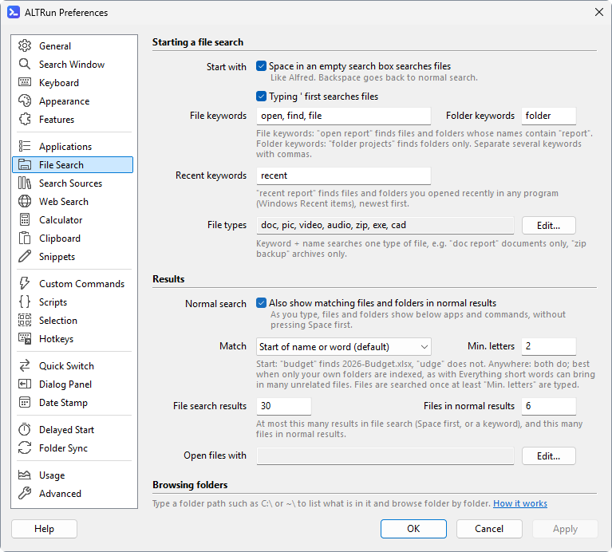
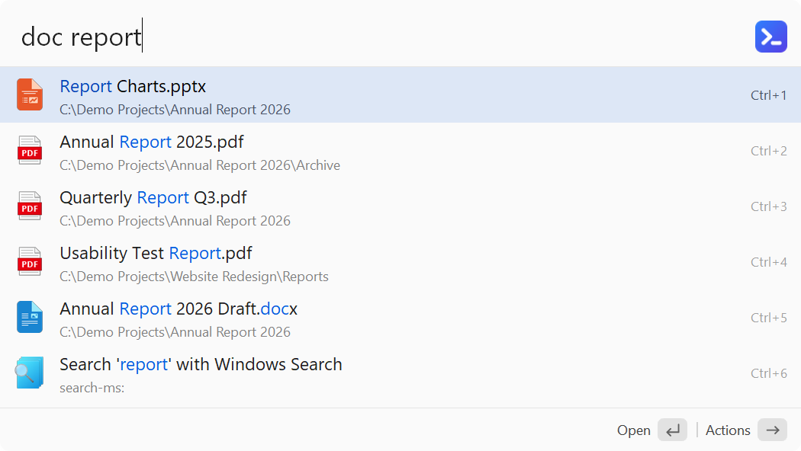
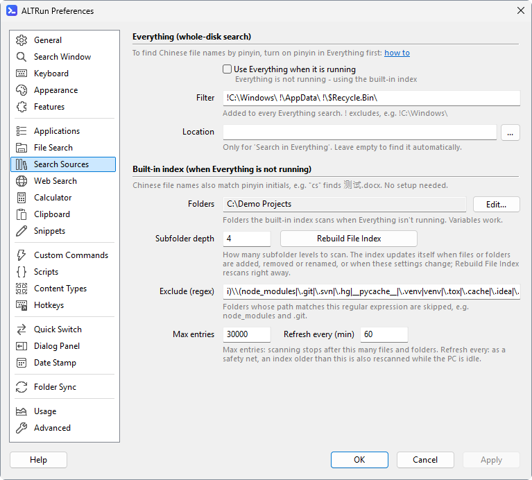

**English** · [中文](File-Search-zh)

# File search

## How to search for files
Normal searches show apps, commands, snippets and so on, but **not** files from all over your disks (so unrelated files such as `NIRMALA.TTF` don't get mixed in). To search for files:

- **Space**: in an empty search box, press `Space` first; the input box shows a gray "Search files...", then type the name. If you've already typed something, move the cursor to the start (`Home`) and press `Space` to search files for it. `Backspace` in an empty input box or at the start goes back to a normal search. Like Alfred's Quick File Search
- **`file report`**, **`open report`**, **`find report`** or **`'report`**: same effect
- **Folders only**: **`folder budget`** (change the keyword in Preferences → File Search → "Folder keywords"); `folder budget` also works in file search mode. With Everything this is the same as Everything's `folder:budget`

- **Recently opened files**: **`recent report`** searches the files and folders you opened recently in any program (Windows' "Recent items"), newest first, on local disks and network shares alike; **`recent `** with nothing after it lists the newest. It reads Windows' Recent folder directly, so it works without Everything and without the built-in index (Everything doesn't list these by default: `\AppData\` is excluded in Preferences → Search Sources → "Filter"). Change the keyword in Preferences → File Search → "Recent keywords"; `recent report` also works in file search mode. Network files are listed without accessing the network, so a slow or disconnected share doesn't hold up the list
- **By type** (like Listary's filters): **`doc report`** searches documents only; there are also `pic` pictures, `video`, `audio`, `zip` archives, `exe` programs and `cad` (dwg / dxf / dgn / rvt / ifc / skp...). `doc report` also works in file search mode. Change the keywords and extensions in Preferences → File Search → "File types" → **Edit...**, one `keyword = ext ext ...` per line (the line shows just the keywords). With Everything this is the same as `ext:doc;docx;...`

### Default file types and extensions

| Keyword | Extensions |
|---|---|
| `doc` | `doc docx xls xlsx xlsm csv ppt pptx pdf txt md rtf odt ods` |
| `pic` | `jpg jpeg png gif bmp tif tiff webp svg ico heic` |
| `video` | `mp4 mkv avi mov wmv flv webm m4v` |
| `audio` | `mp3 wav flac aac m4a ogg wma` |
| `zip` | `zip rar 7z tar gz tgz bz2 xz iso` |
| `exe` | `exe msi bat cmd ps1 lnk` |
| `cad` | `dwg dxf dgn dwf rvt ifc skp` |

The list is editable. Each rule uses one keyword, an equals sign and a space-separated extension list. Extensions may include or omit the leading dot; commas and semicolons can also separate extensions. Lines without `=` are ignored.
- To find files by modification date, write Everything's syntax directly, for example `Space` + `dm:today report` or `dm:2days`

A keyword needs a space after it to start a file search: typing just `folder`, `open`, `recent` or `doc` shows commands and apps with that word in their name as usual, plus a hint for the keyword. Apps and commands whose name starts with that word (e.g. Docker for `doc`) stay above the hint, so `Enter` still opens them; otherwise the hint comes first. `Enter`, `Tab` or a double-click on the hint completes the keyword and the space (e.g. `recent `). While a keyword isn't typed in full yet (at least 3 letters, e.g. `fol`, `rec`, `vid`), its hint shows at the end of the list.

Results are sorted by how well the name matches: exact > start of the name > start of a word (for example `2026-Budget`) > contains (for example `NewBudget`); at the same match quality, folders come before files, then by modification time (newest first). With Everything, ALTRun takes Everything's first 300 results and then sorts them, so the best-matching folder isn't missed just because it wasn't modified recently.

Everything search syntax is passed directly to Everything when it is running. ALTRun does not parse it, and it is not available when the built-in index is used. For example, `Space` + `folder:budget 2024`, `ext:pdf report` or `dm:today report`.

## Everything search syntax reference

Everything supports a query language for matching filenames, folders and indexed properties. ALTRun passes the query to Everything through its IPC interface; it does not implement or extend this syntax. Results depend on the installed Everything version and its indexing settings.

> **Version note:** The current official Search Syntax, Search Functions and Search Modifiers references are marked as requiring Everything 1.5. ALTRun's IPC integration is tested with Everything 1.4 and 1.5, but that does not mean every 1.5 search function is available in 1.4. Check the version requirement before using advanced expressions.

### 1. Query structure

A search term follows this structure:

`[!][search-modifier:][search-function:]<value>`

- `!` excludes a term.
- `search-modifier:` changes how a term is matched.
- `search-function:` selects a property, such as extension, size or modification date.
- `value` is the text or property value to match.
- Text without a search function searches names; it also searches full paths when Match Path is enabled.

| Query | Meaning |
|---|---|
| `report budget` | Both terms must match (AND) |
| `report \| budget` | Either term may match (OR) |
| `!draft` | Exclude terms matching draft |
| `"annual report"` | Treat the quoted phrase as plain text |
| `<report budget> \| invoice` | Grouping: (report AND budget) OR invoice |

By default, OR is evaluated before AND. Use `< >` to group terms explicitly. Spaces around `|` are optional.

### 2. Wildcards and literal characters

| Pattern | Meaning |
|---|---|
| `*` | Zero or more characters, except a path separator |
| `**` | Zero or more characters, including path separators |
| `?` | Exactly one character, except a path separator |

Examples: `*.pdf`, `report*` and `*report*`. Wildcards match the whole filename. Use `wildcards:` for extended wildcard syntax in property searches: `#` matches one digit, `[abc]` matches one character from a set, `[!abc]` matches one character outside a set, and a backslash escapes the next character.

For literal special characters, use quotes or character entities such as `&sp:` (space), `&vert:` (vertical bar), `&excl:` (exclamation mark), `&lt:`, `&gt:` and `&quot:`. Unicode characters can use `&#<decimal>:` or `&#x<hex>:`.

### 3. File and folder filters

| Search term | Meaning | Example |
|---|---|---|
| `file:` | Files only | `file:report` |
| `folder:` | Folders only | `folder:budget` |
| `ext:` | Match whole file extensions | `ext:pdf` |
| `ext:` list | Match any listed extension | `ext:pdf;docx;xlsx` |
| `extension:` | Search the extension property | `extension:pdf` |
| `stem:` | Search the filename without its extension | `stem:report` |
| `path:` modifier | Match full path and name | `path:Projects report` |
| `no-path:` modifier | Match name only | `no-path:report` |

Built-in Everything type macros include `audio:`, `zip:`, `doc:`, `exe:`, `image:` and `video:`. `doc:` uses Everything's own document category. ALTRun's `doc report` uses the extension list configured in Preferences → File Search → File types. These are not the same filter definition.

`ext:` ignores leading `.`, `*` and `*.` in extension values, and supports `*` / `?` wildcards, e.g. `ext:*.doc*`. `ext:` with an empty value matches files without an extension. Folders have no extension; use `folder:` for folders.

Quote paths containing spaces, for example `"C:\Program Files"`.

### 4. Common property functions

| Function | Property | Example |
|---|---|---|
| `ext:` | File extension | `ext:pdf;docx` |
| `size:` | File size | `size:>10mb` |
| `date-modified:` (`dm:`) | Modification date | `dm:today` |
| `date-created:` (`dc:`) | Creation date | `dc:yesterday` |
| `date-accessed:` | Last access date | `date-accessed:7days` |
| `attributes:` | Windows file attributes | `attributes:RH` |
| `content:` | File contents | `content:"annual report"` |
| `width:`, `height:` | Image dimensions | `width:>=1920` |
| `length:` | Media duration | `length:>10mins` |
| `kind:` | File or folder kind | `kind:document` |

A function uses `function:value`. Hyphens in function names may be omitted, so `date-modified:` and `datemodified:` are equivalent. Available functions depend on the Everything version and indexed metadata.

### 5. Supported value formats

The value format depends on the property type.

**Text values**
- Plain text: `author:Example`
- Quoted text, including spaces or operators: `author:"Example Author"`
- Empty value: `author:` matches a non-empty text value; `size:` matches a non-zero numeric value.
- Unknown value: `size:unknown` matches a property that is unknown or has not been indexed.

**Numeric values and comparisons**

| Format | Meaning |
|---|---|
| `function:value` | Equal within the precision implied by the unit |
| `function:=value` or `function:==value` | Exact equality |
| `function:<value` / `<=value` | Less than / less than or equal |
| `function:>value` / `>=value` | Greater than / greater than or equal |
| `function:!=value` | Not exactly equal |
| `function:!value` | Not equal within the value's unit granularity |
| `function:start..end` or `function:start-end` | Inclusive range |

For example, `size:1kb` matches 1024–2047 bytes, while `size:=1kb` matches exactly 1024 bytes. Other examples: `size:>10mb`, `width:1920..3840`.

**Units**
- File sizes accept units such as `b`, `kb`, `mb` and `gb`.
- Durations accept combined units, such as `length:1hour2mins5secs`, or `length:90seconds`.
- Durations can also use `minutes:seconds` (for example, `length:1:32`) or ISO 8601 duration syntax (for example, `length:pt1h20m30s`).

**Date values**

- Constants: `today`, `yesterday`, month names or abbreviations, weekday names or abbreviations, `mtd`, `ytd`, `qtd`, and `unknown`.
- Year: `2026` or the two-digit current-century year `26`.
- Month: `07/2026` or `2026/07`.
- Full date: `YYYY/MM/DD`, `DD/MM/YYYY` or `MM/DD/YYYY`; slash-separated formats depend on regional settings.
- ISO 8601: `2026-07`, `2026-07-22` or `2026-07-22T10:30`.
- Compact date: `20260722` or `260722`.
- Relative duration: `10mins`, `2days`, `3weeks`, `4months`.
- Inclusive date range: `2026-07-01..2026-07-31`.

Examples: `dm:today`, `dm:2days`, `dc:2026-07`, `date-modified:2026-07-01..2026-07-31`.

**Additional date formats**
- Excel serial date/time: values from `10000` to `99999`, for example `date-modified:46189.7795022`.
- Windows FILETIME: a 9-or-more-digit decimal value or hexadecimal with a `0x` prefix, for example `date-modified:134260745917910877` or `date-modified:0x1DCFD6FE3B74F5D`.
- In ISO 8601 extended dates, `*` can stand for a date component, for example `date-modified:*-02`.

**Duration formats**
- Unit format: `[n<hours|hour|h>][n<minutes|minute|mins|min|m>][n<seconds|second|secs|sec|s>]`.
- Clock format: `[[[days:]hours:]minutes:]seconds[.milliseconds]`, for example `length:1:43:21.987`.
- ISO 8601 duration: `P[n]Y[n]M[n]DT[n]H[n]M[n]S`, `P[n]W`, `PYYYYMMDDThhmmss` or `P[YYYY]-[MM]-[DD]T[hh]:[mm]:[ss]`.

**Sub-expressions**

Property functions can apply to a grouped expression in `< >`. For example, `content:<abc 123>` matches content containing both terms, while `content:<abc|123>` matches either term.

**Function parsing**
- A hyphen in a search function name is optional, e.g. `date-modified:` and `datemodified:`.
- Add `*` immediately after a function name to treat the rest of the query as plain text without further parsing, e.g. `content*:
`.
- Property substitution uses `$property-name:` to insert the current item's property value. Regex captures can be reused as `$0:` to `$9:`. These are advanced Everything 1.5 features.

**File attribute values**

`attributes:` accepts one or more letters: `A` (Archive), `C` (Compressed), `D` (Directory), `E` (Encrypted), `H` (Hidden), `I` (Not Content Indexed), `L` (Reparse Point), `N` (Normal), `M` (Recall on Data Access), `O` (Offline), `P` (Pinned), `R` (Read-only), `S` (System), `T` (Temporary), `U` (Unpinned), `V` (Integrity Stream) and `X` (No Scrub Data). Decimal and hexadecimal Windows attribute values are also accepted; hexadecimal uses the `0x` prefix. Examples: `attributes:RH`, `attributes:0x200`.

**Lists and multi-value properties**
- Property functions accept semicolon-separated lists: `ext:pdf;docx;xlsx`.
- List items are ORed: `width:1920;3840` matches either width.
- Quote a list item containing a semicolon: `artist:John;"Jane Doe"`.
- Multi-value properties normally match if any value matches. Use `all-strings:` to require every value to match, or `no-multi-string:` to treat the entire list as one literal string. Example: `all-strings:artist:John;Jane`.
- Full-text functions such as `content:` treat semicolons as search text, not list separators.

**Wildcards and regular expressions**
- Filename text supports `*`, `**` and `?`.
- Use `wildcards:` for extended wildcards in other text properties, for example `wildcards:comment:project*`.
- Use `regex:` for regular expressions, for example `regex:^report.*\.pdf$` or `regex:content:^Invoice`.

### 6. Search modifiers (Everything 1.5)

Modifiers change how a search term is matched. Multiple modifiers can be combined and can apply to a grouped expression.

| Modifier | Meaning | Example |
|---|---|---|
| `case:` / `no-case:` | Enable / disable case-sensitive matching | `case:Report` |
| `whole:` | Match the whole filename or property value | `whole:hosts` |
| `whole-words:` | Match whole words | `whole-words:report` |
| `prefix:` | Match the start of words | `prefix:ever` |
| `suffix:` | Match the end of words | `suffix:hosts` |
| `start-with:` | Match only the start of a filename or property value | `start-with:report` |
| `end-with:` | Match only the end of a filename | `end-with:hosts` |
| `path:` / `no-path:` | Enable / disable full-path matching | `path:system32 hosts` |
| `regex:` | Enable regular expressions | `regex:^report` |
| `wildcards:` / `no-wildcards:` | Enable extended / disable wildcard matching | `wildcards:comment:project*` |
| `pinyin:` | Match Chinese using full Pinyin | `pinyin:nihao` |
| `diacritics:` | Match accent marks | `diacritics:"Déjà Vu"` |

Modifiers can be disabled with `no-`, for example `no-case:` and `no-path:`. Hyphens in modifier names are optional: `end-with:` and `endwith:` are equivalent, as are `start-with:` and `startwith:`. The hyphenated forms are the official documented names. A modifier can be prefixed with `?` to apply it to the rest of the query, e.g. `?case: FOO BAR`; `::` selects the built-in modifier instead of a user-defined override. A trailing `*` on a modifier makes the rest of the query plain text.

### 7. Performance and practical examples

Everything evaluates faster indexed conditions before slower operations such as content searches. Combine a selective filter with a content search for better performance.

| Goal | Query |
|---|---|
| PDF reports | `ext:pdf report` |
| Documents modified today | `doc: dm:today` |
| Large files | `size:>100mb` |
| PDFs in a project path | `path:Projects ext:pdf` |
| Exclude hidden items | `!attributes:H` |
| Search PDF contents | `ext:pdf content:"annual report"` |
| Images at least 1920 px wide | `width:>=1920` |
| Videos longer than 10 minutes | `length:>10mins` |

Content searches can be slow and depend on Everything's content indexing and supported file formats. Property functions also depend on the relevant metadata being available or indexed.

### 8. Official references

This is a practical reference, not a copy of the complete Everything manual. For the full list of functions, modifiers, aliases and property-specific values, see:

- [Search Syntax](https://www.voidtools.com/support/everything/search_syntax/)
- [Search Functions](https://www.voidtools.com/support/everything/search_functions/)
- [Search Modifiers](https://www.voidtools.com/support/everything/search_modifiers/)

The official Search Syntax, Search Functions and Search Modifiers pages currently state that they require Everything 1.5.

At most 30 results are shown; when nothing is found you can continue in Everything or Windows Search with one key. When a normal search finds nothing at all, a "Search files" fallback item is offered at the end as well.

To show files in normal searches too, without pressing Space first: in Preferences → File Search, tick "Also show matching files and folders in normal results". They show below apps and commands, at most 6 ("Files in normal results"), once you've typed 2 letters ("Min. letters"). "Match" decides which names count:

- **Start of the name or of a word** (default): `budget` finds `2026-Budget.xlsx`, `udge` doesn't. Short inputs don't pull in long lists of unrelated names
- **Anywhere in the name**: `udge` finds it too, as in file search. Best when the built-in index covers only your own folders (Preferences → Search Sources); with Everything, which searches the whole disk, short inputs can bring in many unrelated files

Folders you use often work better as [custom commands](Custom-Commands): custom commands also match their target's folder name, so a normal search finds them.

`Enter` opens, `Ctrl+Enter` reveals in the file manager, `Alt+Enter` copies the path, `→` shows more actions (Open With, copy / cut the file, copy / move to the current folder in TC, Open Terminal Here, Properties, Move to Recycle Bin...), see the [action panel](Usage#action-panel).

Custom commands set for a file's content type (for example `Markdown` = `md, markdown`) come right after Open in its action panel, and the type's **Open (Enter)** can name a command that opens its files on `Enter`, like Total Commander's internal associations: useful when Windows doesn't know the type, as in a portable setup. See [Your own actions for a selection](Usage#your-own-actions-for-a-selection).

## Browsing folders
Type a path in the search box to list what's in that folder (folders first); the last part of the path filters the list:

| Input | Result |
|---|---|
| `C:\` `D:\Projects\` | Everything in that folder |
| `D:\Projects\rep` | Items whose name matches `rep` (the same fuzzy matching as a normal search) |
| `~\` | Your user folder (`C:\Users\your-name`) |
| `%OneDrive%\` | Environment variables |
| `\\server\share\` | Network shares |

`Tab` goes into the selected folder and `Backspace` removes one part of the path to go up a level; a folder in any result (custom command, file search...) can be entered with `Tab` too. `Enter` opens, and `→` has all the file actions. Hidden and system files aren't listed. `Insert` marks several files to copy, move or delete them together, see [shortcuts](Usage#shortcuts).

## Where results come from
ALTRun picks automatically:

| Situation | What is searched |
|---|---|
| [Everything](https://www.voidtools.com/) is running | Queries **all disks** directly through Everything's IPC interface, instantly; no `Everything64.dll` or `es.exe` needed |
| Everything isn't running | The built-in index: scans Desktop, Documents and Downloads in the background (4 levels deep, at most 30,000 items), cached in `Data\FileIndex.bin`. When files or folders are added, removed or renamed in those folders, it is rescanned in the background a few seconds later (at most once every 5 minutes; edits to file contents and browser downloads in progress don't count). Changing the indexed folders, depth, exclusions or max entries in Preferences also rescans in the background after you click Apply (the old index keeps working until then). There is also a fallback rescan every 60 minutes by default. If Everything is running when ALTRun starts, the built-in index isn't read or scanned until Everything is closed and it's actually needed |

The top of Preferences → Search Sources shows whether Everything is running right now.

Installing Everything and letting it start with Windows (Everything's "Options → General → Start Everything on system startup") is recommended: wider coverage and faster.

## Settings

Preferences → File Search (how a search starts, file types, number of results) and Search Sources (Everything, built-in index), or `ALTRun.json` → `Features.FileSearch`:

| Setting | Default | Description |
|---|---|---|
| SpacePrefix | 1 | Pressing Space in an empty search box starts file search mode |
| InDefaultResults | 0 | Also show matching files and folders in normal searches |
| DefaultResultsLimit | 6 | Maximum number of files in normal results |
| DefaultResultsMatch | `Start` | Which files show in normal results: `Start` = the name or a word in it starts with what you typed, `Contains` = anywhere in the name |
| MinQueryLength | 2 | Minimum number of letters before files are searched |
| Keywords | `open, find, file` | Keywords that search files only |
| FolderKeywords | `folder` | Keywords that search folders only |
| RecentKeywords | `recent` | Keywords that search recently opened files and folders (Windows' Recent items) |
| TypeFilters | doc / pic / video / audio / zip / exe / cad | File type filters, one `keyword = ext ...` per line |
| QuotePrefix | 1 | Input starting with `'` searches files and folders only |
| MaxResults | 30 | Maximum number of results when searching files only |
| UseEverything | 1 | Use Everything when it's running |
| EverythingFilter | `!C:\Windows\ !\AppData\ !\$Recycle.Bin\` | Conditions added to every Everything search; `!` excludes (Everything search syntax) |
| EverythingPath | empty | Location of Everything.exe, only used for "Search in Everything"; leave empty to find it automatically |
| ScopeFolders | Desktop, Documents, Downloads | Folders the built-in index scans; [path variables](Custom-Commands#variables-in-paths) work |
| ScopeDepth | 4 | Subfolder depth of the built-in index |
| ScopeExclude | `node_modules`, `.git`, `.svn`, `.hg`, `__pycache__`, `.venv`, `venv`, `.tox`, `.cache`, `.idea`, `.vs`, Recycle Bin | Folders the built-in index skips (regular expression, matched against the full path). By default it skips code repositories, Python virtual environments and developer tool caches: they often hold tens of thousands of files that would fill up MaxEntries, and none of them are documents you look for |
| MaxEntries | 30000 | Maximum number of items in the built-in index |
| RefreshMinutes | 60 | Fallback: the built-in index is also rescanned in the background when its cache is older than this (at least 5 minutes; checked at startup and then every minute, rebuilt once the keyboard and mouse have been idle for 30 seconds and the search window is closed). Normally it updates itself by watching the folders; nothing is scanned while Everything is used |

After changing what the built-in index covers, click "Rebuild File Index" in Preferences to apply it right away.

## Troubleshooting
- **Everything is installed but not used**: Everything must be running (its icon is in the notification area). If Everything runs as administrator and ALTRun doesn't, Windows may block the communication between them; run both with the same rights (installing Everything as a service and running it normally is recommended).
- **Files on network drives**: Everything doesn't index network drives by default; add them in Everything's "Options → Indexes → Folders". The built-in index can include network folders in ScopeFolders, but scanning is slower. Network folders you use often work better as [custom commands](Custom-Commands).
- **Searching Chinese file names by pinyin** (for example `cs` finding "测试.bat" or `zjsm` finding "证件扫描文件.zip"): pinyin initials are supported; files found this way are highlighted too and sorted by how well the initials match (at the same match quality, names that match directly come first)
  - **Without Everything (built-in index)**: works out of the box. The initials are worked out in the background after the index loads (a fraction of a second for 10,000 Chinese file names); for that short moment after startup pinyin isn't matched yet. Only a single word is matched: `zj sm` written apart isn't found
  - **With Everything**: Everything does the finding, so make Everything itself match pinyin first (ALTRun passes your input to Everything as is, so nothing else needs to be set):
    - **Everything 1.5 (beta)**: Tools → Options → Advanced, search for `pinyin` and set it to `true` (initials only). The 1.5 alphas, which run as a named "1.5a" instance, are found too
    - **Everything 1.4**: install the open-source extension [IbEverythingExt](https://github.com/Chaoses-Ib/IbEverythingExt), put it in Everything's folder as its instructions say and restart Everything. It supports initials (`cs`), full pinyin (`ceshi`) and shuangpin
    - With several words (for example `zj sm`), files Everything finds are still highlighted but not sorted by pinyin
  - Only common characters (GB2312 level 1) are recognized and a character with several readings uses one of them; full pinyin is only found by Everything + IbEverythingExt, and ALTRun doesn't sort or highlight by full pinyin
