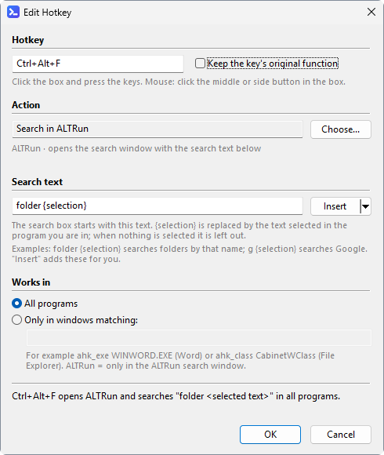
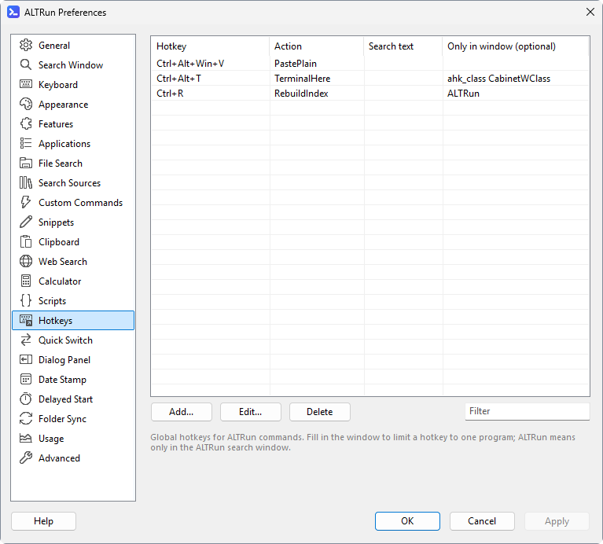
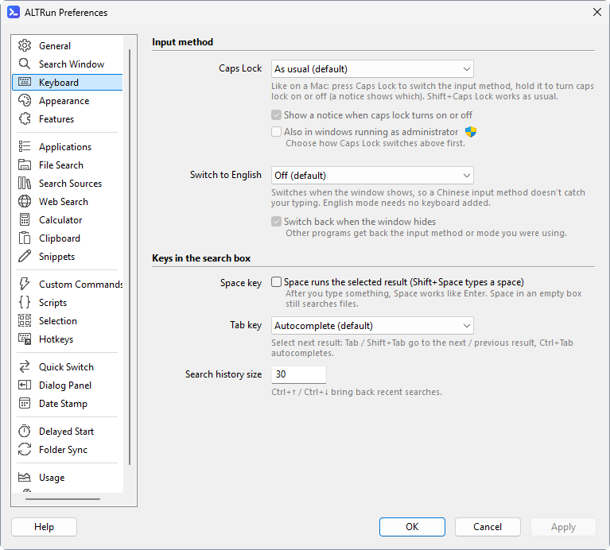

[English](Hotkeys) · **中文**

# 自定义热键

偏好设置 → 自定义热键: 给任意热键指定一条 [系统命令](System-Commands-zh#系统命令), 可以限定只在某个窗口里生效; 也可以打开 ALTRun 并填好搜索内容, 例如在某个范围里搜选中的文字。

**添加** / **修改** 打开热键窗口。从上到下分几组, 每组下面一行灰色说明; 最下面一行用文字说明这个热键会做什么 (例如 `Ctrl+Alt+F: 打开 ALTRun 搜索 "folder <选中的文字>" (所有程序)。`)。别的热键在同样的窗口里已经用了这组键时 (只有一个会起作用), 热键框下面的灰色说明变成红字, 写出是哪一个; 按 **确定** 仍然保存:

| 部分 | 设置文件里 | 说明 |
|---|---|---|
| 热键 | `Key`, 如 `^!f` | 点一下框, 按下组合键 (见下文 [设置热键](#设置热键)); 鼠标热键: 在框里点鼠标中键或侧键。勾选 "保留按键原来的功能" 时, 按键原来的作用照常 (开头的 `~`) |
| 动作 | `Action` | **选择...** 打开一个列表来选: **在 ALTRun 中搜索** (`Search`)、**显示 / 隐藏 ALTRun** (`ToggleWindow`)、你的 [自定义命令](Custom-Commands-zh) (`custom:<Id>`)、你的 [脚本](Scripts-zh) (`script:<文件名>`) 和系统命令 (文件里存的是 Id, 如 `TerminalHere`)。输入文字筛选 (名称、关键字、拼音首字母), `↑` `↓` 和 `Enter` 选定。下面的灰字说明这是什么命令、怎样拿到选中的内容; 自定义命令已删除或脚本文件夹里没有这个脚本时显示红字 |
| 搜索内容 | `SearchText`, 如 `folder {selection}` | 只用于 "在 ALTRun 中搜索": 搜索框里预先填好的文字。`{selection}` 换成当前程序里选中的文字 (合成一行, 最多 100 字); 没有选中或选中的是文件时为空, 只填 `folder `。**插入 ▾** 在光标处插入 `{selection}`, 或把一个范围放到最前面: `folder` (文件夹)、`file`、`doc` (文档)、`pic` (图片)、`recent`、`g` (Google); 前缀见 [使用方法](Usage-zh)。留空 = 空的搜索框。列表里显示在动作后面, 如 `搜索: folder {selection}` |
| 生效范围 | `WinTitle` | **所有程序** (留空), 或 **只在这些窗口里**: `ahk_exe WINWORD.EXE`、`ahk_class CabinetWClass` (资源管理器); `ALTRun` = 只在 ALTRun 的搜索窗口里 |

取选中的文字时, ALTRun 在那个程序里按一次 `Ctrl+C`: 没有选中时最多等 0.8 秒窗口才出来, 所以只在需要的热键里用 `{selection}`。剪贴板随后恢复原样。

**运行自定义命令**: 用 **选择...** 选 (存成 `"Action": "custom:<Id>"`, 即命令在 `ALTRun.json` 里的 `Id`)。带 `{query}` 或设了内容类型的命令, 和 [选中内容的操作](Usage-zh#选中内容的操作) 一样拿到选中的内容: `{query}` 换成选中的文字或路径, 没有 `{query}` 的文件或命令行把它加在最后一个参数; 选中的文字有换行、双引号或命令行的特殊字符时不传 (会提示原因)。没有选中时, 带 `{query}` 又有关键字的命令打开搜索窗口并填好关键字, 接着输入就行。其他命令直接运行, 不复制选中的内容。列表里显示为 `运行: <命令名称>`。删除命令时 (自定义命令页, 或搜索结果里 `Ctrl+Del`), 运行它的热键也一起删除, 删除前的确认里会写出是哪些热键。命令因为别的原因不在了 (手改设置文件、从别的电脑同步过来) 的热键显示成红字 `(命令已删除) custom:<Id>`, 按下时会提示。

**运行脚本**: 写了 `@altrun.argument` 或 `@altrun.selection` 的脚本规则相同 (存成 `"Action": "script:<文件名>"`), 见 [脚本](Scripts-zh)。改了文件名热键就失效 (显示成红字 `(脚本不存在) script:<文件名>`)。

新安装时带六个示例:
- `Ctrl+Alt+Win+V`: 在任何地方把剪贴板粘贴为纯文本 (和 PowerToys 的 "粘贴为纯文本" 同一个键)
- `Ctrl+Alt+F`: 在任何地方 (邮件、图纸目录...) 选中一个名字再按, ALTRun 直接搜这个名字的文件夹 (`folder {selection}`); 没有选中时打开并填好 `folder `
- `Ctrl+Alt+D`: 同样搜文档 (`doc {selection}`)
- `Ctrl+Alt+R`: 最近的文件和文件夹 (`recent `)
- `Ctrl+Alt+T`: 在资源管理器 (`ahk_class CabinetWClass`) 里, 在当前文件夹打开终端
- `Ctrl+R`: 在 ALTRun 搜索窗口 (`ALTRun`) 里重建索引

可以随意删除或修改; 已有的设置保留自己的列表。列表下面的 **添加示例** 只补上还没有的示例 (键和窗口都相同的算已有), 并提示添加了几个、跳过了几个; 点 "确定" / "应用" 后保存。想直达别的范围, 自己加一个 "在 ALTRun 中搜索" 的热键, 例如 `pic {selection}` (图片), 或 `g {selection}` 用 Google 搜选中的文字。搜索窗口里的 `F1` ~ `F4` 是内置的, 见 [使用方法](Usage-zh#快捷键)。

列表下面的 **其他热键** 列出在其他页面设置的热键, 按各页热键框现在的内容 (还没点 "确定" / "应用" 的也算): 呼出 ALTRun 和第二个呼出热键 (通用)、选中内容的操作 (选中内容)、剪贴板历史 (剪贴板历史)、对话框跳转和对话框面板的搜索框 (对话框跳转、对话框面板; 只在对话框里)、一键加日期 (一键加日期; 只在它的窗口里)。关着的功能不列。双击一行跳到设置它的页面。

### CapsLock 切换输入法

和 Mac 一样: 在 偏好设置 → 键盘 → 输入法 把 **CapsLock 键** 设成:
- **按一下切换输入法**: 切换到下一个已安装的输入法, 和 `Win+Space` 一样 (例如 英语(美国) ↔ 微软拼音)
- **按一下切换中 / 英模式**: 切换当前输入法的中 / 英模式, 和微软拼音里按 `Shift` 一样; 只装了一个中文输入法时用这个

按住 CapsLock 0.3 秒才开 / 关大写锁定 (不用等松开), 并短暂提示 "大写锁定: 开 / 关" (不想要提示可以取消 "显示大写锁定开 / 关的提示"); `Shift+CapsLock` 和原来一样开 / 关大写锁定。默认不开 (`General.CapsLock`)。把 CapsLock 当修饰键的自定义热键 (例如 `CapsLock & J`) 不要和它一起用。通过 Chrome 远程桌面等远程控制使用时也可以: 远程软件为了同步大写锁定补发的极短的 CapsLock 会被忽略。

**管理员窗口里也生效**: Windows 不让普通权限的程序控制以管理员身份运行的窗口, 所以默认在这些窗口里按 CapsLock 不会切换。勾选下面的 "在管理员窗口里也生效" (`Keyboard.CapsLockElevated`) 后, ALTRun 建一个计划任务 (这时确认一次 UAC), 之后每次启动都用它以管理员身份运行一个**小助手** (不再弹 UAC), 退出时一起退出。打开 [以管理员身份运行的程序里的对话框跳转](Quick-Switch-zh#以管理员身份运行的程序) 时也是这个小助手做, 两者共用一个计划任务。ALTRun 本身还是普通权限, 从它打开的程序、拖放文件、网络驱动器都不受影响。取消勾选时删掉计划任务 (再确认一次), Quick Switch 的那个选项还开着时保留。移动了 ALTRun 的文件夹后, 把这个选项关掉再打开一次。用这个选项时请把 ALTRun 放在只有管理员能修改的文件夹 (例如 `C:\Program Files`): 计划任务不经确认就以管理员权限运行 ALTRun, 能替换文件夹里 ALTRun 的程序就能借它拿到管理员权限。文件夹不用管理员权限就能修改时, ALTRun 会提醒。

### 设置热键
偏好设置里所有的热键 (呼出热键、剪贴板历史、对话框跳转、一键加日期、自定义热键) 都用同一种框, 和 Alfred、PowerToys 一样直接按键录制:
- 框里显示 `Alt+Space`、`Ctrl+Alt+C` 这样的写法。点一下框, 出现 "请按下快捷键...", 按下想要的组合键就记下来
- `Esc` 取消 (保留原来的热键), `Backspace` / `Delete` 清除 (不用这个热键)
- 单独的字母、数字、空格、回车等会影响平时打字, 要加上 `Ctrl`、`Alt` 或 `Win`; `F1` ~ `F24`、`Pause` 等可以单独用
- 录制时 ALTRun 自己的热键暂停, `Alt+Space`、`Win+E` 这类组合也不会触发系统或其它程序的功能
- 区分左右: 默认 `Ctrl`、`Alt`、`Shift`、`Win` 左右都可以。在 偏好设置 → 通用 勾选 "热键区分左右 Ctrl / Alt / Shift / Win" 后, 之后录制的热键会记住按的是哪一边: 按左 `Alt` + `空格` 显示为 `LAlt+Space`, 只有左 `Alt` 能触发, 右边可以留给其它软件 (例如占用 `RAlt+Space` 的语音输入)。两边同时按住则记成左右都可以。已经设好的热键在重新录制之前不变。区分左右的热键没法用 Windows 的系统热键 (系统热键不分左右), 是通过 ALTRun 的键盘钩子实现的: 以管理员身份运行的窗口在前面时不起作用 (见 [常见问题](FAQ-zh#以管理员身份运行的窗口里-capslock-等不起作用)); 开始菜单或 Windows 搜索开着时可以用, 会先把它们关掉
- 保存时, 如果两个全局热键相同 (例如呼出热键和剪贴板历史都是 `Ctrl+Alt+C`), 会先提示。`Alt+Space` 和 `LAlt+Space` 算相同 (按左 `Alt` 时两个都会触发), `LAlt+Space` 和 `RAlt+Space` 不算。只在某些窗口里生效的热键 (对话框跳转、一键加日期、填了窗口的自定义热键) 可以重复

设置文件里仍然是 AutoHotkey 的写法 (`!` Alt, `^` Ctrl, `+` Shift, `#` Win, 例如 `!Space`; 前面加 `<` / `>` = 只用左边 / 右边的键, 例如 `<!Space`), 也可以直接编辑; `CapsLock & J` 这类特殊写法在偏好设置里重新录制之前会原样保留。
