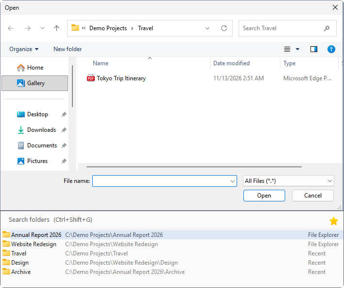
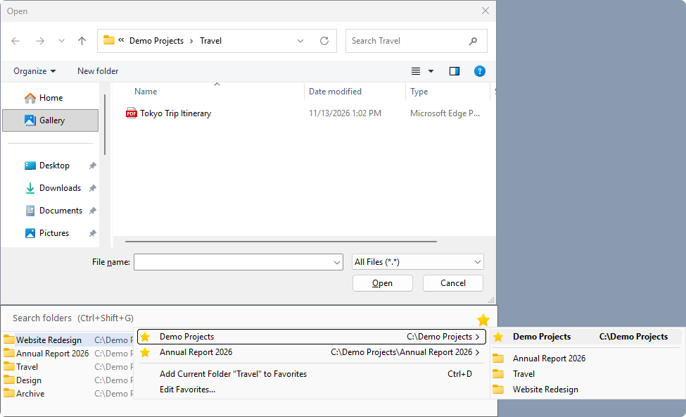
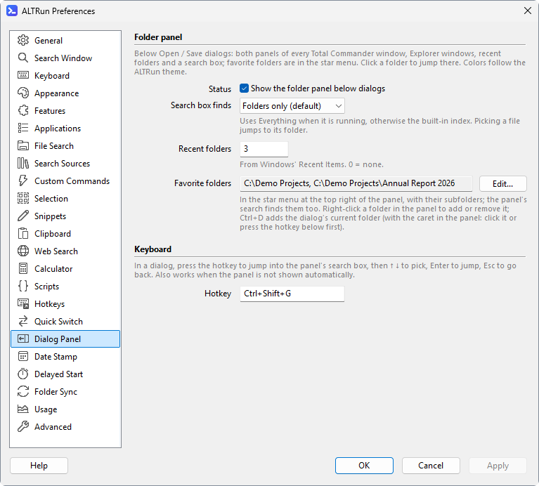

[English](Quick-Switch-Panel) · **中文**

# 对话框文件夹面板

文件夹面板是 Quick Switch 的可视操作方式。默认启用; 打开 / 保存对话框 (或 [浏览文件夹](Quick-Switch-zh#浏览文件夹对话框) 对话框) 出现时, 面板会贴在对话框下方, 下方空间不足时显示在上方。点击文件夹即可跳转, 不用记快捷键。

## 面板内容与操作

- 显示每个 Total Commander 窗口的当前面板和另一侧面板、每个 Directory Opus 窗口的当前标签页 (和另一侧)、已打开的资源管理器窗口, 以及最近用过的文件夹。[收藏的文件夹](#收藏的文件夹) 在右上角的星形菜单里。
- 搜索框先过滤现有列表, 再通过 Everything (或 ALTRun 内置文件索引) 搜索匹配名称的文件夹和文件; 文件夹排在文件前面。
- 选中一个文件后, 跳到它所在的文件夹, 不会替用户打开或保存该文件。
- 没有 Everything 时, 内置索引只覆盖 偏好设置 → 文件搜索 里列出的文件夹 (默认是桌面、文档、下载)。搜不到结果时, 面板会显示一行说明覆盖了哪些文件夹; 按 `Enter` (或点击这一行) 打开该页面, 把要搜索的文件夹加进去。
- `↑` / `↓` 选择, `Enter` 跳转, `Esc` 返回原对话框。使用中文输入法时, 第一次 `Enter` 可能只是把拼音上屏, 上屏后再按一次才会跳转。
- 对话框不在前台时, 面板会隐藏。面板和对话框一样宽 (100% 缩放时最窄 420 像素, 最宽不超过屏幕), 对话框改变宽度时跟着调整。面板颜色跟随 ALTRun 主题。
- 面板不会挡住对话框的按钮和文件列表。对话框上下的空间放不下整个列表时, 列表显示的行数会少一些 (至少 3 行, 其余的滚动查看); 连 3 行都放不下时 (对话框很高或最大化), 只显示搜索框, 放在对话框下方、上方或者盖在它的标题栏上; 点它 (或按 `Ctrl+Shift+G`) 打开列表, 回到对话框时又收起。

在标准打开 / 保存对话框里, `Ctrl+Shift+G` 可临时显示面板并聚焦搜索框。即使关闭了自动显示, 仍然可以用这个热键打开。

## 收藏的文件夹

经常保存到、或者从里面打开文件的文件夹, 放在面板右上角的星形菜单里:

- **跳转**: 点星形按钮 (或者在面板的搜索框里按 `Alt+↓` 或 `F4`, 和下拉框一样), 再点一个收藏。有子文件夹的收藏会展开一个子菜单, 列出它的子文件夹 (一层); 子菜单的第一项 (粗体) 是这个收藏本身, 所以点哪一项都会跳过去。按名字排序后列出前 30 个子文件夹, 排法和资源管理器一样 ("2" 在 "10" 前面); 隐藏和系统文件夹不列。最多读 500 个, 所以有几千个子文件夹的收藏也能马上打开 ("还有 470+ 个文件夹")。
- **搜索**: 面板的搜索框也能找到收藏, 排在最前面, 标着 "收藏"。
- **加入**: 星形菜单 → **把当前文件夹 "…" 加入收藏**, 把对话框现在显示的文件夹加进去; 或者在面板里右键点一个文件夹 → **加入收藏**。会弹出一条简短的提示。
- **键盘**: 光标在面板里时 (先点一下面板, 或者按 `Ctrl+Shift+G`), 按 `Ctrl+D` 把对话框当前的文件夹加入收藏。在对话框里按 `Ctrl+D` 是 [日期戳](Date-Stamp-zh) 的热键, 会往文件名里加日期。
- **删除**: 在面板里右键点收藏的文件夹 (在文件管理器里打开的, 或者搜索找到的) → **从收藏中删除**。
- **编辑列表**: 星形菜单 → **编辑收藏...**, 或者偏好设置 → 对话框面板 → "收藏的文件夹" → **编辑...**, 每行一个文件夹; 可以用 `%USERPROFILE%\Documents` 这样的环境变量。

收藏按加入的顺序排列, 保存在 `ALTRun.json` 里。子文件夹在打开菜单时读取, 只读这台电脑自己的驱动器: 网络共享、映射的网络驱动器或光盘上的收藏, 菜单里只显示收藏本身, 不列子文件夹, 这样断开的驱动器不会让菜单卡住。

## 搜索范围

偏好设置 → 对话框面板 → “搜索框搜索”决定搜索范围:

- **只搜文件夹** (默认): 只显示匹配的文件夹。
- **文件夹和文件**: 同时搜索文件和文件夹; 文件夹仍然单独优先显示, 不会被同名文件挤掉。

最近文件夹来自 Windows 的“最近使用的项目”。打开过文件时, 记录的是文件所在文件夹; 默认显示最近 10 个, 设为 0 则不显示最近文件夹。

## 相关设置

在偏好设置 → 对话框面板中修改, 对应设置文件为 `Extensions.QuickSwitch`:

| 设置 | 默认 / 可选值 | 作用 |
|---|---|---|
| `ShowPanel` | `1` | 自动显示文件夹面板 |
| `PanelSearch` | `folders` / `all` | 搜索文件夹, 或同时搜索文件夹和文件 |
| `Favorites` | `[]` | 收藏的文件夹, 在星形菜单里 (见 [收藏的文件夹](#收藏的文件夹)) |
| `RecentFolders` | `10` | 最近文件夹数量; `0` = 不显示 |
| `MenuHotkey` | `Ctrl+Shift+G` | 显示面板并聚焦搜索框 |

更多快捷键和自动跳转设置见[对话框快速跳转](Quick-Switch-zh)。
