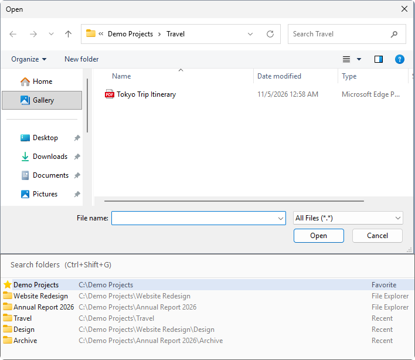
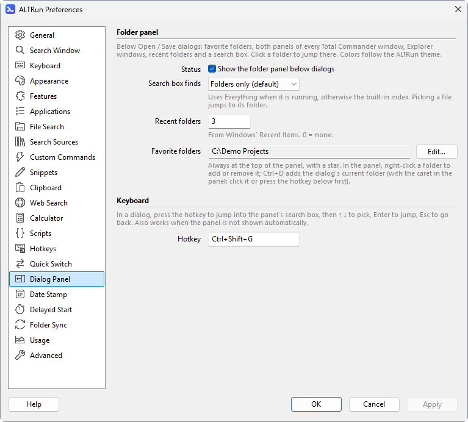

**English** · [中文](Quick-Switch-Panel-zh)

# Dialog Folder Panel

The folder panel is the visual way to use Quick Switch. It is enabled by default. When an Open / Save dialog (or a [Browse for Folder](Quick-Switch#browse-for-folder-dialogs) dialog) appears, the panel attaches below it, or above it if there is not enough room. Click a folder to jump there without remembering a shortcut.

## Contents and controls

- Lists your [favorite folders](#favorite-folders) first, then the current and opposite panels of each Total Commander window, the current tab (and the other side) of each Directory Opus window, open File Explorer windows and recently used folders.
- The search box filters the list first, then searches matching folder and file names with Everything (or ALTRun's built-in file index); folders are listed before files.
- Selecting a file jumps to its containing folder; it does not open or save the file.
- Use `↑` / `↓` to select, `Enter` to jump and `Esc` to return to the original dialog. With a Chinese input method, the first `Enter` may commit the composition; press it again to jump.
- The panel hides when the dialog is not in the foreground and uses the current ALTRun theme. It is as wide as the dialog (at least 420 pixels at 100% scaling, at most the width of the screen), and follows when the dialog is resized.

In a standard Open / Save dialog, `Ctrl+Shift+G` temporarily shows the panel and focuses its search box. This works even when automatic display is disabled.

## Favorite folders

Folders you often save to or open from can be kept at the top of the panel, with a star icon and marked "Favorite":

- **Add**: right-click a folder in the panel → **Add to Favorites**, or right-click → **Add Current Folder "…" to Favorites** for the folder the dialog shows now. A short notice confirms it and the favorite is selected.
- **Keyboard**: `Ctrl+D` adds the dialog's current folder while the caret is in the panel (click the panel, or press `Ctrl+Shift+G`, first). In the dialog itself `Ctrl+D` is the [date stamp](Date-Stamp) hotkey and adds a date to the file name.
- **Remove**: right-click a favorite → **Remove from Favorites**.
- **Edit the list**: Preferences → Dialog Panel → "Favorite folders" → **Edit...**, one folder per line; environment variables such as `%USERPROFILE%\Documents` work.

Favorites are listed in the order they were added and are saved in `ALTRun.json`. A favorite that is also open in Explorer or Total Commander shows once, as a favorite. A favorite on a drive that isn't connected is still listed (ALTRun doesn't check, so a disconnected network drive can't make the panel hang).

## Search scope

Preferences → Dialog Panel → **Search box finds** controls the scope:

- **Folders only** (default): only matching folders are shown.
- **Folders and files**: search both; folders remain grouped first so files with the same name do not push them out.

Recent folders come from Windows' **Recent items**. For a file that was opened, its containing folder is used. The default is 10 recent folders; set it to 0 to hide them.

## Settings

Change these in Preferences → Dialog Panel. They are stored under `Extensions.QuickSwitch`:

| Setting | Default / values | Purpose |
|---|---|---|
| `ShowPanel` | `1` | Automatically show the folder panel |
| `PanelSearch` | `folders` / `all` | Search folders only, or both folders and files |
| `Favorites` | `[]` | Favorite folders, listed first (see [Favorite folders](#favorite-folders)) |
| `RecentFolders` | `10` | Number of recent folders; `0` = none |
| `MenuHotkey` | `Ctrl+Shift+G` | Show the panel and focus its search box |

For the other shortcuts and automatic switching settings, see [Quick Switch](Quick-Switch).
