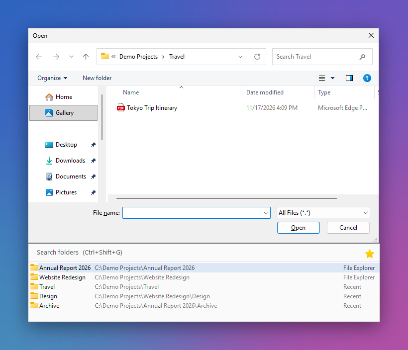
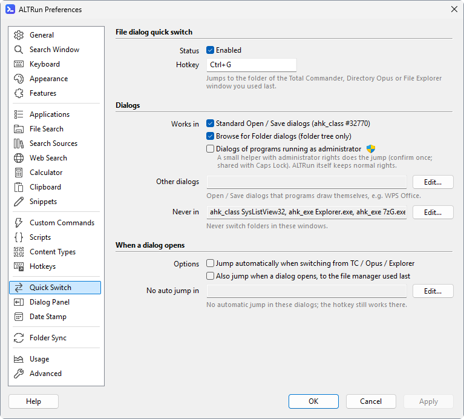

**English** · [中文](Quick-Switch-zh)

# Quick Switch

Quick Switch jumps an Open / Save dialog to a folder you already have open, without browsing through the directory tree again. For the visual folder panel and its settings, see [Dialog Folder Panel](Quick-Switch-Panel).

## Shortcuts

In a standard Open / Save file dialog:

- `Ctrl+G`: jump to the folder open in the file manager you used last: Total Commander, Directory Opus, Arke or File Explorer. ALTRun looks at the windows from front to back and takes the first of the four, so with several open it is the one you used most recently; the [folder panel](Quick-Switch-Panel) lists all of them
- `Ctrl+Shift+G`: show the folder panel and focus its search box so you can pick a folder or file with the keyboard

The existing file name is preserved when jumping. For example, a name suggested by a Save As dialog is not cleared.

## Automatic switching

Enable **Auto switch** in Preferences → Quick Switch to jump automatically when you switch from Total Commander, Directory Opus, Arke or File Explorer to an Open / Save dialog: the dialog goes to the folder of the window you came from. It works however you switch (taskbar, Alt+Tab, a click on the dialog's title bar). In standard Open / Save dialogs the folder is put into the file name box and the dialog is told to go there with window messages, without simulated keys; a name Save As suggested stays in the box.

Tick **Also jump when a dialog opens, to the file manager used last** (`AutoSwitchOnOpen`, off by default) and a dialog that has just opened jumps once too, to the folder of the Total Commander / Directory Opus / Arke / Explorer window used last (the frontmost one), for example after browsing a folder in Explorer and pressing Ctrl+O in Word. It overrides the folder the program remembers (such as where Save As suggests saving), so it is off by default; **No auto jump in** applies to it too.

**Works in**: tick **Standard Open / Save dialogs** (`ahk_class #32770`, on by default; only dialogs with an Explorer file list count, so program windows that are dialogs themselves, such as System Information (msinfo32), are left alone); **Browse for Folder dialogs** (on by default) covers the older folder picker that only shows a folder tree (see below); dialogs that programs draw themselves go in **Other dialogs** (**Edit...**, one per line), for example WPS's `ahk_class Qt5QWindowIcon` (ALTRun types the folder into the dialog's file name box and presses Enter, which works in most Qt, GTK and Java file dialogs). Windows in **Never in** never switch (these lists are edited with **Edit...** too, one window per line); **No auto jump in** disables only automatic switching, and the hotkeys still work there.

## Browse for Folder dialogs

Many programs still pick a folder with the older "Browse for Folder" dialog: a folder tree with OK / Cancel and no file list. The folder panel and `Ctrl+G` work there too: the tree expands to the folder and selects it, and you still click OK yourself (pressing Enter in that dialog would mean OK). Untick **Browse for Folder dialogs** under **Works in** to leave these dialogs alone (`BrowseDialogs`). In programs running as administrator, see below.

## WinRAR and 7-Zip extract windows

The extract windows of WinRAR ("Extraction path and options") and 7-Zip ("Extract", also "Copy" / "Move" in 7-Zip File Manager) count too: `Ctrl+G` or a click in the folder panel puts the folder into the destination box, and nothing more. Enter or OK there would start extracting, so ALTRun presses neither: check the other options and click OK yourself. They never jump by themselves (auto switch leaves them alone, as the program suggests a folder named after the archive). Untick **WinRAR / 7-Zip extract windows** under **Works in** to leave them alone (`ExtractDialogs`). Not in programs running as administrator.

## WeCom and similar: jumping through the address bar

In standard Open / Save dialogs, ALTRun puts the folder into the file name box and presses OK: a normal dialog that gets OK with a folder in that box goes to the folder. Some programs take that as "this folder is chosen" instead: the send-file dialog of WeCom (`WXWork.exe`) adds the folder to the chat rather than opening it (#600).

Dialogs of such programs jump through the address bar: ALTRun presses `Alt+D` to go to the address bar, types the folder and presses Enter. Enter in the address bar only goes to the folder, it never chooses it.

- Only WeCom by default: the setting `AddressBarDialogs` is `["ahk_exe WXWork.exe"]`, nothing to set up.
- It isn't in Preferences. If another program does the same (the dialog closes after a jump and the folder is taken as the chosen item), add a line to `Extensions.QuickSwitch.AddressBarDialogs` in ALTRun.json, for example `"AddressBarDialogs": ["ahk_exe WXWork.exe", "ahk_exe program.exe"]`, and restart ALTRun; please also tell me in [Issues](https://github.com/zhugecaomao/ALTRun/issues) so it can go into the default list.
- Only for standard dialogs (`ahk_class #32770`); dialogs that programs draw themselves already get the folder typed and Enter.
- The jump uses keys, so the dialog has to be in front: it is when you click the panel or press `Ctrl+G`. Automatic switching waits until keys and mouse buttons are released (for example Alt after Alt+Tab).

## Programs running as administrator

Windows doesn't let programs with normal rights control windows running as administrator, so by default ALTRun can't jump the dialogs of such programs (installers, tools started with "Run as administrator"); a jump there shows a hint once per dialog. Tick **Dialogs of programs running as administrator** under **Works in** (`AdminDialogs`) and ALTRun creates a scheduled task (confirm UAC once); from then on every start uses it to run a **small helper with administrator rights** (no more UAC prompts), and the helper exits with ALTRun. The jumps there then work like anywhere else: the hotkeys, the folder panel, auto switch, Open / Save and Browse for Folder dialogs. ALTRun itself keeps normal rights, so programs opened from it, drag and drop and network drives are not affected. The helper is the same one as for [Caps Lock in administrator windows](Hotkeys#caps-lock-switches-the-input-method), one task for both; unticking the last of the two options deletes the task (confirm once more).

The helper only jumps: it takes a request only for the dialog in front, a standard Open / Save or Browse for Folder dialog of a program running as administrator, and a full path to a folder that exists, and it doesn't press Open or Save. Keep ALTRun in a folder only administrators can change (for example `C:\Program Files`) when you use this option: the task runs ALTRun with administrator rights without asking. ALTRun warns when its folder can be changed without administrator rights. The hotkeys (`Ctrl+G`, `Ctrl+Shift+G`) work in these dialogs too: ALTRun gets no keys there, so the helper catches them and only tells ALTRun which hotkey was pressed (ALTRun still decides the folder, and the helper checks the jump as above); in every other window ALTRun handles them itself, so a key never does both.

## Where the folders come from

None of them go through the clipboard, so the paths don't appear in Windows clipboard history (`Win+V`):
- **Total Commander**: asked directly through its `WM_COPYDATA` interface (TC 8.0 or later)
- **Directory Opus**: Opus's own `dopusrt.exe /info …,paths`, which lists the tabs of every Opus window (found next to the running `dopus.exe`, nothing to set up). It runs only while an Opus window is open, when a folder is actually needed (the hotkey, auto switch, or the panel when a dialog opens; the panel shows the other folders first and adds Opus's a moment later), and a result is reused for 1.5 s. With logging on, the log shows how long each read took (`Perf: Directory Opus paths … ms`)
- **Arke** (0.8.0 or later): asked directly through its `WM_COPYDATA` interface, one request for all its windows: the active pane of each window's active tab, and the other pane in split view. Home, search results, the Recycle Bin and remote locations aren't folders. See [File managers](File-Managers#arke)
- **File Explorer**: the Shell windows list

What works with each file manager, and how to set one up: [File managers](File-Managers).

A network folder (`\\server\share`, a mapped drive) must answer within 0.5 s, or the dialog isn't jumped there: a server that is offline would otherwise keep ALTRun waiting about 20 s. With logging on, the log says which folder didn't answer.

## Settings

Preferences → Quick Switch controls the hotkeys, eligible windows and automatic switching. The settings are stored under `Extensions.QuickSwitch`:

| Setting | Default / purpose |
|---|---|
| `Enabled` | `1` = enable Quick Switch |
| `Hotkey` | The jump hotkey, default `Ctrl+G`: the folder of the Total Commander / Directory Opus / Arke / File Explorer window used last (`TotalCmdHotkey` before settings version 6) |
| `AutoSwitch` | Jump automatically when switching from Total Commander, Directory Opus, Arke or File Explorer to a dialog, default `0` (off) |
| `AutoSwitchOnOpen` | A dialog that has just opened jumps once too, to the folder of the file manager used last, default `0` (off) |
| `StandardDialogs` | `1` = in the standard Open / Save dialogs (`ahk_class #32770`) |
| `DialogWindows` | Other dialogs where Quick Switch works (dialogs programs draw themselves), a list of window conditions, default `[]` |
| `BrowseDialogs` | `1` = also in "Browse for Folder" dialogs (folder tree only) |
| `ExtractDialogs` | `1` = also in the extract windows of WinRAR / 7-Zip: only the destination box is filled (see above); default `1` |
| `AdminDialogs` | `1` = also in dialogs of programs running as administrator, through a small helper with administrator rights (see above); default `0` |
| `ExcludeWindows` | Windows where Quick Switch is fully disabled (a list) |
| `AutoSwitchExclude` | Windows where automatic switching is disabled but manual hotkeys still work (a list) |
| `AddressBarDialogs` | Standard dialogs that jump through the address bar (a list), default `["ahk_exe WXWork.exe"]` (WeCom); not in Preferences, see [WeCom and similar](#wecom-and-similar-jumping-through-the-address-bar) |

Window conditions are `ahk_exe program.exe`, `ahk_class ClassName` or part of the window title, one per list item, for example `"ExcludeWindows": ["ahk_exe TOTALCMD64.exe", "ahk_class SysListView32"]`.

The [Dialog Folder Panel](Quick-Switch-Panel) has its own Preferences page and can appear beside Open / Save dialogs.
