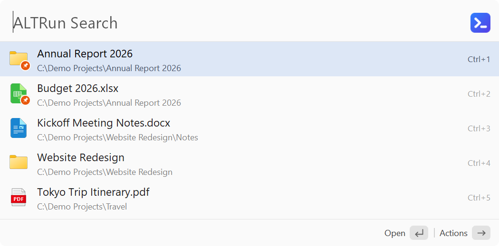
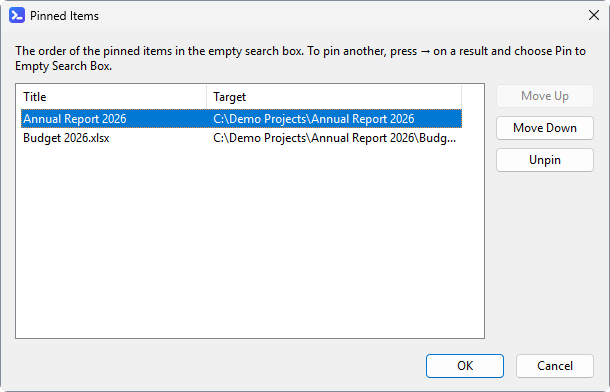

[English](Recent) · **中文**

# 置顶和最近使用

呼出搜索窗口还没输入时, 下面直接列出 (置顶的项目图标右下角有一个图钉):

- **置顶的项目** (默认显示): 任意一个结果按 `→` 打开操作面板, 选 **置顶到空搜索框**。置顶相当于空搜索框里的常用收藏 (和对话框面板的 [收藏的文件夹](Quick-Switch-Panel-zh) 是两回事)。置顶的项目保存在 `ALTRun.json` 里 (`Features.Recent.Pinned`), 换电脑同步设置时一起带走。要调整顺序或一次取消好几个: 偏好设置 → 搜索窗口 → 空搜索框 → "显示置顶的项目" 旁边的 **编辑...** (上移 / 下移 / 取消置顶)
- **拖进来置顶**: 把文件或文件夹 (从资源管理器或桌面, 一次最多 20 个) 拖到搜索窗口上。窗口没打开时, 先按住鼠标开始拖, 不松手按 `Alt+Space` (你设的呼出热键), 再放到窗口上。置顶的文件也可以再拖到别的程序里 (复制过去)
- **最近打开的项目**: 默认不显示; 勾上 偏好设置 → 搜索窗口 → 空搜索框 → "显示最近使用的项目" 就会列出; 显示几个在下一行 "最近使用的项目显示数量" 里改 (默认 5)。勾选框旁边的 **清空...** 一次全部清掉 (置顶的不受影响)
- **搜索框里的灰色文字**: 默认 "ALTRun 搜索", 在 偏好设置 → 搜索窗口 → 空搜索框 → "提示文字" 改成自己喜欢的 (留空恢复默认, 写一个空格就什么都不显示)

只记能重新打开的结果: 应用、文件、文件夹、网址、自定义命令和系统命令; 剪贴板历史、计算结果、片段、网页搜索、窗口不记。选中一项按 `Ctrl+Del` 取消置顶或从最近使用里去掉; 偏好设置 → 高级 → "重置学习排序" 也会清空最近使用。两个都不勾就都不显示。
