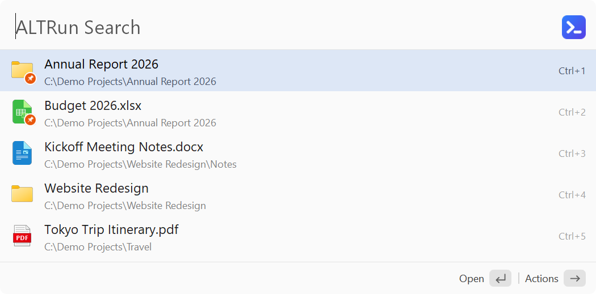
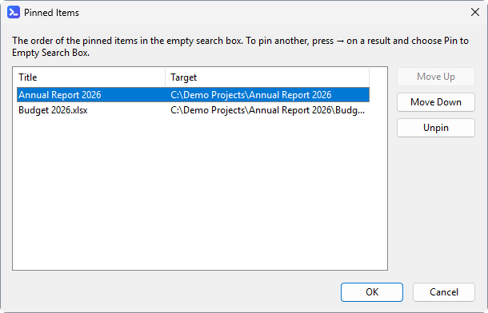

**English** · [中文](Recent-zh)

# Pinned and recent items

Before you type anything, the search window lists your pinned items and, if you turn it on, the items you opened recently, so the things you use every day are one `↓` and `Enter` away (or `Ctrl+1`–`Ctrl+9`). Like the favorites and recent items of Raycast and Alfred.

| Shown | By default | Where it comes from | Kept in |
|---|---|---|---|
| Pinned items (a pin at the bottom right of the icon) | On | Items you pin yourself, in your order | `ALTRun.json` (`Features.Recent.Pinned`): travels with your settings |
| Recently opened items | Off | What you opened from the search window, newest first | `Data\Knowledge.json`: the last 30 are kept |

A pinned item isn't listed again among the recent items.

## Pinned items
- **Pin**: on any result, press `→` to open the action panel and choose **Pin to Empty Search Box** (also on a recent item in the empty search box)
- **Unpin**: select it in the empty search box and press `Ctrl+Del` (it asks first), or `→` → **Unpin**
- **Change the order, unpin several at once**: Preferences → Search Window → Empty search box → "Show pinned items" → **Edit...**: **Move Up** / **Move Down** / **Unpin**, then OK
- Pinned items are your quick favorites in the empty search box; they are not the same as the [Favorite folders](Quick-Switch-Panel) of the dialog panel

## Recently opened items
- Turn on Preferences → Search Window → Empty search box → "Show recently used items"; the row below, "Number of recent items to show", sets how many (5 by default)
- Opening an item again moves it to the top
- **Remove one**: select it and press `Ctrl+Del`
- **Forget all of them**: **Clear...** next to the check box (pinned items stay); Preferences → Advanced → "Reset Learned Ranking" clears them too

## What can be pinned and remembered
Only results you can open again later:

| Remembered | Not remembered |
|---|---|
| Apps, files, folders, URLs, custom commands, system commands | Clipboard history, calculations, snippets, web searches, windows, terminal commands, the cheat sheet |

Files, folders and URLs are saved with their path; system commands by their Id, so they show in the current interface language. A file that has since been moved or deleted is still listed: remove it with `Ctrl+Del`.

## Gray text in the empty search box
"ALTRun Search" by default; change it in Preferences → Search Window → Empty search box → "Placeholder text" (leave it blank for the default, or type a single space to show nothing). While a usage tip is shown ("Show a usage tip"), the tip takes its place.

## Settings
| Setting | Default | Description |
|---|---|---|
| `Window.ShowPinned` | `1` | List the pinned items in the empty search box |
| `Window.ShowRecent` | `0` | Then list the recently opened items |
| `Window.RecentCount` | `5` | How many recent items to show |
| `Window.Placeholder` | `""` | Gray text in the empty search box |
| `Features.Recent.Pinned` | `[]` | The pinned items; change them in the action panel or with **Edit...**, not by hand |

Uncheck both boxes to show neither. More: [Settings reference → Window](Configuration#window).
