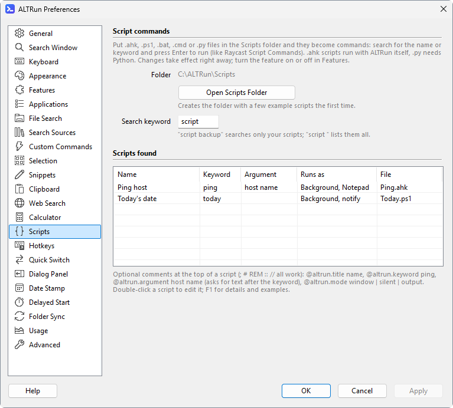

[English](Scripts) · **中文**

# 脚本扩展

把自己的脚本放进 `Scripts\` 文件夹 (程序目录里; 偏好设置 → 脚本 → "打开脚本文件夹", 或者搜索 "打开脚本文件夹", 第一次打开时会建几个示例: 后台运行显示通知的、关键字后面带参数的、用文本编辑器看输出的), 就能在搜索窗口里按名称或关键字找到并运行, 和 Raycast 的 Script Commands 一样。只想看脚本时, 输入 **`script `** (列出全部) 或 **`script 名称`** (只输入 `script` 不带空格时, 显示一行提示 (名字以 script 开头的排在它前面), 在提示上按 `Enter` 补全成 `script `; 还没输完整时, 例如 `scr`, 提示在列表最后); 关键字在 偏好设置 → 脚本 → "搜索关键字" 修改。支持 `.ahk` (用 ALTRun 自带的 AutoHotkey 运行, 不用另外安装)、`.ps1`、`.bat` / `.cmd`、`.py` (需要装 Python)。偏好设置 → 脚本 列出找到的脚本, 双击用记事本编辑:



脚本开头的注释里可以写这些设置 (注释符 `;` `#` `REM` `::` `//` 都行, 都可以不写):

| 设置 | 说明 |
|---|---|
| `@altrun.title 名称` | 显示的名称, 默认用文件名 |
| `@altrun.keyword 关键字` | 输入完全相同时排在最前面 |
| `@altrun.argument 提示` | 需要参数: 输入 "关键字 文字", 文字作为第一个参数传给脚本; 只搜到名称时 `Enter` 补全成 "关键字 " |
| `@altrun.mode window` | 默认: 正常运行 (有窗口) |
| `@altrun.mode silent` | 在后台运行, 结束后把输出的最后一行显示成通知 |
| `@altrun.mode output` | 在后台运行, 结束后用 `.txt` 的默认程序 (一般是记事本) 打开全部输出 |
| `@altrun.selection Text, PDF` | [内容类型](Usage-zh#选中内容的操作) (内置的或自己的, 用逗号分开): 选中这些类型的内容按 `Ctrl+Alt+\` 时, 操作面板里出现这个脚本 (排在自定义命令后面), 选中的内容作为第一个参数传给它 (多个文件: 每个一个参数) |

例子 (`Scripts\Hash.ps1`):
```powershell
# @altrun.title    文件哈希
# @altrun.keyword  hash
# @altrun.argument 文件路径
# @altrun.mode     output
Get-FileHash -Algorithm SHA256 $args[0] | Format-List
```
输入 `hash D:\Downloads\setup.exe` 后 `Enter`, SHA256 用文本编辑器显示。关键字不要和默认命令重复 (例如 `ping` 已经是自带的 Ping 命令)。

**选中内容用的脚本**: 写了 `@altrun.selection` 的脚本, 在任何程序里选中这种类型的内容按 `Ctrl+Alt+\`, 列表里就有它。选中的文字有换行或双引号时不传, 有脚本所用 shell 的特殊字符时也不传 (`.bat` / `.cmd` 和所有 `silent` / `output` 脚本经过 cmd, `.ps1` 经过 PowerShell), 这时列表里不出现这个脚本。偏好设置 → 脚本 的 "选中内容类型" 列写出每个脚本的类型。

**给脚本设热键**: 偏好设置 → 自定义热键 里 **选择...** 也列出脚本 (存成 `"Action": "script:<文件名>"`, 例如 `script:hash.ps1`)。写了 `@altrun.argument` 或 `@altrun.selection` 的脚本把选中的内容作为参数, 检查同上; 没有选中时, 有参数又有关键字的脚本打开搜索窗口并填好关键字。改了文件名热键就失效: 显示成红字 `(脚本不存在) script:<文件名>`, 重新选一次脚本就好。

`.ahk` 脚本里用 `FileAppend("文字", "*")` 输出。增删、修改脚本后马上生效, 不用重新载入; 选中脚本按 `F3` 用记事本编辑。后台运行的脚本最多等 2 分钟。
