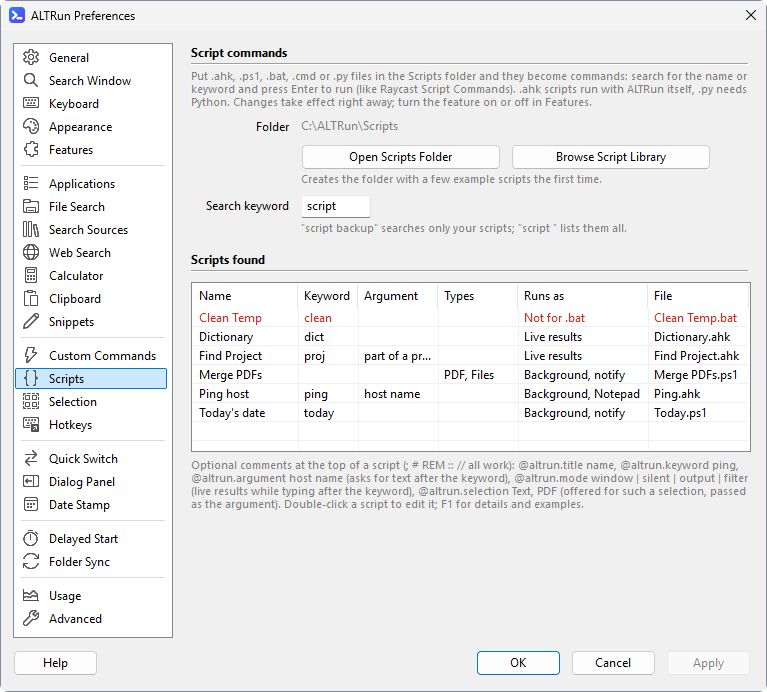

[English](Scripts) · **中文**

# 脚本扩展

把自己的脚本放进 `Scripts\` 文件夹 (程序目录里; 偏好设置 → 脚本 → "打开脚本文件夹", 或者搜索 "打开脚本文件夹", 第一次打开时会建几个示例: 后台运行显示通知的、关键字后面带参数的、用文本编辑器看输出的、实时结果的), 就能在搜索窗口里按名称或关键字找到并运行, 和 Raycast 的 Script Commands 一样。只想看脚本时, 输入 **`script `** (列出全部) 或 **`script 名称`** (只输入 `script` 不带空格时, 显示一行提示 (名字以 script 开头的排在它前面), 在提示上按 `Enter` 补全成 `script `; 还没输完整时, 例如 `scr`, 提示在列表最后); 关键字在 偏好设置 → 脚本 → "搜索关键字" 修改。支持 `.ahk` (用 ALTRun 自带的 AutoHotkey 运行, 不用另外安装)、`.ps1`、`.bat` / `.cmd`、`.py` (需要装 Python)。偏好设置 → 脚本 列出找到的脚本, 双击用记事本编辑:



脚本开头的注释里可以写这些设置 (注释符 `;` `#` `REM` `::` `//` 都行, 都可以不写):

| 设置 | 说明 |
|---|---|
| `@altrun.title 名称` | 显示的名称, 默认用文件名 |
| `@altrun.keyword 关键字` | 输入完全相同时排在最前面 |
| `@altrun.argument 提示` | 需要参数: 输入 "关键字 文字", 文字作为第一个参数传给脚本; 只搜到名称时 `Enter` 补全成 "关键字 " |
| `@altrun.mode window` | 默认: 正常运行 (有窗口) |
| `@altrun.mode silent` | 在后台运行, 结束后把输出的最后一行显示成通知 (没有输出时显示 "完成"); 失败时 (退出码不是 0、启动不了、2 分钟后被结束) 显示错误输出的第一行或原因 |
| `@altrun.mode output` | 在后台运行, 结束后用 `.txt` 的默认程序 (一般是记事本) 打开全部输出; 错误输出空一行接在后面 |
| `@altrun.mode filter` | 实时结果: 输入 "关键字 文字" 时一边输入一边运行脚本, 把它的输出显示成结果 (见下面的 [实时结果](#实时结果))。需要关键字; 只支持 `.ahk`、`.py`、`.ps1` |
| `@altrun.filter altrun` | 和 `filter` 一起用: 输入关键字时只运行一次脚本, 之后输入时由 ALTRun 过滤它的输出 (见下面) |
| `@altrun.selection Text, PDF` | [内容类型](Usage-zh#选中内容的操作) (内置的或自己的, 用逗号分开): 选中这些类型的内容按 `Ctrl+Alt+\` 时, 操作面板里出现这个脚本 (排在自定义命令后面), 选中的内容作为第一个参数传给它 (多个文件: 每个一个参数) |

例子 (`Scripts\Hash.ps1`):
```powershell
# @altrun.title    文件哈希
# @altrun.keyword  hash
# @altrun.argument 文件路径
# @altrun.mode     output
Get-FileHash -Algorithm SHA256 $args[0] | Format-List
```
输入 `hash D:\Downloads\setup.exe` 后 `Enter`, SHA256 用文本编辑器显示。关键字不要和默认命令重复 (例如 `ping` 已经是自带的 Ping 命令)。

**选中内容用的脚本**: 写了 `@altrun.selection` 的脚本, 在任何程序里选中这种类型的内容按 `Ctrl+Alt+\`, 列表里就有它。选中的文字有换行或双引号时不传, 有脚本所用 shell 的特殊字符时也不传 (`.bat` / `.cmd` 经过 cmd, `.ps1` 经过 PowerShell), 这时列表里不出现这个脚本。偏好设置 → 脚本 的 "类型" 列写出每个脚本的类型。

**给脚本设热键**: 偏好设置 → 自定义热键 里 **选择...** 也列出脚本 (存成 `"Action": "script:<文件名>"`, 例如 `script:hash.ps1`)。写了 `@altrun.argument` 或 `@altrun.selection` 的脚本把选中的内容作为参数, 检查同上; 没有选中时, 有参数又有关键字的脚本打开搜索窗口并填好关键字。改了文件名热键就失效: 显示成红字 `(脚本不存在) script:<文件名>`, 重新选一次脚本就好。

`.ahk` 脚本里用 `FileAppend("文字", "*")` 输出。增删、修改脚本后马上生效, 不用重新载入; 选中脚本按 `F3` 用记事本编辑。

**后台脚本** (`silent` / `output`) 直接启动, 不经过 cmd, 所以参数里的 `&`、`|`、`>`、引号都只是文字 (`.bat` / `.cmd` 仍经过 cmd, 参数里有双引号时不运行)。它们和[运行脚本的结果](#实时结果)拿到同样的环境变量: `ALTRUN_ACTION` (`run`)、`ALTRUN_ARG` (第一个参数)、`ALTRUN_KEYWORD`、`ALTRUN_VERSION` 和之前在前面的窗口 (`ALTRUN_HWND`、`ALTRUN_PID`、`ALTRUN_PROCESS`); 正常运行 (`window`) 的脚本没有。后台脚本最多运行 2 分钟, 到时被结束 (它启动的程序照常运行)。输出是 UTF-8 就按 UTF-8 读; 否则 `.ahk` 脚本按系统的 ANSI 代码页读 (`FileAppend("文字", "*")` 写的就是它), 其他脚本按控制台代码页读。

## 实时结果

写了 `@altrun.mode filter` 的脚本自己就是一个搜索来源, 类似 Alfred 的 Script Filter。输入它的关键字和空格: ALTRun 把后面输入的文字交给脚本运行, 把脚本的输出显示成结果, 结果和其他结果一样能打开、复制、`→` 打开操作面板、`F3` 编辑脚本。


```autohotkey
; @altrun.title    找项目
; @altrun.keyword  proj
; @altrun.mode     filter
query := A_Args[1]
out := ""
Loop Files, "D:\Projects\*" query "*", "D"
    out .= A_LoopFileName "`t" A_LoopFileFullPath "`t" A_LoopFileFullPath "`tfolder`n"
FileAppend(out, "*", "UTF-8-RAW")
```
输入 `proj alt`: 列出 `D:\Projects` 下名字含 "alt" 的文件夹; `Enter` 打开。

**脚本收到什么**: 关键字后面的文字作为第一个参数 (还没输入时是 `""`), 也在环境变量 `ALTRUN_QUERY` 里 (另外有 `ALTRUN_KEYWORD` 和 `ALTRUN_VERSION`)。`.ps1` 脚本用 `$env:ALTRUN_QUERY`。ALTRun 弹出前在前台的窗口在 `ALTRUN_HWND` (窗口句柄, 十进制, 和自定义命令的 `{hwnd}` 一样)、`ALTRUN_PID` 和 `ALTRUN_PROCESS` (程序文件名, 例如 `TOTALCMD64.EXE`) 里; 那个窗口已经不在时不设这三个变量。脚本可以按程序列出不同的命令, 例如 `if (EnvGet("ALTRUN_PROCESS") = "TOTALCMD64.EXE")`。脚本是直接启动的, 不经过 cmd, 所以文字里的 `&`、`|`、`>`、引号都只是文字。

**脚本输出什么**, 两种都行:
- 每行一个结果, 用 Tab 分开: `标题⇥副标题⇥目标⇥类型⇥图标` (只有标题必须写; 不写目标就是标题), 或
- JSON, 字段名和 Alfred 的 Script Filter 一样:
```json
{"items": [
  {"title": "ALTRun", "subtitle": "D:\\Projects\\ALTRun", "arg": "D:\\Projects\\ALTRun", "type": "folder", "uid": "altrun"},
  {"title": "Wiki", "arg": "https://example.com/wiki", "icon": "C:\\Icons\\wiki.ico"}
]}
```

| 字段 | 意思 |
|---|---|
| `title` | 必须有 |
| `subtitle` | 标题下面的灰色一行 |
| `arg` | `Enter` 作用的对象; 不写就是标题 |
| `type` | `file`、`folder`、`url` (打开)、`text` (复制) 或 `script` (用 `arg` 再运行这个脚本, 见下面)。不写时看目标的样子: 网址是 `url`, `C:\...` 或 `\\server\...` 是 `file` (以 `\` 结尾是 `folder`), 其他是 `text` |
| `icon` | 本地的 `.ico` / `.png` / `.exe` / `.dll` 文件; 不用网址。不写时文件和文件夹用它自己的图标 |
| `uid` | 让 ALTRun 像对其他结果一样记住你输入什么时选了哪个; 不写就按脚本给的顺序 |
| `valid` | `false`: 这一行不能运行 (提示行); 有 `autocomplete` 时 `Enter` 把 "关键字 autocomplete" 填进搜索框 |
| `autocomplete` | `Tab` (或在不能运行的行上按 `Enter`) 填进关键字后面的文字 |
| `match` | 用 `@altrun.filter altrun` 时: ALTRun 拿它 (而不是标题) 和输入的文字匹配 |
| `text.largetype` | `Ctrl+L` 大字显示的文字 |

输出用 UTF-8: `.ahk` 脚本写 `FileAppend(text, "*", "UTF-8-RAW")`; Python 和 PowerShell 由 ALTRun 运行时已经输出 UTF-8。

**什么时候运行**: 输入关键字和空格后马上运行一次, 之后每次停下输入一会儿 (0.15 秒) 再运行。新的一次开始、离开关键字、关掉搜索窗口时, 还在运行的那次会连同它启动的程序一起结束。运行期间保留上一次的结果; 0.3 秒后还什么都没有才显示 "正在运行…"。一次最多 10 秒。结果保留到搜索窗口关闭, 退格回到搜过的文字时马上显示。

**运行脚本的结果** (`"type": "script"`): `Enter` 关掉搜索窗口, 在后台再运行这个脚本, 结果的 `arg` 作为第一个参数, 也在 `ALTRUN_ARG` 里 (`.ps1` 用 `$env:ALTRUN_ARG`)。这时 `ALTRUN_ACTION` 是 `run` (列结果时是 `filter`); 输入的文字和窗口变量都一样。所以一个脚本就能做前台程序的命令面板: 按 `ALTRUN_PROCESS` 列出适用的命令, 选中后对 `ALTRUN_HWND` 那个窗口执行:
```autohotkey
; @altrun.keyword np
; @altrun.mode    filter
if (EnvGet("ALTRUN_ACTION") = "run") {                ; 在结果上按了 Enter: 执行
    hwnd := EnvGet("ALTRUN_HWND")
    if (hwnd != "" && A_Args[1] = "upper") {
        WinActivate("ahk_id " hwnd), A_Clipboard := ""
        Send("^c"), ClipWait(1), Send("{Text}" StrUpper(A_Clipboard))
    }
    FileAppend("Done", "*")                          ; 打印的最后一行显示成通知
    ExitApp
}
if (EnvGet("ALTRUN_PROCESS") = "notepad.exe")        ; 列结果: 只在记事本里
    FileAppend("选中的文字转大写`t`tupper`tscript`n", "*", "UTF-8-RAW")
```
搜索窗口先关掉, 所以原来的程序又回到前台。脚本启动的东西 (编辑器、文件夹窗口) 在脚本结束后照常运行。脚本结束后, 有输出就把最后一行显示成通知; 失败时 (启动不了、退出码不是 0、2 分钟后还没结束被停掉) 显示原因。在这种结果上按 `→`: 运行, 或复制它的 `arg` (`Alt+Enter`)。

**由 ALTRun 过滤的列表**: 列表和输入的文字无关时 (自己的项目、服务器、某个工具的书签), 加一行 `@altrun.filter altrun`。这样输入关键字和空格时脚本只运行一次 (文字为空), ALTRun 把输出留到搜索窗口关闭, 边输入边过滤, 匹配方式和其他结果一样 (模糊匹配, 也认拼音首字母), 用 `match`, 没有就用标题, 最匹配的排前面。输入时不再运行脚本, 所以适合 PowerShell 这种启动慢的。 这样的列表最多 2000 条结果 (其他实时结果只取前 200 条)。

**出错时**: 显示一行原因 (脚本写到错误输出的第一行、退出码、JSON 的问题或超时)。在这一行上 `Enter` 编辑脚本, `Ctrl+L` 显示全部错误输出。什么都没输出时显示 "没有结果"。

**速度**: `.ahk` 和 `.py` 脚本启动很快; Windows PowerShell 启动明显慢, 所以 `.ps1` 脚本会感觉慢一些: 能用 `@altrun.filter altrun` 就用。给实时结果脚本设的热键会打开搜索窗口, 填好关键字和选中的那一行文字。实时结果脚本不出现在选中内容的操作面板里。

### 例子: 实时翻译
输入 `fy` 和文字, 边打字边显示译文 (中文 → 英文, 其他语言 → 中文); `Enter` 复制, `Ctrl+Enter` 粘贴到原来的窗口。用的是 [DeepL](https://www.deepl.com/pro-api) 和你自己的 API key (免费版每月 50 万字符, 够用)。**`fy` 后面输入的文字会在打字时发给 DeepL**; ALTRun 自己不发送任何东西。DeepL 按每次请求的字符数计费, 打字时每停顿一下就会把整段文字再发一次, 所以逐个字母打一句英文, 计费可能是它长度的好几倍; 用下面的热键只发一次。

1. 在 DeepL 申请 API key (Account → API Keys), 加成用户环境变量 `DEEPL_AUTH_KEY` (Windows 搜索 "编辑账户的环境变量")。脚本会去那里读, 不用重启 ALTRun。
2. 下载 [Translate.ahk](https://github.com/zhugecaomao/ALTRun/blob/main/docs/scripts/Translate.ahk) ([原始文件](https://raw.githubusercontent.com/zhugecaomao/ALTRun/main/docs/scripts/Translate.ahk): 右键 → 链接另存为), 放进 `Scripts\` 文件夹 (偏好设置 → 脚本 → 打开脚本文件夹)。
3. 可以给它设热键: 偏好设置 → 热键 里加一个, 动作选 "在 ALTRun 中搜索", 搜索内容填 `fy {selection}`: 在任何程序里选中文字, 按热键就能看到译文。选中的文字会合成一行, 最多取前 100 个字。

没有 key 或还没输入时, 那一行会提示该做什么; key 不被接受、本月额度用完、连不上 DeepL 时显示一行错误。要译成别的语言, 改脚本里的 `target` (DeepL 的代码, 例如 `JA`、`DE`、`EN-GB`)。

### 例子: Total Commander 命令面板
[Total Commander](https://www.ghisler.com) 的命令面板: 输入 `tc` 和命令名的一部分 (英文或 TC 界面用的语言, 也认拼音首字母), `Enter` 就在 TC 里执行。列出 TC 的内部命令 (`cm_...`, 读 `TOTALCMD.INC`, 有语言文件时用译名, 例如中文) 和你自己的命令 (`em_...`, 读 `usercmd.ini`, 用菜单文字)。作用于打开 ALTRun 之前的那个 TC 窗口, 没有就用最近用过的 TC 窗口。需要 ALTRun 2026.11.16.4 或更新的版本。

1. 下载 [TC Commands.ahk](https://github.com/zhugecaomao/ALTRun/blob/main/docs/scripts/TC%20Commands.ahk) ([原始文件](https://raw.githubusercontent.com/zhugecaomao/ALTRun/main/docs/scripts/TC%20Commands.ahk): 右键 → 链接另存为), 放进 `Scripts\` 文件夹 (偏好设置 → 脚本 → 打开脚本文件夹)。
2. 在 TC 里打开 ALTRun, 输入 `tc ` (带空格): 列出命令; 继续输入筛选, `Enter` 执行。
3. 可以在 TC 里给它设热键: 偏好设置 → 热键 → 添加, 动作选 "在 ALTRun 中搜索", 搜索内容填 `tc ` (带空格), 生效范围选 "只在这些窗口里" 填 `ahk_class TTOTAL_CMD`, 键例如 `Ctrl+Shift+P` (之后在 TC 里按它就做这件事, 不再是 TC 原来的功能, 如果有的话)。动作用 "在 ALTRun 中搜索", 不要直接选这个脚本: 脚本的热键会先复制选中的内容, 在 TC 里就是复制选中的文件。

原理: 脚本读 TC 程序文件夹里的 `TOTALCMD.INC`, 再读 `wincmd.ini` (按 `COMMANDER_INI`、注册表的 `IniFileName`、程序文件夹的顺序找, 都没有就用 `%APPDATA%\GHISLER`) 找语言文件和 `usercmd.ini` 所在的文件夹。`Enter` 时按 TC 文档的方法: `cm_` 命令发它的编号 (消息 `WM_USER+51`), `em_` 命令发名字 (`WM_COPYDATA`)。以管理员身份运行的 TC 不接受 ALTRun 发来的命令。需要参数的命令 (`CD <目录>` 等) 不列出。
