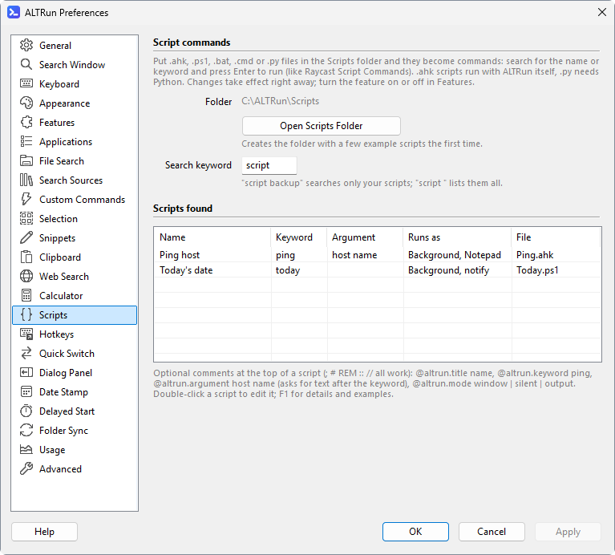

**English** · [中文](Scripts-zh)

# Scripts

Put your own scripts into the `Scripts\` folder (in the program folder; Preferences → Scripts → "Open Scripts Folder", or search for "Open Scripts Folder"; a few examples are created the first time: a background script that shows a notification, one that takes an argument after its keyword, and one whose output opens in your text editor) and you can find and run them by name or keyword in the search window, like Raycast's Script Commands. To see only scripts, type **`script `** (all of them) or **`script name`** (typing just `script`, without the space, shows a hint after the names that start with "script"; `Enter` on it completes `script `; while typing, e.g. `scr`, the hint is at the end of the list); change the keyword in Preferences → Scripts → "Search keyword". Supported: `.ahk` (run with the AutoHotkey inside ALTRun, nothing else to install), `.ps1`, `.bat` / `.cmd`, `.py` (needs Python). Preferences → Scripts lists the scripts found; double-click one to edit it in Notepad:



Comments at the top of a script can hold these settings (the comment markers `;` `#` `REM` `::` `//` all work; all are optional):

| Setting | Description |
|---|---|
| `@altrun.title name` | The name shown; the file name by default |
| `@altrun.keyword keyword` | An exact match ranks first |
| `@altrun.argument hint` | Needs an argument: type "keyword text" and the text is passed to the script as its first argument; when only the name is found, `Enter` completes it to "keyword " |
| `@altrun.mode window` | Default: runs normally (with a window) |
| `@altrun.mode silent` | Runs in the background and shows the last line of its output as a notification when done |
| `@altrun.mode output` | Runs in the background and opens all of its output with the default program for `.txt` files (usually Notepad) when done |
| `@altrun.selection Text, PDF` | [Content types](Usage#actions-on-selected-content) (built-in or your own, separated by commas): the script is offered in the actions panel (`Ctrl+Alt+\`) of such a selection, after the custom commands, and the selection is passed to it as its first argument (several files: one argument each) |

Example (`Scripts\Hash.ps1`):
```powershell
# @altrun.title    File hash
# @altrun.keyword  hash
# @altrun.argument file path
# @altrun.mode     output
Get-FileHash -Algorithm SHA256 $args[0] | Format-List
```
Type `hash D:\Downloads\setup.exe` and press `Enter`; the SHA256 opens in your text editor. Pick a keyword that isn't used by a default command (for example `ping` already belongs to the built-in Ping command).

**Scripts for selected content**: with `@altrun.selection`, select something of that type in any program and press `Ctrl+Alt+\`; the script is in the list. Selected text with a line break or a double quote isn't passed, nor characters the script's shell treats specially (`.bat` / `.cmd` and every `silent` / `output` script run through cmd, `.ps1` through PowerShell); the script isn't listed then. The "Types" column of Preferences → Scripts shows each script's types.

**A hotkey for a script**: in Preferences → Hotkeys, **Choose...** lists the scripts too (stored as `"Action": "script:<file name>"`, for example `script:hash.ps1`). A script with `@altrun.argument` or `@altrun.selection` gets the selection as its argument, with the same checks; with nothing selected, one with an argument and a keyword opens the search window with the keyword typed. Renaming the file breaks the hotkey: it is shown in red as `(script not found) script:<file name>` until you choose the script again.

In `.ahk` scripts, write output with `FileAppend("text", "*")`. Adding, removing or changing scripts takes effect right away without reloading; select a script and press `F3` to edit it in Notepad. Background scripts are given at most 2 minutes.
