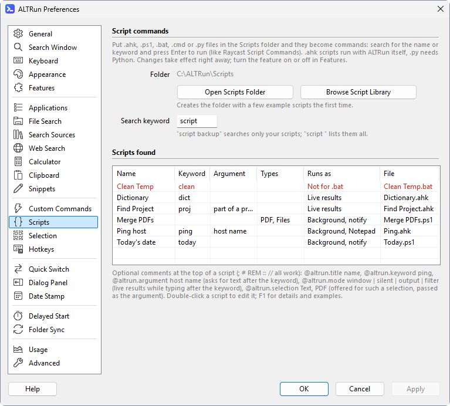
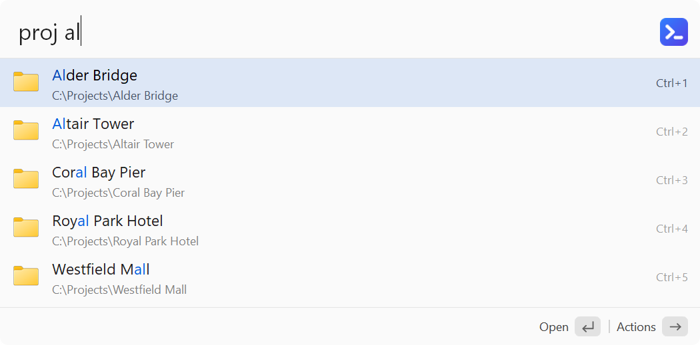

**English** · [中文](Scripts-zh)

# Scripts

**Ready-made scripts** (translation, a Total Commander command palette, file hashes and more) are in the [script library](https://zhugecaomao.github.io/ALTRun/#scripts) on the website: download one into the `Scripts\` folder and use it. Wrote one others could use? [Contribute it to the library](https://github.com/zhugecaomao/ALTRun/blob/main/docs/scripts/README.md#contributing-a-script--投稿脚本) with a pull request.

Put your own scripts into the `Scripts\` folder (beside the program when its folder is writable; otherwise `%APPDATA%\ALTRun\Scripts`; Preferences → Scripts → "Open Scripts Folder", or search for "Open Scripts Folder"; it starts empty: ready-made scripts are in the [script library](https://zhugecaomao.github.io/ALTRun/#scripts), Preferences → Scripts → "Browse Script Library") and you can find and run them by name or keyword in the search window, like Raycast's Script Commands. To see only scripts, type **`script `** (all of them) or **`script name`** (typing just `script`, without the space, shows a hint after the names that start with "script"; `Enter` on it completes `script `; while typing, e.g. `scr`, the hint is at the end of the list); change the keyword in Preferences → Scripts → "Search keyword". Supported: `.ahk` (run with the AutoHotkey inside ALTRun, nothing else to install), `.ps1`, `.bat` / `.cmd`, `.py` (needs Python). Preferences → Scripts lists the scripts found. Select a script to see its description (when provided), requirements, declared network access and full path. Double-click a script to edit it with the program registered for the file type's **Edit** action; if no editor is registered, ALTRun opens it in Notepad. Right-click a script, or press the Menu key / `Shift+F10`, for **Edit**, **Run**, **Reveal in File Manager** and **Copy Path**:



The optional script-library metadata in the first 30 lines can provide `@altrun.description`, `@altrun.description_zh`, `@altrun.requires`, `@altrun.requires_zh` and `@altrun.network`. The selected-script details show the description, requirements and declared hosts; set `@altrun.network none` to state that a script does not connect to the network. The `_zh` fields provide Chinese text when available. These fields describe the script; they do not change how it runs.

Comments at the top of a script can hold these settings (the comment markers `;` `#` `REM` `::` `//` all work; all are optional):

| Setting | Description |
|---|---|
| `@altrun.title name` | The name shown; the file name by default |
| `@altrun.keyword keyword` | An exact match ranks first |
| `@altrun.argument hint` | Needs an argument: type "keyword text" and the text is passed to the script as its first argument; when only the name is found, `Enter` completes it to "keyword " |
| `@altrun.mode window` | Default: runs normally (with a window) |
| `@altrun.mode silent` | Runs in the background and shows the last line of its output as a notification when done (nothing printed: "done"); when it fails (ends with an exit code other than 0, can't start, or is stopped after 2 minutes), the first line of its error output or the reason |
| `@altrun.mode output` | Runs in the background and opens all of its output with the default program for `.txt` files (usually Notepad) when done; its error output follows after an empty line |
| `@altrun.mode filter` | Live results: typing "keyword text" runs the script while you type and shows what it prints as results (see [Live results](#live-results) below). Needs a keyword; `.ahk`, `.py` and `.ps1` only |
| `@altrun.filter altrun` | With `filter`: run the script once when you type the keyword, then let ALTRun filter what it printed while you type (see below) |
| `@altrun.selection Text, PDF` | [Content types](Usage#actions-on-selected-content) (built-in or your own, separated by commas): the script is offered in the actions panel (`Ctrl+Alt+\`) of such a selection, after the custom commands, and the selection is passed to it as its first argument (several files: one argument each) |
| `@altrun.types Text, PDF` | Another name for `@altrun.selection` (the settings call them `ContentTypes`); with both lines, the types of both count |

Example (`Scripts\Hash.ps1`):
```powershell
# @altrun.title    File hash
# @altrun.keyword  hash
# @altrun.argument file path
# @altrun.mode     output
Get-FileHash -Algorithm SHA256 $args[0] | Format-List
```
Type `hash D:\Downloads\setup.exe` and press `Enter`; the SHA256 opens in your text editor. Pick a keyword that isn't used by a default command (for example `ping` already belongs to the built-in Ping command).

A script that runs in the background and shows the last line it prints as a notification (`Scripts\Today.ahk`; change the mode to `output` to read everything it prints in your text editor):
```autohotkey
; @altrun.title  Today's date
; @altrun.mode   silent
FileAppend(FormatTime(, "dddd, d MMMM yyyy") ", week " SubStr(FormatTime(, "YWeek"), 5), "*")
```

**Scripts for selected content**: with `@altrun.selection`, select something of that type in any program and press `Ctrl+Alt+\`; the script is in the list. Selected text with a line break or a double quote isn't passed, nor characters the script's shell treats specially (`.bat` / `.cmd` run through cmd, `.ps1` through PowerShell); the script isn't listed then. The "Types" column of Preferences → Scripts shows each script's types.

**A hotkey for a script**: in Preferences → Hotkeys, **Choose...** lists the scripts too (stored as `"Action": "script:<file name>"`, for example `script:hash.ps1`). A script with `@altrun.argument` or `@altrun.selection` gets the selection as its argument, with the same checks; with nothing selected, one with an argument and a keyword opens the search window with the keyword typed. Renaming the file breaks the hotkey: it is shown in red as `(script not found) script:<file name>` until you choose the script again.

In `.ahk` scripts, write output with `FileAppend("text", "*")`. Adding, removing or changing scripts takes effect right away without reloading; select a script and press `F3` to edit it in Notepad.

**Background scripts** (`silent` / `output`) are started directly, not through cmd, so `&`, `|`, `>` or quotes in the argument are just text (`.bat` / `.cmd` still run through cmd, so a double quote in their argument is refused). They get the same variables as [results that run the script](#live-results): `ALTRUN_ACTION` (`run`), `ALTRUN_ARG` (the first argument), `ALTRUN_KEYWORD`, `ALTRUN_VERSION` and the window in front before (`ALTRUN_HWND`, `ALTRUN_PID`, `ALTRUN_PROCESS`); scripts that run normally (`window`) don't. A background script may run for at most 2 minutes, then it is stopped (what it started keeps running). Its output is read as UTF-8 when it is; otherwise an `.ahk` script's as the system's ANSI code page (what `FileAppend("text", "*")` writes) and the others' as the console's code page.

## Live results

With `@altrun.mode filter`, a script becomes a search source of its own, like Alfred's Script Filter. Type its keyword and a space: ALTRun runs the script with what you type after it and shows what it prints as results, which open, copy, show the actions panel (`→`) and edit the script (`F3`) like any other result.



```autohotkey
; @altrun.title    Find Project
; @altrun.keyword  proj
; @altrun.mode     filter
query := A_Args[1]
out := ""
Loop Files, "D:\Projects\*" query "*", "D"
    out .= A_LoopFileName "`t" A_LoopFileFullPath "`t" A_LoopFileFullPath "`tfolder`n"
FileAppend(out, "*", "UTF-8-RAW")
```
Type `proj alt`: the folders under `D:\Projects` whose names contain "alt" are listed; `Enter` opens one.

**What the script gets**: the text after the keyword as its first argument (`""` when nothing is typed yet) and in the variable `ALTRUN_QUERY` (also `ALTRUN_KEYWORD` and `ALTRUN_VERSION`). In `.ps1` scripts use `$env:ALTRUN_QUERY`. The window that was in front before ALTRun was shown is in `ALTRUN_HWND` (its handle, a decimal number, the same as `{hwnd}` in custom commands), `ALTRUN_PID` and `ALTRUN_PROCESS` (its program's file name, e.g. `TOTALCMD64.EXE`); they aren't set when that window is gone. A script can list commands for that program, e.g. `if (EnvGet("ALTRUN_PROCESS") = "TOTALCMD64.EXE")`. The script is started directly, not through cmd, so `&`, `|`, `>` or quotes in the text are just text.

**What it prints**, either:
- one result per line, separated by tabs: `title⇥subtitle⇥target⇥type⇥icon` (only the title is needed; the target is the title when left out), or
- JSON, the same names as Alfred's Script Filter:
```json
{"items": [
  {"title": "ALTRun", "subtitle": "D:\\Projects\\ALTRun", "arg": "D:\\Projects\\ALTRun", "type": "folder", "uid": "altrun"},
  {"title": "Wiki", "arg": "https://example.com/wiki", "icon": "C:\\Icons\\wiki.ico"}
]}
```

| Field | Meaning |
|---|---|
| `title` | Required |
| `subtitle` | The gray line under the title |
| `arg` | What `Enter` works on; the title when left out |
| `type` | `file`, `folder`, `url` (opened), `text` (copied) or `script` (runs the script again with `arg`, see below). When left out it follows the target: a web address is `url`, `C:\...` or `\\server\...` is `file` (`folder` when it ends with `\`), anything else `text` |
| `icon` | A local `.ico` / `.png` / `.exe` / `.dll` file; web addresses aren't used. When left out, the file's own icon for files and folders |
| `uid` | Lets ALTRun learn which result you choose for what you type, as for other results; without it the script's order is kept |
| `valid` | `false`: the row can't be run (a hint); with `autocomplete`, `Enter` puts "keyword autocomplete" into the search box |
| `autocomplete` | The text after the keyword that `Tab` (or `Enter` on a row that can't run) fills in |
| `match` | With `@altrun.filter altrun`: the text ALTRun matches what you type against, instead of the title |
| `text.largetype` | The text `Ctrl+L` shows large |

Write UTF-8: in `.ahk` scripts `FileAppend(text, "*", "UTF-8-RAW")`; Python and PowerShell already write UTF-8 when run by ALTRun.

**When it runs**: as soon as you type the keyword and the space, then each time you stop typing for a moment (0.15 s). A run still going is stopped when a new one starts, when you leave the keyword or close the search window, together with any program it started. While it runs, the last results stay; "Running..." shows only when there is nothing yet after 0.3 s. A run can take up to 10 s. Results are kept until the search window closes, so `Backspace` back to a text you already searched shows them at once.

**Results that run the script** (`"type": "script"`): `Enter` closes the search window and runs the same script again in the background, with the result's `arg` as its first argument and in `ALTRUN_ARG` (in `.ps1` scripts `$env:ALTRUN_ARG`). `ALTRUN_ACTION` is then `run` (`filter` while it lists results); the text typed and the window variables are the same. So one script can be a command palette for the program in front: list the commands that fit `ALTRUN_PROCESS`, and run the one chosen on the window `ALTRUN_HWND`:
```autohotkey
; @altrun.keyword np
; @altrun.mode    filter
if (EnvGet("ALTRUN_ACTION") = "run") {                ; Enter on a result: do it
    hwnd := EnvGet("ALTRUN_HWND")
    if (hwnd != "" && A_Args[1] = "upper") {
        WinActivate("ahk_id " hwnd), A_Clipboard := ""
        Send("^c"), ClipWait(1), Send("{Text}" StrUpper(A_Clipboard))
    }
    FileAppend("Done", "*")                          ; the last line printed is shown as a notification
    ExitApp
}
if (EnvGet("ALTRUN_PROCESS") = "notepad.exe")        ; listing: only for Notepad
    FileAppend("Selection to upper case`t`tupper`tscript`n", "*", "UTF-8-RAW")
```
The window closes first, so the program you came from is in front again. What the script starts (an editor, a folder window) keeps running when it ends. After it ends, the last line it printed, if any, is shown as a notification; when it fails (can't start, ends with an exit code other than 0, or is stopped after 2 minutes) the reason is shown. Arrow `→` on such a result: run it, or copy its `arg` (`Alt+Enter`).

**A list ALTRun filters**: when the list doesn't depend on what you type (your projects, servers, bookmarks of a tool), add `@altrun.filter altrun`. The script then runs once, with an empty text, when you type the keyword and the space; ALTRun keeps what it printed until the search window closes and filters it as you type, the same way it matches other results (fuzzy, pinyin initials too), on `match` or else the title, best match first. Nothing runs while you type, so this suits slow starters such as PowerShell. Such a list can have up to 2,000 results (other live results: the first 200).

**When something goes wrong**: one row says what (the first line the script wrote to its error output, its exit code, the JSON problem, or the time-out). `Enter` on it edits the script, `Ctrl+L` shows all of the error output. A script that prints nothing shows "No results".

**Speed**: an `.ahk` or `.py` script starts in a fraction of a second; Windows PowerShell takes noticeably longer to start, so a `.ps1` script feels slower: use `@altrun.filter altrun` when you can. A hotkey for a live results script opens the search window with its keyword and the selected line of text. Live results scripts aren't offered for selected content.

### Example: live translation
Type `fy` and some text: the translation appears as you type (Chinese → English, other languages → Chinese); `Enter` copies it, `Ctrl+Enter` pastes it into the window you came from. It uses [DeepL](https://www.deepl.com/pro-api) with your own API key (the free plan, 500,000 characters a month, is enough for this). **The text you type after `fy` is sent to DeepL** while you type; ALTRun itself sends nothing. DeepL counts the characters of every request, and each pause in typing sends the whole text again, so a sentence typed letter by letter can count several times its length; the hotkey below sends it once.

1. Get a DeepL API key (Account → API Keys), and add it as a user environment variable named `DEEPL_AUTH_KEY` (Windows search: "Edit environment variables for your account"). The script reads it there, so ALTRun doesn't need to restart.
2. Download [Translate.ahk](https://github.com/zhugecaomao/ALTRun/blob/main/docs/scripts/Translate.ahk) ([raw file](https://raw.githubusercontent.com/zhugecaomao/ALTRun/main/docs/scripts/Translate.ahk): right-click → Save link as) into the `Scripts\` folder (Preferences → Scripts → Open Scripts Folder).
3. Optionally give it a hotkey: Preferences → Hotkeys with the action "Search in ALTRun" and the search text `fy {selection}`: select some text in any program and press it to see the translation. The selection is put on one line, and only its first 100 characters are used.

Without a key, or before you type, the row says what to do; a key DeepL doesn't accept, the monthly limit, or no connection show as an error row. To translate into another language, change `target` in the script (DeepL's codes, for example `JA`, `DE`, `EN-GB`).

### Example: Total Commander commands
A command palette for [Total Commander](https://www.ghisler.com): type `tc` and part of a command's name, in English or in the language Total Commander uses (pinyin initials too), and `Enter` runs it in Total Commander. It lists Total Commander's internal commands (`cm_...`, from `TOTALCMD.INC`, named by its language file when there is one, e.g. Chinese) and your own commands (`em_...`, from `usercmd.ini`, by their menu text). It works on the Total Commander window you came from, or else the one used last. Needs ALTRun 2026.11.16.4 or later.

1. Download [TC Commands.ahk](https://github.com/zhugecaomao/ALTRun/blob/main/docs/scripts/TC%20Commands.ahk) ([raw file](https://raw.githubusercontent.com/zhugecaomao/ALTRun/main/docs/scripts/TC%20Commands.ahk): right-click → Save link as) into the `Scripts\` folder (Preferences → Scripts → Open Scripts Folder).
2. In Total Commander, open ALTRun and type `tc ` (with the space): the commands are listed; type to filter, `Enter` to run.
3. Optionally give it a hotkey in Total Commander: Preferences → Hotkeys → Add..., the action "Search in ALTRun", the search text `tc ` (with the space), works in "only in windows matching" `ahk_class TTOTAL_CMD`, and a key such as `Ctrl+Shift+P` (it then does this instead of what the key did in Total Commander, if anything). Use "Search in ALTRun" rather than the script itself as the action: a hotkey for a script first copies the selection, which in Total Commander copies the selected files.

How it works: the script reads `TOTALCMD.INC` in Total Commander's program folder, and `wincmd.ini` (where `COMMANDER_INI`, the registry value `IniFileName` or the program folder says, else `%APPDATA%\GHISLER`) for the language file and the folder of `usercmd.ini`. `Enter` sends a `cm_` command as its number (the message `WM_USER+51`) and an `em_` command by name (`WM_COPYDATA`), as Total Commander's documentation describes. A Total Commander running as administrator doesn't accept them from ALTRun. Commands that need parameters (`CD <directory>` and the like) aren't listed.
