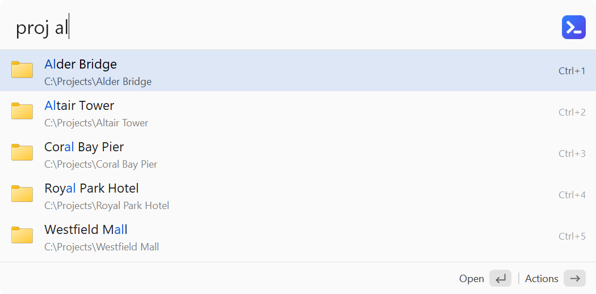

**English** · [中文](Scripts-zh)

# Scripts

Put your own scripts into the `Scripts\` folder (in the program folder; Preferences → Scripts → "Open Scripts Folder", or search for "Open Scripts Folder"; a few examples are created the first time: a background script that shows a notification, one that takes an argument after its keyword, one whose output opens in your text editor, and one with live results) and you can find and run them by name or keyword in the search window, like Raycast's Script Commands. To see only scripts, type **`script `** (all of them) or **`script name`** (typing just `script`, without the space, shows a hint after the names that start with "script"; `Enter` on it completes `script `; while typing, e.g. `scr`, the hint is at the end of the list); change the keyword in Preferences → Scripts → "Search keyword". Supported: `.ahk` (run with the AutoHotkey inside ALTRun, nothing else to install), `.ps1`, `.bat` / `.cmd`, `.py` (needs Python). Preferences → Scripts lists the scripts found; double-click one to edit it in Notepad:


Comments at the top of a script can hold these settings (the comment markers `;` `#` `REM` `::` `//` all work; all are optional):

| Setting | Description |
|---|---|
| `@altrun.title name` | The name shown; the file name by default |
| `@altrun.keyword keyword` | An exact match ranks first |
| `@altrun.argument hint` | Needs an argument: type "keyword text" and the text is passed to the script as its first argument; when only the name is found, `Enter` completes it to "keyword " |
| `@altrun.mode window` | Default: runs normally (with a window) |
| `@altrun.mode silent` | Runs in the background and shows the last line of its output as a notification when done |
| `@altrun.mode output` | Runs in the background and opens all of its output with the default program for `.txt` files (usually Notepad) when done |
| `@altrun.mode filter` | Live results: typing "keyword text" runs the script while you type and shows what it prints as results (see [Live results](#live-results) below). Needs a keyword; `.ahk`, `.py` and `.ps1` only |
| `@altrun.selection Text, PDF` | [Content types](Usage#actions-on-selected-content) (built-in or your own, separated by commas): the script is offered in the actions panel (`Ctrl+Alt+\`) of such a selection, after the custom commands, and the selection is passed to it as its first argument (several files: one argument each) |

Example (`Scripts\Hash.ps1`):
```powershell
# @altrun.title    File hash
# @altrun.keyword  hash
# @altrun.argument file path
# @altrun.mode     output
Get-FileHash -Algorithm SHA256 $args[0] | Format-List
```
Type `hash D:\Downloads\setup.exe` and press `Enter`; the SHA256 opens in your text editor. Pick a keyword that isn't used by a default command (for example `ping` already belongs to the built-in Ping command).

**Scripts for selected content**: with `@altrun.selection`, select something of that type in any program and press `Ctrl+Alt+\`; the script is in the list. Selected text with a line break or a double quote isn't passed, nor characters the script's shell treats specially (`.bat` / `.cmd` and every `silent` / `output` script run through cmd, `.ps1` through PowerShell); the script isn't listed then. The "Types" column of Preferences → Scripts shows each script's types.

**A hotkey for a script**: in Preferences → Hotkeys, **Choose...** lists the scripts too (stored as `"Action": "script:<file name>"`, for example `script:hash.ps1`). A script with `@altrun.argument` or `@altrun.selection` gets the selection as its argument, with the same checks; with nothing selected, one with an argument and a keyword opens the search window with the keyword typed. Renaming the file breaks the hotkey: it is shown in red as `(script not found) script:<file name>` until you choose the script again.

In `.ahk` scripts, write output with `FileAppend("text", "*")`. Adding, removing or changing scripts takes effect right away without reloading; select a script and press `F3` to edit it in Notepad. Background scripts are given at most 2 minutes.

## Live results

With `@altrun.mode filter`, a script becomes a search source of its own, like Alfred's Script Filter. Type its keyword and a space: ALTRun runs the script with what you type after it and shows what it prints as results, which open, copy, show the actions panel (`→`) and edit the script (`F3`) like any other result.



```autohotkey
; @altrun.title    Find Project
; @altrun.keyword  proj
; @altrun.mode     filter
query := A_Args[1]
out := ""
Loop Files, "D:\Projects\*" query "*", "D"
    out .= A_LoopFileName "`t" A_LoopFileFullPath "`t" A_LoopFileFullPath "`tfolder`n"
FileAppend(out, "*", "UTF-8-RAW")
```
Type `proj alt`: the folders under `D:\Projects` whose names contain "alt" are listed; `Enter` opens one.

**What the script gets**: the text after the keyword as its first argument (`""` when nothing is typed yet) and in the variable `ALTRUN_QUERY` (also `ALTRUN_KEYWORD` and `ALTRUN_VERSION`). In `.ps1` scripts use `$env:ALTRUN_QUERY`. The script is started directly, not through cmd, so `&`, `|`, `>` or quotes in the text are just text.

**What it prints**, either:
- one result per line, separated by tabs: `title⇥subtitle⇥target⇥type⇥icon` (only the title is needed; the target is the title when left out), or
- JSON, the same names as Alfred's Script Filter:
```json
{"items": [
  {"title": "ALTRun", "subtitle": "D:\\Projects\\ALTRun", "arg": "D:\\Projects\\ALTRun", "type": "folder", "uid": "altrun"},
  {"title": "Wiki", "arg": "https://example.com/wiki", "icon": "C:\\Icons\\wiki.ico"}
]}
```

| Field | Meaning |
|---|---|
| `title` | Required |
| `subtitle` | The gray line under the title |
| `arg` | What `Enter` works on; the title when left out |
| `type` | `file`, `folder`, `url` (opened) or `text` (copied). When left out it follows the target: a web address is `url`, `C:\...` or `\\server\...` is `file` (`folder` when it ends with `\`), anything else `text` |
| `icon` | A local `.ico` / `.png` / `.exe` / `.dll` file; web addresses aren't used. When left out, the file's own icon for files and folders |
| `uid` | Lets ALTRun learn which result you choose for what you type, as for other results; without it the script's order is kept |
| `valid` | `false`: the row can't be run (a hint); with `autocomplete`, `Enter` puts "keyword autocomplete" into the search box |
| `autocomplete` | The text after the keyword that `Tab` (or `Enter` on a row that can't run) fills in |
| `text.largetype` | The text `Ctrl+L` shows large |

Write UTF-8: in `.ahk` scripts `FileAppend(text, "*", "UTF-8-RAW")`; Python and PowerShell already write UTF-8 when run by ALTRun.

**When it runs**: as soon as you type the keyword and the space, then each time you stop typing for a moment (0.15 s). A run still going is stopped when a new one starts, when you leave the keyword or close the search window, together with any program it started. While it runs, the last results stay; "Running..." shows only when there is nothing yet after 0.3 s. A run can take up to 10 s. Results are kept until the search window closes, so `Backspace` back to a text you already searched shows them at once.

**When something goes wrong**: one row says what (the first line the script wrote to its error output, its exit code, the JSON problem, or the time-out). `Enter` on it edits the script, `Ctrl+L` shows all of the error output. A script that prints nothing shows "No results".

**Speed**: an `.ahk` or `.py` script starts in a fraction of a second; Windows PowerShell takes noticeably longer to start, so a `.ps1` script feels slower. A hotkey for a live results script opens the search window with its keyword and the selected line of text. Live results scripts aren't offered for selected content.
