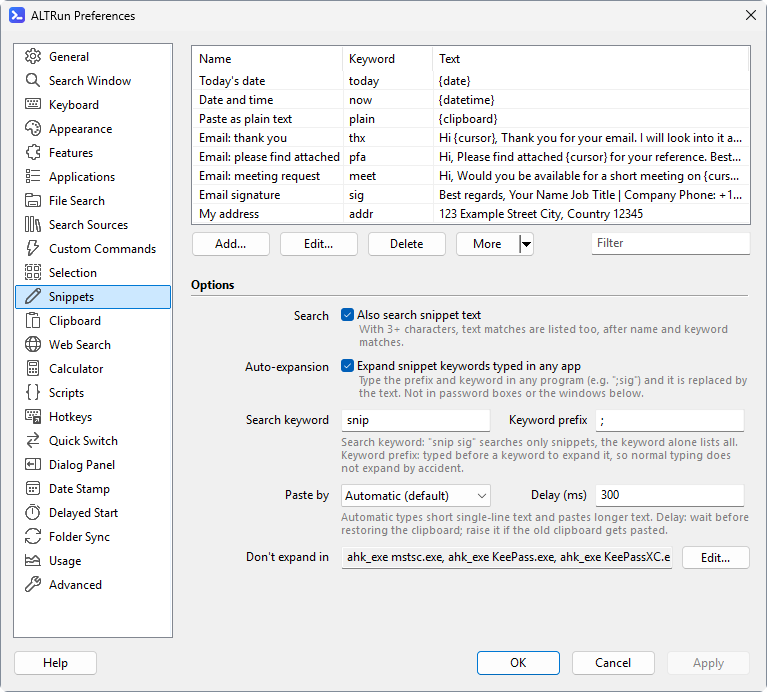
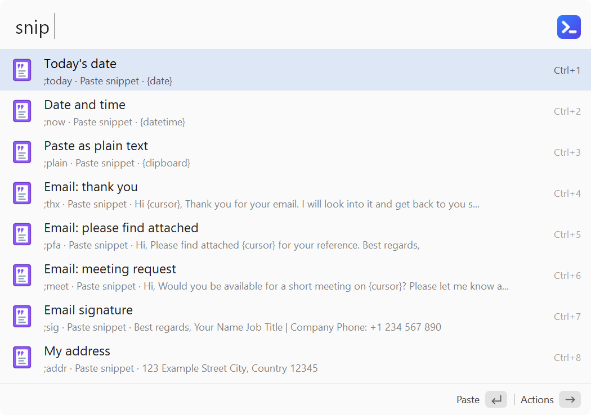
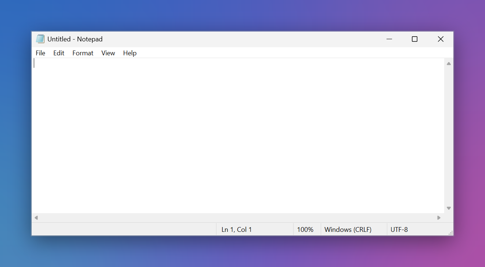

**English** · [中文](Snippets-zh)

# Snippets
Save text you use often (signatures, addresses, templates...) as snippets. Search by name, keyword or a word in the text, and `Enter` pastes it into the window you were in before opening ALTRun. Type `snip` to list all snippets, `snip xxx` to search snippets only (while typing, e.g. `sni`, a hint at the end of the list completes `snip `).

| Field | Description |
|---|---|
| Name | Required. Shown in search results and used for searching. Use words you would type to find it, for example `PT quotation` |
| Keyword | Optional and short, for example `pq`. An exact match ranks first; to auto-expand, type `;pq`. The prefix plus the keyword can be at most 40 characters (39 for the keyword with the default prefix `;`), without spaces; you're told before saving if it's too long. Several keywords: separate with commas (for example `sig, signature`); each one searches and expands |
| Text | Required. What gets pasted; can be several lines and use the placeholders below. Words in the text are searchable too (type at least 3 characters; turn it off in Preferences if you don't want this) |
| AutoExpand | Type `;keyword` in any program and it's replaced by the text right away |

## Placeholders
Replaced when pasting:

| Placeholder | Replaced by |
|---|---|
| `{date}` | Today's date, in the DateFormat of the [date stamp](Date-Stamp) (default `dd.MM.yyyy`) |
| `{time}` | The current time `HH:mm` |
| `{datetime}` | Date + time |
| `{clipboard}` | The text on the clipboard |
| `{date:yyyy-MM-dd}` `{time:HH:mm:ss}` | Your own format (as in [FormatTime](https://www.autohotkey.com/docs/v2/lib/FormatTime.htm), for example `dddd` for the day of the week) |
| `{date+7}` `{date-1:dd.MM}` | A date some days later / earlier, optionally with a format |
| `{clipboard:1}` `{clipboard:2}` | The 1st, 2nd previous text in the clipboard history (like Alfred; `{clipboard}` is the current clipboard; files and images are skipped) |
| `{uuid}` | A randomly generated UUID, different each time |
| `{cursor}` | The cursor ends up here after pasting |

## Snippet expansion
Type `;keyword` (for example `;sig`) in any program and what you typed is deleted and replaced by the snippet text, like Alfred's snippets. The `;` prefix keeps normal typing from triggering it by accident; change it in `Features.Snippets.ExpandPrefix`. To stop a single snippet from expanding, untick "Expand automatically when typed" in its edit window (`"AutoExpand": 0`); it can still be searched. Snippets don't expand in ALTRun's own search window, in Windows password boxes, or in the windows listed under [Don't expand in](#dont-expand-in).

To see what expands what, type `snip` in the search window: each snippet's second line starts with what you type to expand it (`;sig, ;signature · Paste snippet · ...`); Preferences → Snippets lists them too.

## Don't expand in
Preferences → Snippets → "Don't expand in" (`Features.Snippets.ExpandExclude`): typing `;keyword` in these windows doesn't expand anything. Useful for Remote Desktop, password managers, games, or programs where you really type text starting with `;`.

- Click **Edit...** and enter one window per line, for example `ahk_exe mstsc.exe`, `ahk_exe KeePass.exe`, `ahk_class Notepad`
- Each item can be:
  - `ahk_exe program.exe`: every window of that program (Task Manager → Details shows the program name)
  - `ahk_class ClassName`: windows of that class
  - part of the window title (case-sensitive), for example `Remote Desktop Connection`
- Default: Remote Desktop (`mstsc.exe`), KeePass, KeePassXC
- Whatever is listed here, snippets never expand in ALTRun's own search window or in Windows password boxes
- To keep a single snippet from expanding, untick "Expand automatically when typed" in its edit window instead

## Paste mode
`Features.Snippets.PasteMode`:
- `Auto` (default): types single-line text of up to 100 characters (instant, leaves the clipboard alone); text with several lines, tabs, more characters or emoji goes through the clipboard
- `Clipboard`: borrows the clipboard + `Ctrl+V`, then restores the clipboard (the default before 2026.10.14; changed to `Auto` on upgrade)
- `Type`: types the text character by character, for programs that don't accept pasting

The clipboard history uses the same setting, but what it pastes stays on the clipboard: with `Auto` and `Clipboard` it always goes through the clipboard (nothing is restored, so there is no wait); with `Type` it is typed and also put on the clipboard.

## Importing and exporting
Preferences → Snippets → "More ▾":
- **Import from a table**: paste cells copied from Excel, or click "Open File" to read a CSV / TSV file (UTF-8, or the system's default encoding). Columns: Name | Keyword | Text | Expand automatically (optional, `1` / `0`, blank = on). A header row is skipped, rows without text are skipped, and a missing name is taken from the keyword or the first line of the text
- A row whose keyword matches an existing snippet (ignoring case; or whose name matches, when there's no keyword) updates it; other rows are added. If a keyword is too long or has spaces (so it can't expand), auto-expansion is turned off for it
- Imported snippets are saved when you click OK or Apply in Preferences; Cancel discards them
- **Export to CSV**: with a header row, UTF-8 with BOM, so Excel opens it directly; edit it there and import it again
- **Add Examples** (in the same menu): adds the default snippets you don't have yet (a snippet with the same name or keyword counts as already there) and tells you how many were added and skipped; saved when you press OK / Apply
