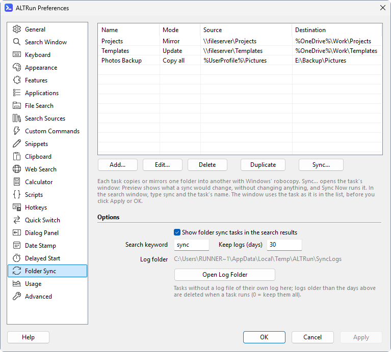
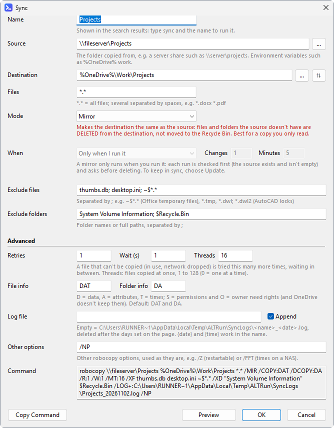
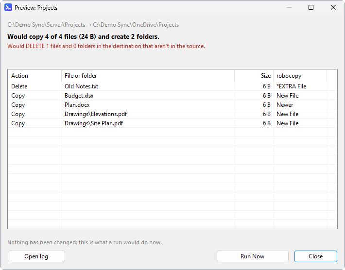

[English](Sync-Tasks) · **中文**

# 同步任务

用 Windows 自带的 `robocopy` 让一个文件夹和另一个保持一致, 例如把服务器共享同步到 OneDrive。ALTRun 在后台运行它, 先检查危险的设置, 完成后告诉你结果。

## 设置任务
偏好设置 → **同步** 列出所有任务, 包括模式、文件夹和状态 (*运行中*、*持续同步中*、*成功 09:30*、*失败 09:30*)。



- **添加**、**编辑** (或双击)、**删除**、**复制一份** (复制后再改, 例如用于另一个文件夹)。
- **预览**、**运行**、**停止**、**打开日志** 直接作用于选中的任务, 用的是列表里现在的内容 (不用先点应用)。
- 选项: 在搜索结果里显示任务、搜索关键字 (`sync`)、日志保留天数、日志文件夹。

编辑窗口从上到下:



- **名称**、**源** 和 **目标** (**⇅** 交换两者)、**文件** (`*.*` = 所有文件)。
- **模式**: **镜像** (目标和源完全一致, 源中没有的会被删除)、**更新** (只复制新的和更新过的文件, 不删除)、**全部复制** (不同的都复制, 不删除)、**只复制顶层**。下面一行说明这个模式做什么, 镜像的说明是红色的。
- **何时运行**: 只在你运行时, 或 **持续同步** (robocopy 一直运行, 有变化后再同步)。镜像只在你运行时运行 (见下面)。
- **排除文件** / **排除文件夹**, 用 `;` 分隔。
- **高级**: 重试次数和等待、线程、复制哪些文件和文件夹信息、日志文件、其他 robocopy 参数。
- **命令** 显示任务生成的 robocopy 命令行, 输入时随时更新, 包括运行时用的日志 (**日志文件** 空着时是默认的日志)。**复制命令** 可以复制它。
- **预览** 在保存前显示任务会改变什么。**确定** 时检查任务: 错误 (没有源、同一个文件夹、镜像到盘符根目录等) 必须改正; 目标和其他任务重叠时先询问。

## 预览
**预览** 用 `/L` 运行 robocopy, 不做任何改动, 列出运行时会做的事: 会复制多少个文件、会删除多少个文件和文件夹, 以及每一项 (删除的排在前面, 列表上方用红字说明)。**立即运行** 按预览的内容运行任务。



## 运行任务
- 输入任务名, 或输入 `sync ` 列出所有任务 (`sync proj` 只搜任务)。**Enter** 运行; 运行中再按 Enter 会停止。
- `→` 打开操作: 运行、预览 (不做任何改动)、打开日志、打开源 / 目标文件夹。
- 结果里显示任务做什么、现在怎样: *10:05 开始运行*、*10:05 开始持续同步*、*上次 09:30: 成功*。
- 任务结束时提示结果 (复制和删除了多少文件)。失败时可以直接打开日志。

## 安全措施
- **镜像** (`/MIR`) 让目标和源完全一致: 目标里源中没有的文件会被**删除**。镜像运行前, ALTRun 先预览 (`/L`, 不做任何改动); 如果会删除东西, 预览窗口列出要删除的文件, 点 **运行并删除** 才会运行 (Enter 或 Esc 关闭窗口)。
- 源文件夹找不到或是空的 (例如服务器共享没连上) 时不运行镜像, 否则会把目标清空。
- 源和目标是同一个文件夹、一个在另一个里面, 或者镜像到盘符、共享、OneDrive 文件夹、用户文件夹的根目录 (会删掉那里其他所有东西) 时, 不运行。
- 源和目标必须是完整路径 (`D:\Sync\Projects`、`\\server\share\folder`)。相对路径、`\folder` (当前盘的根目录) 或这台电脑上没有的环境变量 (没装 OneDrive 时的 `%OneDrive%`) 会让 robocopy 在别的文件夹里操作, 所以这样的任务不会运行。
- 镜像不能 **持续同步**: robocopy 之后每一轮都会删除, 却没有上面这些检查 (服务器共享突然看起来是空的, 就会清空目标)。要持续同步请用 **更新** 模式, 或者由你自己运行镜像。
- **持续同步** (`/MON`、`/MOT`) 的任务会一直运行, 有变化后再同步。退出 ALTRun 时会停止; ALTRun 只是重新启动 (改了设置、升级) 时会继续运行。

## 日志
每次运行都有日志: 写到任务自己的日志文件, 或 `%TEMP%\ALTRun\SyncLogs\<任务名>_<日期>.log`。**打开日志** 打开当天的日志。
- 日志不放在 Data 文件夹里: Data 在 OneDrive 里时, 不断变大的日志会一直上传。
- `%TEMP%\ALTRun\SyncLogs` 里超过 30 天的日志在运行任务时自动删除 (`Features.Sync.KeepLogDays`, `0` = 全部保留)。任务自己的日志文件不会删除。
- 每次运行在 `ALTRun.log` 里记一行: 什么时候开始、结果怎样 (复制、删除了多少文件, 或退出码)。

## 设置文件里的写法
```jsonc
"SyncTasks": [
  {
    "Name": "Projects",
    "Source": "\\\\fileserver\\Projects",
    "Destination": "%OneDrive%\\Work\\Projects",
    "Files": "*.*",
    "Mode": "Mirror",            // Mirror (/MIR 镜像)、Update (/E /XO 更新: 只复制新的和更新过的文件, 不删除)、Copy (/E 全部复制: 不同的都复制, 不删除) 或 Top (只复制顶层)
    "Copy": "DAT", "DirCopy": "DA",
    "Retries": 1, "Wait": 1, "Threads": 16,
    "Monitor": 0, "MonitorChanges": 1, "MonitorMinutes": 5,
    "ExcludeFiles": ["thumbs.db", "desktop.ini", "~$*.*"],
    "ExcludeDirs": ["System Volume Information", "$Recycle.Bin"],
    "LogFile": "%OneDrive%\\Logs\\Projects_{date}.log", "AppendLog": 1,
    "Extra": "/NP"               // 其他 robocopy 参数, 原样使用
  }
]
```
路径可以用 `%环境变量%`; 日志文件名可以用 `{date}` (yyyyMMdd) 和 `{time}` (HHmmss)。
