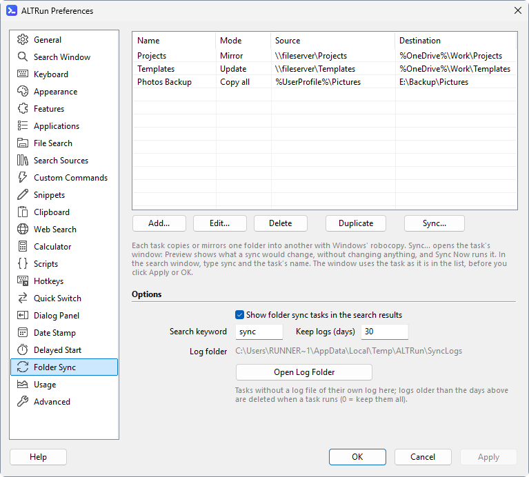
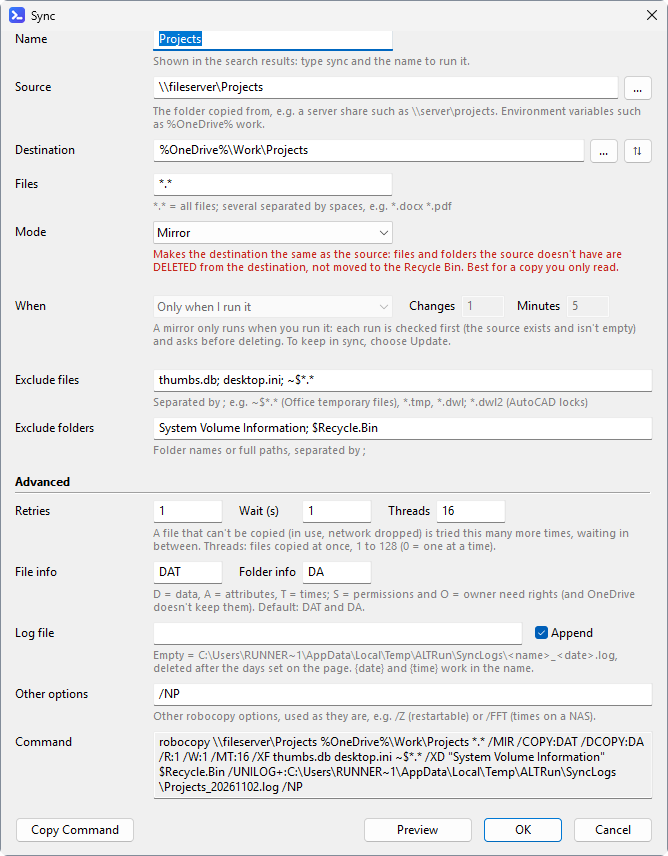
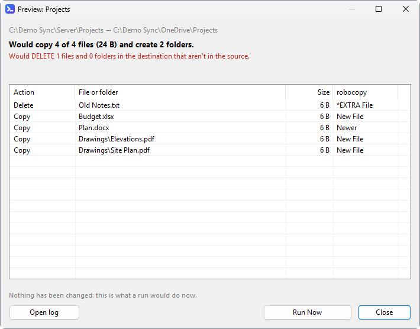

**English** · [中文](Sync-Tasks-zh)

# Sync Tasks

Keep a folder in step with another one, for example a server share copied into your OneDrive, with Windows' own `robocopy`. ALTRun runs it in the background, checks risky settings first and tells you how it went.

## Setting up tasks
Preferences → **Sync** lists the tasks, with their mode, folders and state (*Running*, *Monitoring*, *OK 09:30*, *Failed 09:30*).



- **Add**, **Edit** (or double-click), **Delete**, **Duplicate** (a copy to change, e.g. for a second folder).
- **Preview**, **Run**, **Stop**, **Open log** act on the selected task right away, as it is in the list (no need to click Apply first).
- Options: show the tasks in the search results, the search keyword (`sync`), how many days logs are kept, and the log folder.

The edit window, top to bottom:



- **Name**, **Source** and **Destination** (with **⇅** to swap them), **Files** (`*.*` = all).
- **Mode**: **Mirror** (the destination becomes the same as the source; what the source doesn't have is deleted), **Update** (new and newer files only, never deletes), **Copy all** (everything that differs, never deletes), **Top folder only**. The line under it says what the mode does; mirror's is red.
- **When**: only when you run it, or **Keep in sync** (robocopy keeps running and syncs again after changes). A mirror only runs when you run it (see below).
- **Exclude files** / **Exclude folders**, separated by `;`.
- **Advanced**: retries and wait, threads, which file and folder information to copy, the log file, other robocopy options.
- **Command** shows the robocopy command line the task makes, updated as you type, with the log it runs with (the default one when **Log file** is empty). **Copy Command** copies it.
- **Preview** shows what the task would change before you save it. **OK** checks the task: mistakes (no source, the same folder twice, mirroring into a drive...) must be fixed; a destination that overlaps another task's asks first.

## Preview
**Preview** runs robocopy with `/L`, which changes nothing, and lists what a run would do: how many files it would copy, how many files and folders it would delete, and each of them (deletions first, in red text above the list). **Run Now** runs the task as previewed.



## Running a task
- Type the task's name, or `sync ` to list all tasks (`sync proj` searches only them). **Enter** runs the task; while it runs, Enter stops it.
- `→` opens the actions: Run, Preview (changes nothing), Open log, open the source or destination folder.
- The result shows what the task does and how it is doing: *Running since 10:05*, *Monitoring since 10:05*, *Last run 09:30: OK*.
- A task that ends says how it went (files copied and removed). If it fails, ALTRun offers to open its log.

## Safety
- **Mirror** (`/MIR`) makes the destination an exact copy of the source: files in the destination that aren't in the source are **deleted**. Before a mirror runs, ALTRun previews it (`/L`, which changes nothing); when the run would delete anything, the preview window lists what would be deleted, and nothing runs until you click **Run and Delete** (Enter or Esc closes it).
  - The window opens when the preview has finished. If you have gone on working in another program by then, it can't come to the front (Windows doesn't let a background program take the focus): it flashes in the taskbar and a notification says it is waiting.
  - Each task has its own window: previewing another task doesn't close one still waiting.
  - A window left open for more than 5 minutes previews again when you click **Run and Delete**, as the destination may have changed since.
- A mirror doesn't run when the source folder can't be found or is empty (for example a server share that didn't connect), since that would empty the destination.
- A task doesn't run when the source and destination are the same folder or one is inside the other, or when a mirror would go into a drive, a share, the OneDrive folder or the user folder (it would delete everything else there).
- Source and destination must be full paths (`D:\Sync\Projects`, `\\server\share\folder`). A relative path, `\folder` (the root of whichever drive is current) or an environment variable that doesn't exist on this PC (`%OneDrive%` without OneDrive) would make robocopy work in some other folder, so such a task doesn't run.
- A mirror can't **keep in sync**: robocopy's later rounds would delete without the checks above (a server share that suddenly looks empty would empty the destination). Keep in sync with **Update**, or run the mirror yourself.
- **Monitoring** tasks (`/MON`, `/MOT`) keep running and sync again after changes. They stop when ALTRun quits; when ALTRun only restarts (after changing a setting, an update), they keep running.

## Logs
Each run is logged: to the task's own log file, or to `%TEMP%\ALTRun\SyncLogs\<task name>_<date>.log`. **Open log** opens today's log.
- The logs aren't kept in the Data folder: when that is in OneDrive, logs that grow all the time would keep uploading.
- Logs in `%TEMP%\ALTRun\SyncLogs` older than 30 days are deleted when a task runs (`Features.Sync.KeepLogDays`, `0` = keep them all). A task's own log file is never deleted.
- Logs are written in Unicode (`/UNILOG`), so file names in any language read correctly.
- `ALTRun.log` gets one line per run: when it started and how it ended (files copied and deleted, or the exit code).

## In the settings file
```jsonc
"SyncTasks": [
  {
    "Name": "Projects",
    "Source": "\\\\fileserver\\Projects",
    "Destination": "%OneDrive%\\Work\\Projects",
    "Files": "*.*",
    "Mode": "Mirror",            // Mirror (/MIR), Update (/E /XO: new and newer files, never deletes), Copy (/E: all that differ, never deletes) or Top (top folder only)
    "Copy": "DAT", "DirCopy": "DA",
    "Retries": 1, "Wait": 1, "Threads": 16,
    "Monitor": 0, "MonitorChanges": 1, "MonitorMinutes": 5,
    "ExcludeFiles": ["thumbs.db", "desktop.ini", "~$*.*"],
    "ExcludeDirs": ["System Volume Information", "$Recycle.Bin"],
    "LogFile": "%OneDrive%\\Logs\\Projects_{date}.log", "AppendLog": 1,
    "Extra": "/NP"               // other robocopy options, as they are
  }
]
```
Paths may use `%environment variables%`; the log file name may use `{date}` (yyyyMMdd) and `{time}` (HHmmss).
