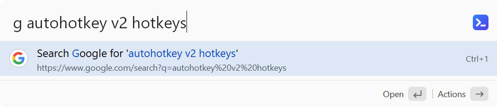
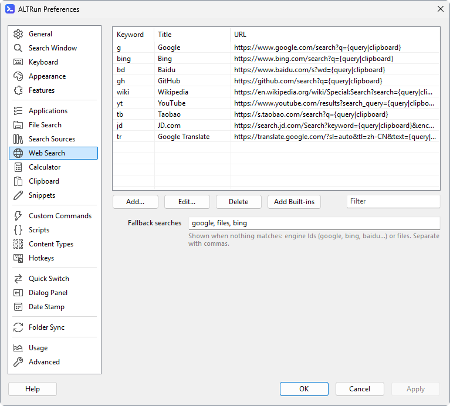
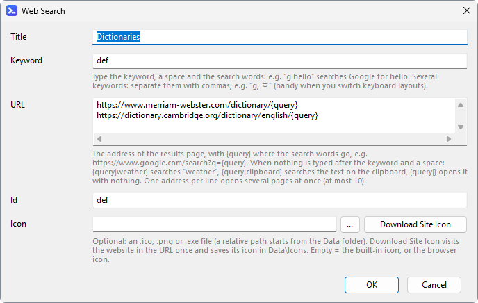
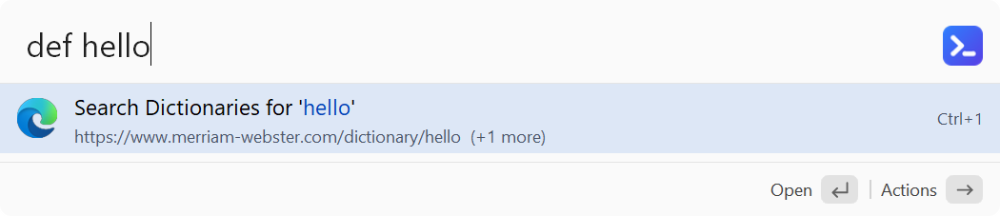

**English** · [中文](Web-Search-zh)

# Web search

Type "keyword search terms" to search a website, for example `g autohotkey hotkeys` searches Google; `Enter` opens it in your browser (the default one, or Preferences → General → Browser).



## Built-in search engines
| Keyword | Site |
|---|---|
| `g` | Google |
| `bing` | Bing |
| `bd` | Baidu |
| `gh` | GitHub |
| `wiki` | Wikipedia (English) |
| `yt` | YouTube |
| `tb` | Taobao |
| `jd` | JD.com |
| `tr` | Google Translate (into Simplified Chinese) |

- Once the keyword is followed by a space (for example `g `), only that site shows in the results, not mixed with apps and files
- Typing only the keyword (`g`) shows "Type after 'g '" and `Enter` completes it to `g `; typing the site name (for example `google`) shows the hint too
- The keyword and a space (`g `) with nothing after it searches the **text on the clipboard**: the built-in sites all have `{query|clipboard}` in their URL, the list shows "Search Google for clipboard: '...'" and `Enter` opens it; if the clipboard has no text (copied files, empty) it says "The clipboard has no text" and can't be opened. If you go on to type search words, those are searched
- Select text in any program and press `Ctrl+Alt+\`: the action panel can search the selection on every site, see [Actions on selected content](Usage#actions-on-selected-content)

## Adding and editing
Preferences → Web Search: double-click an engine in the list to edit it, or click "Add". **Add Built-ins** puts back the built-in engines you deleted (an engine with the same Id or keyword counts as already there) and tells you how many were added and skipped; saved when you press OK / Apply. Each engine has these fields:



| Field | Description |
|---|---|
| Title | Shown in the result, for example "Search Google for ..." |
| Keyword | Type it followed by a space to search this site. Several keywords: separate them with commas, for example `g, ㅎ, google` (handy when you switch keyboard layouts: any of them works); hints and completion use the one you typed. In an action panel (the selection hotkey, `→`), typing a keyword finds that engine's row too (`g` → "Search Google") |
| URL | The address of the results page; `{query}` is replaced by what you typed (encoded). With a non-empty `{query\|default}`, the keyword and a space with no search words searches the default value, for example `https://www.bing.com/search?q={query\|weather}` searches "weather" when you type `bing `; with the default `clipboard` (`https://www.google.com/search?q={query\|clipboard}`), the text on the clipboard is searched. An empty default (`{query\|}`) opens the URL with nothing in place of `{query}`: `https://www.baidu.com/s?wd={query\|}` opens Baidu when you type `bd `. Typing only the keyword (`bing`) never uses the default, it completes to `bing `. [Custom commands](Custom-Commands#commands-with-an-argument-query) follow the same rules. Several lines, one address per line, open several pages at once: see [Opening several pages at once](#opening-several-pages-at-once) |
| Id | A name (Latin letters) that identifies the engine, used by fallback searches |
| Icon | Optional: an `.ico`, `.png` or `.exe` file; a relative path starts from the Data folder. **Download Site Icon** visits the website in the URL once, saves its icon in `Data\Icons` and fills this in. Empty = the built-in icon (the engines above have one) or the browser icon |

Examples:

| Title | Keyword | URL |
|---|---|---|
| Merriam-Webster | `dict` | `https://www.merriam-webster.com/dictionary/{query}` |
| Amazon | `amz` | `https://www.amazon.com/s?k={query}` |
| Local dev server | `lh` | `http://localhost:{query\|8000}` (8000 is the port: `lh ` opens 8000, `lh 3000` opens 3000) |

### Opening several pages at once
Write several addresses in **URL**, one per line (press `Enter` in the box for a new line). One search then opens all of them, in that order, for example to compare prices or to look a word up in two dictionaries:



```text
https://www.merriam-webster.com/dictionary/{query}
https://dictionary.cambridge.org/dictionary/english/{query}
```

| You type | What opens |
|---|---|
| `def hello` | Both pages for "hello", each in a new browser tab |
| `def` and `Enter` | Completes to `def ` (nothing opens yet) |



- At most 10 addresses; blank lines are skipped
- `{query}` / `{query\|default}` work in every line. The default used when nothing is typed after the keyword comes from the first `{query\|...}`; with an empty default (`{query\|}`), each line opens with nothing in place of `{query}`
- The result shows the first address and how many more, for example `https://www.merriam-webster.com/dictionary/hello  (+1 more)`; `Alt+Enter` copies all the addresses, one per line
- The pages open a quarter of a second apart, so a browser that is still starting gets each one. Searching the selection or a clipboard history item with this engine (`→`) also opens all of them
- The list in Preferences shows the lines separated by `|`; **Download Site Icon** uses the first address's site

### Searching the clipboard
- The clipboard is read only after the keyword and a space (`g `); the completion hint for only the keyword (`g`) or the engine name (for example `google`) doesn't read it
- Only text is used: whitespace is merged into one space, at most 200 characters. When text and an image are copied together (for example Excel cells), the text is searched; copied files are not searched
- Content copied from password managers (KeePass, 1Password, Bitwarden...) is not read, just like in the clipboard history; the full address is shown under the title before you press `Enter`, so you can see what will be sent
- When you upgrade, built-in engines whose URL is still the old default (`{query}`) switch to `{query|clipboard}`; engines whose URL you changed and engines you added are left alone. To get this for them, change `{query}` to `{query|clipboard}` in the URL
- In the clipboard history, select a text item and press `→` to search it with each site

## Fallback searches
When nothing matches, the list shows a few fallback items, by default "Search Google for '...'", "Search files" and "Search Bing for '...'". Change them in Preferences → Web Search → "Fallback searches": engine Ids or `files` (file search), separated by commas.

## Settings file
`Features.WebSearch` → `Engines` (the engine list, each with `Id` / `Keyword` / `Title` / `Url` / `Icon`) and `Fallbacks`, see [Settings reference](Configuration#websearch). The whole feature can be turned off in Preferences → Features.
